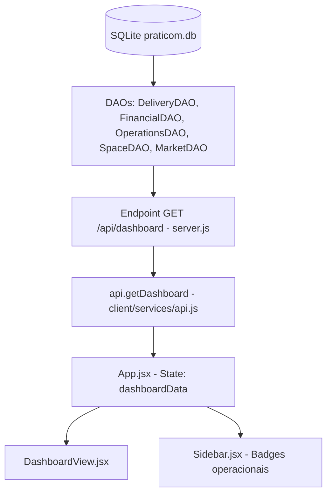

# ANÁLISE TÉCNICA E ARQUITETURAL DO DASHBOARD — PRATICOM ERP

## 1. Visão Geral Executiva

O módulo de **Dashboard** do Praticom ERP tem como objetivo prover ao usuário (Síndico, Portaria ou Administrador) uma visão executiva e operacional em tempo real da saúde do condomínio.

Atualmente, o painel é composto por:
1. **Banner Superior de Boas-Vindas:** Identificação do condomínio e atalhos rápidos.
2. **Grid de 5 Indicadores Chave (KPIs):**
   - Encomendas Pendentes
   - Saldo em Caixa (com subtítulo de unidades em atraso)
   - Pessoas no Condomínio (Visitantes & Prestadores ativos)
   - Reservas de Hoje
   - Estoque do Mercadinho (Itens abaixo do estoque mínimo)
3. **Duas Tabelas Operacionais Centrais:**
   - Fluxo da Portaria em Tempo Real (últimas movimentações de acesso)
   - Últimas Encomendas Recebidas (pacotes aguardando retirada)
4. **Dois Cards Laterais de Destaque:**
   - Avisos em Destaque (Comunicados com prioridade urgente)
   - Próximas Reservas (Agendamentos futuros de áreas comuns)

Esta auditoria técnica analisou integralmente o ciclo de vida dos dados, desde as tabelas no SQLite, passando pelos Data Access Objects (DAOs), controladores e endpoints REST no Express, até a renderização visual em React 18 / Vite.

---

## 2. Arquitetura da Solução e Fluxo de Dados

O fluxo de dados do Dashboard segue o padrão de camadas estabelecido no Praticom ERP:



### 2.1 Camada de Persistência (SQLite)
As tabelas que alimentam o Dashboard e suas relações:
- `condominiums`: Cadastro de condomínios.
- `blocks`: Blocos pertencentes aos condomínios (`condominium_id`).
- `units`: Unidades/apartamentos associados aos blocos (`block_id`).
- `deliveries`: Encomendas registradas na portaria (`unit_id`, `resident_id`).
- `financial_transactions`: Transações financeiras de receitas e despesas (`condominium_id`, `unit_id`).
- `access_logs`: Registros de entrada/saída de visitantes (`destination_unit_id`).
- `reservations`: Reservas de espaços comuns (`space_id`, `unit_id`, `resident_id`).
- `spaces`: Áreas de lazer e espaços comuns (`condominium_id`).
- `announcements`: Comunicados do mural (`condominium_id`, `priority`, `expires_at`).
- `market_products`: Produtos do minimercado autônomo (`condominium_id`, `stock_quantity`).

### 2.2 Camada de Acesso a Dados (DAOs)
- `DeliveryDAO.getDeliveries({ condominiumId })`: Busca encomendas filtrando por condomínio através do join com `units` e `blocks`.
- `FinancialDAO.getSummary({ condominiumId })`: Agrega receitas e despesas pagas, pendentes e vencidas, e calcula inadimplência.
- `AccessDAO.getAccessLogs({ condominiumId })`: Busca histórico de acessos vinculados às unidades do condomínio.
- `ReservationDAO.getReservations({ condominiumId })`: Lista agendamentos de espaços do condomínio.
- `AnnouncementDAO.getAnnouncements({ condominiumId })`: Lista comunicados cadastrados para o condomínio.
- `MarketDAO.getProducts({ condominiumId })`: Lista produtos e estoques (atualmente não consumido pelo endpoint do dashboard).

### 2.3 Camada de API REST (`server/server.js`)
O endpoint `GET /api/dashboard` consolida os dados em uma única resposta JSON:
- Cabeçalho esperado: `X-Condominium-Id`.
- Verificação de módulos ativos: `condominiumDAO.isModuleEnabled(condominiumId, moduleKey)`.
- Estrutura de retorno atual:
  ```json
  {
    "metrics": {
      "pendingDeliveries": 2,
      "activeAccess": 1,
      "overdueAmount": 0,
      "defaultRate": 0
    },
    "recentAccess": [...],
    "recentDeliveries": [...],
    "urgentAnnouncements": [...],
    "upcomingReservations": [...]
  }
  ```

### 2.4 Camada Frontend (`client/src/`)
- `App.jsx`: Invoca `api.getDashboard()` no carregamento inicial, na troca de condomínio e em intervalos de polling (15 segundos). Armazena o resultado em `dashboardData`.
- `Sidebar.jsx`: Consome `dashboardData.metrics` para renderizar badges numéricas nos menus de navegação.
- `DashboardView.jsx`: Recebe `data={dashboardData}` como prop e desestrutura em `metrics`, `recentAccess`, `recentDeliveries`, `urgentAnnouncements` e `upcomingReservations`.

---

## 3. Mapeamento e Diagnóstico dos Indicadores

| Elemento Visual | Origem no Backend | Prop Esperada pelo Frontend | Situação Atual | Impacto |
| :--- | :--- | :--- | :--- | :--- |
| **Banner: Nome do Condomínio** | N/A (fixo) | N/A | **Hardcoded** (`Condomínio Residencial Parque das Flores`) | Exibe nome incorreto em qualquer condomínio |
| **KPI 1: Encomendas Pendentes** | `metrics.pendingDeliveries` | `metrics.pendingDeliveries` | **Operacional** | Exibe contagem correta se módulo ativo |
| **KPI 2: Saldo em Caixa** | Não enviado (`summary.currentBalance` omitido) | `metrics.balance` | **Quebrado (Mismatch de chave)** | Exibe sempre `R$ 0,00` |
| **KPI 2 (Subtext): Unidades em Atraso** | Não enviado (`summary.default_rate` enviado) | `metrics.overdueCount` | **Quebrado (Chave ausente)** | Exibe sempre "Taxas em dia" |
| **KPI 3: Pessoas no Condomínio** | `metrics.activeAccess` | `metrics.activeVisitors` | **Quebrado (Mismatch de chave)** | Exibe sempre `0` |
| **KPI 4: Reservas de Hoje** | Não calculado | `metrics.todayReservations` | **Quebrado (Chave ausente)** | Exibe sempre `0` |
| **KPI 5: Estoque do Mercadinho** | Não consultado (`MarketDAO` não chamado) | `metrics.lowStockItems` | **Quebrado (Chave ausente)** | Exibe sempre `0` ("Estoque abastecido") |
| **Tabela: Fluxo da Portaria** | `data.recentAccess` | `recentAccess` | **Inversão de Status** | Registros `'IN_PROPERTY'` aparecem como "Saiu" |
| **Tabela: Últimas Encomendas** | `data.recentDeliveries` | `recentDeliveries` | **Filtro Restrito** | Apenas pendentes são enviadas; canceladas/entregues nunca aparecem |
| **Card: Avisos em Destaque** | `data.urgentAnnouncements` | `urgentAnnouncements` | **Filtro de Casing Incompatível** | Ignora avisos `'urgent'` (só busca `'URGENTE'` ou `'high'`) |
| **Card: Próximas Reservas** | `data.upcomingReservations` | `upcomingReservations` | **Ordenação e Escopo Invertidos** | Ordenado `DESC` trazendo reservas passadas (ex: ago/2026) |

---

## 4. Avaliação de Multi-Tenancy e Isolamento por Condomínio

1. **Vazamento de Despesas Corporativas (`FinancialDAO.js`):**
   - Na consulta de resumo financeiro (`FinancialDAO.getSummary`), para o condomínio 1 é utilizada a cláusula:
     `AND (f.condominium_id = 1 OR f.condominium_id IS NULL OR b.condominium_id = 1 OR u.block_id IS NULL)`.
   - Transações financeiras com `unit_id IS NULL` (despesas comuns como energia, água e manutenção) possuem `u.block_id IS NULL = TRUE`.
   - Isso faz com que despesas pertencentes explicitamente a outros condomínios (ex: condomínio 2 ou 6) sejam contabilizadas indevidamente no saldo e despesas do Condomínio 1.
2. **Isolamento de Acessos de Portaria (`access_logs`):**
   - A tabela `access_logs` não possui a coluna `condominium_id`. O isolamento é feito exclusivamente pelo relacionamento com a unidade de destino (`destination_unit_id` → `units` → `blocks`).
   - Se uma unidade não possuir bloco associado (`block_id IS NULL`), o acesso é absorvido pela consulta do Condomínio 1.
3. **Isolamento de Reservas (`reservations`):**
   - A tabela `reservations` não possui `condominium_id` direto; o isolamento ocorre via `spaces.condominium_id` ou `blocks.condominium_id`. Se um espaço for cadastrado sem condomínio (`NULL`), ele é exposto no Condomínio 1.

---

## 5. Avaliação de Resiliência a Módulos Inativos (LPS)

O Praticom ERP possui controle de ativação de módulos por condomínio (`dashboard`, `access`, `deliveries`, `reservations`, `financial`, `market`).
- **Comportamento no Backend:** Quando um módulo está desativado para o condomínio ativo, `server.js` retorna `null` para a respectiva métrica em `metrics`.
- **Falha no Frontend (`DashboardView.jsx`):**
  - O componente não recebe a lista de módulos habilitados (`availableModules`).
  - Utiliza o operador de coalescência nula (`?? 0` ou `|| 0`).
  - Como consequência, módulos desativados não são ocultados e não indicam "Módulo Desativado"; eles exibem simplesmente `0` ou `R$ 0,00`.
  - Os cards mantêm o cursor clicável e disparam navegação para a tela do módulo desativado, causando confusão ao usuário.

---

## 6. Codificação, Caracteres e Formatação

1. **Codificação UTF-8:**
   - **Banco de Dados SQLite:** Verificado. Registros contendo acentuação (`Condomínio Alpha Praticom`, `Manutenção Preventiva`, `Água/Luz`, `São Paulo`) estão gravados em UTF-8 íntegro, sem caracteres corrompidos.
   - **Cabeçalhos HTTP Express:** Verificado. A API responde com `Content-Type: application/json; charset=utf-8`.
   - **HTML / Frontend:** Verificado. `index.html` declara `<meta charset="UTF-8" />` e `<html lang="pt-BR">`.
   - **Conclusão:** Não foram encontradas evidências de dupla codificação ou mojibake (como `CondomÃnio`).
2. **Formatação Monetária e Numérica:**
   - `(metrics.balance || 0).toLocaleString('pt-BR', { minimumFractionDigits: 2 })` formata corretamente em padrão brasileiro quando o valor numérico é fornecido.
   - Existe risco de dízimas flutuantes no cálculo de saldo no DAO (`12298.4 - 6261.2 = 6037.199999999999`), necessitando de truncamento/arredondamento financeiro explícito (`toFixed(2)` / `Math.round`).
3. **Formatação Temporal e Datas:**
   - A tabela de portaria formata `entered_at` com `toLocaleTimeString('pt-BR')`. Porém, registros gerados com `CURRENT_TIMESTAMP` do SQLite possuem formato sem fuso horário (`YYYY-MM-DD HH:MM:SS`), enquanto seeds utilizam formato ISO com `Z` (`UTC`), gerando discrepâncias de exibição de horário.
   - As datas das reservas no card lateral são exibidas em formato cru `YYYY-MM-DD` em vez do formato brasileiro `DD/MM/YYYY`.

---

## 7. Gráficos e Indicadores Visuais

- O Praticom ERP atualmente **não possui biblioteca gráfica instalada** (como Recharts, Chart.js ou ApexCharts).
- O dashboard é construído exclusivamente com cartões de métricas (KPIs), tabelas de dados e cartões de lista estilizados em CSS.
- Não existem gráficos ocultos, quebrados ou renderizando em branco; a ausência de gráficos decorre da arquitetura atual baseada em componentes visuais diretos.
