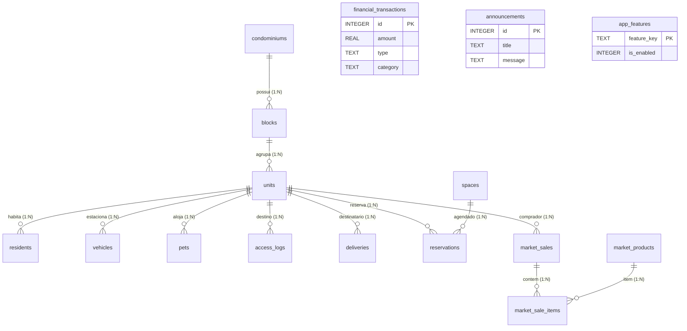
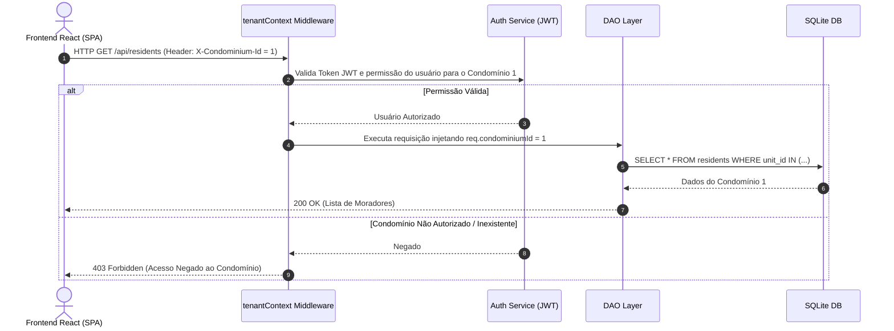

# 🏢 DIAGNÓSTICO E ARQUITETURA MULTI-TENANT PARA GESTÃO CONDOMINIAL — PRATICOM ERP

**Documento:** Relatório Técnico de Diagnóstico, Comparação Arquitetural e Proposta Multi-Tenant  
**Projeto:** Praticom ERP  
**Data da Última Revisão:** 10 de Outubro de 2026  
**Status:** Diagnóstico Concluído — Componentes Base Implementados (Aguardando Decisão Definitiva de Transição)  

---

## 1. Resumo Executivo

O **Praticom ERP** opera atualmente sobre uma arquitetura de persistência relacional baseada em **Node.js/Express** e **SQLite 3** (`better-sqlite3`), estruturada com os padrões GoF **Data Access Object (DAO)** ([`DAOFactory.js`](file:///c:/Users/Heitor/Praticom_Broken/server/dao/DAOFactory.js)) e **Singleton** ([`DatabaseSingleton.js`](file:///c:/Users/Heitor/Praticom_Broken/server/config/DatabaseSingleton.js)).

Uma auditoria exaustiva no banco de dados operacional (`condo_database.sqlite`) e no código-fonte do servidor revelou:
1. **Estrutura de Tabelas Territoriais Existente:** As tabelas `condominiums` e `blocks` já constam no DDL ([`server/schema.sql`](file:///c:/Users/Heitor/Praticom_Broken/server/schema.sql)), porém os registros de condomínios e blocos ainda possuem volume zero na base de dados inicial.
2. **Dados Órfãos / Sem Vínculo Territorial:** 100% dos dados operacionais existentes (8 unidades, 8 moradores, 5 veículos, 4 pets, 8 acessos, 5 entregas, 13 transações financeiras, 4 comunicados e 10 produtos) estão sem associação direta com `condominium_id` ou possuem `block_id = NULL`.
3. **Módulos Multi-Tenant Já Desenvolvidos:**
   - [`CondominiumDAO.js`](file:///c:/Users/Heitor/Praticom_Broken/server/dao/CondominiumDAO.js): DAO responsável pela gestão de condomínios, blocos e vinculação retroativa de unidades legadas.
   - [`tenantContext.js`](file:///c:/Users/Heitor/Praticom_Broken/server/middleware/tenantContext.js): Middleware HTTP responsável por interceptar requisições, validar o header `X-Condominium-Id` e injetar o contexto de tenant no objeto `req.condominiumId`.

> **Recomendação Técnica Principal:** **Alternativa A (Bancos SQLite Isolados por Condomínio com Banco Master Central)** é a solução mais segura, robusta e aderente às características do SQLite, garantindo isolamento físico absoluto, backups independentes sem risco de contaminação mútua e pulverização de locks de gravação. Como rota de transição simples e imediata, a **Alternativa C (Banco Compartilhado com Coluna `condominium_id` e Tenant Middleware)** também possui protótipo funcional em `tenantContext.js`.

---

## 2. Diagnóstico Comprovado do Estado Atual do Banco

### 2.1 Stack Tecnológica Verificada
* **Frontend:** React (Vite 5), SPA com Vanilla CSS (`client/src/*`). Comunicação via Fetch API em [`client/src/services/api.js`](file:///c:/Users/Heitor/Praticom_Broken/client/src/services/api.js).
* **Backend:** Node.js (v18+) com Express 4.18.2 em [`server/server.js`](file:///c:/Users/Heitor/Praticom_Broken/server/server.js).
* **Persistência:** SQLite 3 através da biblioteca síncrona `better-sqlite3` (`condo_database.sqlite`).
* **Conexão:** [`DatabaseSingleton.js`](file:///c:/Users/Heitor/Praticom_Broken/server/config/DatabaseSingleton.js) gerencia a conexão única com `PRAGMA foreign_keys = ON;`, `journal_mode = WAL` e `busy_timeout = 5000`.

### 2.2 Diagnóstico de Integridade e Isolamento no Banco de Dados
A inspeção automatizada realizada no arquivo de banco ativo confirmou os seguintes números:

| Tabela | Volume | Coluna de Vínculo Condominial | Status de Associação |
| :--- | :---: | :--- | :--- |
| `condominiums` | 0 | Chave Primária (`id`) | Tabela Vazia |
| `blocks` | 0 | `condominium_id` (FK) | Tabela Vazia |
| `units` | 8 | `block_id` (FK opcional) | 100% com `block_id = NULL` |
| `residents` | 8 | Vínculo indireto (`unit_id`) | Dependentes de `units` órfãs |
| `vehicles` | 5 | Vínculo indireto (`unit_id`) | Dependentes de `units` órfãs |
| `pets` | 4 | Vínculo indireto (`unit_id`) | Dependentes de `units` órfãs |
| `access_logs` | 8 | `destination_unit_id` | Dependentes de `units` órfãs |
| `deliveries` | 5 | `unit_id` | Dependentes de `units` órfãs |
| `spaces` | 3 | Sem coluna territorial | 100% Compartilhados globalmente |
| `reservations` | 2 | `space_id` e `unit_id` | Sem isolamento territorial |
| `financial_transactions` | 13 | Sem coluna territorial | **Crítico:** Sem identificação de condomínio |
| `announcements` | 4 | Sem coluna territorial | 100% Globais |
| `market_products` | 10 | Sem coluna territorial | 100% Globais |
| `market_sales` | 4 | `unit_id` | Sem isolamento de PDV/Estoque |
| `market_sale_items` | 12 | `sale_id` (FK), `product_id` (FK) | Relacionamento normalizado |
| `app_features` | 2 | Global (Flags de Sistema) | Global por design |

---

## 3. Diagrama Entidade-Relacionamento e Escopo de Dados

### 3.1 Diagrama ER Atual (Mermaid)

### 3.2 Classificação das Entidades por Escopo de Tenant

* **Escopo Global / Plataforma:**
  - `app_features`: Configuração global da Linha de Produtos de Software (LPS).
  - `system_users`: Autenticação central, credenciais e permissões (banco Master).
  - `condominiums`: Cadastro mestre dos condomínios clientes.
* **Escopo Específico por Condomínio:**
  - `blocks` e `units`: Estrutura física territorial.
  - `residents`, `vehicles`, `pets`: Dados pessoais dos ocupantes.
  - `access_logs` e `deliveries`: Registros de portaria e segurança física.
  - `spaces` e `reservations`: Áreas comuns e regras de agendamento.
  - `financial_transactions`: **Dado Crítico** — Contas a pagar/receber e fluxo de caixa do condomínio.
  - `announcements`: Quadro de avisos e comunicados locais.
  - `market_products`, `market_sales`, `market_sale_items`: Estoque e vendas do mercadinho autônomo.

---

## 4. Matriz Comparativa Detalhada de Arquiteturas Multi-Tenant

### 4.1 Estudo Comparativo

#### Alternativa A — Banco Independente por Condomínio (Database-per-Tenant) [RECOMENDADA]
* **Mecanismo:** Banco Master central (`master_database.sqlite`) para usuários e licenças; um arquivo SQLite separado por condomínio (`tenants/condo_{id}.sqlite`).
* **Vantagens:** Isolamento físico absoluto (impossível vazar dados por esquecimento de `WHERE`), backup/restore individual trivial (cópia simples de arquivo `.sqlite`), concorrência pulverizada (locks do SQLite isolados por arquivo).
* **Desafios:** Necessita de gestor de pool de conexões por ID de condomínio e runner de migração DDL em lote.

#### Alternativa B — Schema Independente por Condomínio (Schema-per-Tenant) [INVIÁVEL]
* **Mecanismo:** Schemas separados no mesmo banco (ex: `schema_condo_1.units`).
* **Vantagens:** N/A.
* **Desafios:** **Inviável no SQLite.** Não há suporte nativo a schemas dinâmicos e o comando `ATTACH DATABASE` possui limite severo de conexões simultâneas.

#### Alternativa C — Banco Compartilhado com `condominium_id` (Shared Database) [TRANSIÇÃO]
* **Mecanismo:** Todas as tabelas no arquivo `condo_database.sqlite` com coluna `condominium_id INTEGER NOT NULL`.
* **Vantagens:** Manutenção DDL simples e consultas administrativas globais fáceis.
* **Desafios:** Isolamento frágil (depende 100% do código backend aplicar `WHERE condominium_id = ?`), backups individuais extremamente complexos e maior risco de contenção de lock em acessos simultâneos.

---

### 4.2 Matriz Ponderada de Avaliação

$$\text{Pontuação Final} = \sum (\text{Nota da Alternativa} \times \text{Peso do Critério})$$

| Critério de Avaliação | Peso | Alternativa A (Banco Isolado) | Alternativa B (Schema) | Alternativa C (Banco Compartilhado) |
| :--- | :---: | :---: | :---: | :---: |
| **Isolamento e Segurança Física** | 20% | **10.0** (Isolamento total por arquivo) | 6.0 (Inviável) | 6.5 (Depende 100% de `WHERE`) |
| **Backup e Recuperação Individual** | 15% | **10.0** (Cópia direta do arquivo `.sqlite`) | 4.0 (Inviável) | 4.0 (Requer DML complexo) |
| **Concorrência (SQLite Locks)** | 15% | **9.5** (Locks pulverizados por tenant) | 3.0 (Contenção) | 4.0 (Contenção no arquivo único) |
| **Complexidade de Implementação** | 10% | 7.5 (Gestor de pool de conexões) | 2.0 (Complexo) | **9.0** (Apenas nova coluna DDL) |
| **Manutenção e Migração DDL** | 10% | 8.0 (Migrador em lote por tenant) | 3.0 (Complexo) | **9.5** (Um único script DDL) |
| **Escalabilidade & Limite I/O** | 10% | **9.0** (Escala com centenas de arquivos) | 2.0 (Limite `ATTACH`) | 6.0 (Gargalo em arquivo único) |
| **Relatórios Globais (SuperAdmin)** | 10% | 7.0 (Agregação via backend) | 5.0 (Inviável) | **10.0** (Queries diretas com `GROUP BY`) |
| **Compatibilidade com Stack Atual** | 10% | **9.5** (Integração fácil com GoF DAOs) | 1.0 (Incompatível) | 9.0 (Altera assinaturas dos DAOs) |
| **NOTA FINAL PONDERADA** | 100% | **8.95 (VENCEDORA)** | **3.05 (INVIÁVEL)** | **6.75 (SEGUNDA OPÇÃO)** |

---

## 5. Autenticação, Permissões e Segurança Anti-Spoofing

### 5.1 Fluxo de Requisição com Validação de Tenant Context

### 5.2 Implementação do Middleware de Contexto ([`tenantContext.js`](file:///c:/Users/Heitor/Praticom_Broken/server/middleware/tenantContext.js))
O middleware já desenvolvido intercepta todas as requisições HTTP para a API, extrai o header `X-Condominium-Id`, valida a existência e status `ACTIVE` do condomínio no SQLite e injeta `req.condominiumId` no fluxo da requisição.

---

## 6. Plano de Ação e Fases de Execução

| Fase | Descrição da Atividade | Arquivos e Componentes Impactados | Critério de Aceite |
| :---: | :--- | :--- | :--- |
| **Fase 1** | **Mapeamento de Blocos e Unidades Legadas** | Execução de [`CondominiumDAO.js`](file:///c:/Users/Heitor/Praticom_Broken/server/dao/CondominiumDAO.js) (`mapPendingUnits`). | 100% das 8 unidades associadas a um `block_id` válido. |
| **Fase 2** | **Criação do Condomínio Inicial (Tenant 1)** | Inserção do `Condomínio Alpha Praticom` e blocos de teste em `schema.sql`. | Tabela `condominiums` com registro de ID 1 ativo. |
| **Fase 3** | **Ativação do Middleware nas Rotas Express** | Importação de [`tenantContext.js`](file:///c:/Users/Heitor/Praticom_Broken/server/middleware/tenantContext.js) em [`server/server.js`](file:///c:/Users/Heitor/Praticom_Broken/server/server.js). | Rotas REST respondem com validação de tenant context. |
| **Fase 4** | **Transição Estrutural (Alternativa A ou C)** | Provisionamento de `tenants/condo_{id}.sqlite` ou aplicação de `condominium_id` DDL. | Zero erro de integridade referencial nas consultas. |
| **Fase 5** | **Suíte de Testes de Isolamento Cross-Tenant** | Execução da suíte [`server/tests/suite.js`](file:///c:/Users/Heitor/Praticom_Broken/server/tests/suite.js). | Zero vazamento de dados entre condomínios nos testes automatizados. |

---

## 7. Conclusão e Decisões Pendentes

1. **Aprovação da Arquitetura Final:** Validação da **Alternativa A (Bancos Isolados por Arquivo)** como solução definitiva de longo prazo.
2. **Homologação dos Dados Legados:** Autorização para associar todos os dados cadastrais e financeiros existentes ao condomínio padrão **`Condomínio Alpha Praticom (ID 1)`**.
3. **Seletor de Condomínio no Frontend:** Liberação para inclusão do componente dropdown de condomínios no cabeçalho do React SPA (`client/src/`).
