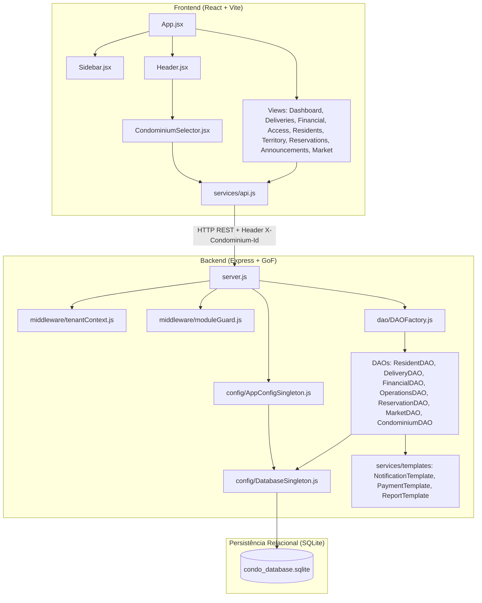

# MAPEAMENTO COMPLETO DA ARQUITETURA — PRATICOM ERP

## 1. Visão Geral da Arquitetura do Sistema

O **Praticom ERP** é uma aplicação completa de gestão condominial com arquitetura web cliente-servidor, estruturada em:

- **Frontend:** SPA (Single Page Application) desenvolvida em **React 18** com **Vite**, sem dependência de frameworks CSS pesados (utiliza Vanilla CSS estruturado em design tokens e variáveis modernas em `index.css`), ícones com `lucide-react` e comunicação RESTful via `fetch`.
- **Backend:** API REST desenvolvida em **Node.js (ES Modules)** utilizando o microframework **Express 4.22**.
- **Persistência de Dados:** Banco de Dados Relacional **SQLite 3** gerenciado pela biblioteca de alta performance `better-sqlite3`, operando no arquivo `server/condo_database.sqlite` em modo WAL (`Write-Ahead Logging`) e `PRAGMA foreign_keys = ON`.
- **Padrões de Projeto (GoF) Implementados:**
  - **Singleton:** `DatabaseSingleton` (conexão única com SQLite) e `AppConfigSingleton` (gestão centralizada de configurações e Feature Flags da LPS).
  - **Factory Method:** `DAOFactory` (instanciação e desacoplamento das DAOs).
  - **Data Access Object (DAO):** Isolamento de regras de persistência (`ResidentDAO`, `DeliveryDAO`, `OperationsDAO`, `ReservationDAO`, `FinancialDAO`, `MarketDAO`, `CondominiumDAO`).
  - **Template Method:** Processamento polimórfico de pagamentos (`PixPaymentProcessor`, `CondoFeePaymentProcessor`), notificações (`NotificationTemplate`) e relatórios financeiros (`FinancialReportGenerator`).
- **Linha de Produtos de Software (LPS):** Feature Flags persistidas na tabela `app_features` (`ENABLE_MARKETPLACE`, `ENABLE_ADVANCED_DELIVERIES`).
- **Modelo Multi-Tenant (Alternativa C — Row-Level Isolation):** Banco compartilhado com segregação lógica por condomínio via coluna `condominium_id` e middleware `tenantContextMiddleware`.
- **Gestão de Módulos por Condomínio:** Tabela `condominium_modules` e middleware `checkModuleAvailability` para ativação/desativação granular de módulos por condomínio.

---

## 2. Ponto de Entrada e Estrutura do Backend

### 2.1 Ponto de Entrada
- **Arquivo:** `server/server.js`
- **Porta:** `5000` (configurável via variável de ambiente `PORT`)
- **Middlewares Globais:**
  1. `cors()`: Permite requisições de origens cruzadas (frontend Vite em `localhost:5173`).
  2. `express.json()`: Parser de corpos JSON com limite padrão.
  3. `tenantContextMiddleware`: Intercepta o header `X-Condominium-Id` ou query param `condominium_id`, valida a existência e status (`ACTIVE`) do condomínio e injeta `req.condominiumId` e `req.condominiumName`.

### 2.2 Estrutura de Diretórios do Servidor
```
server/
├── config/
│   ├── AppConfigSingleton.js       # Gerenciamento de Feature Flags (LPS) via Singleton
│   └── DatabaseSingleton.js        # Instância única da conexão SQLite e migrações
├── dao/
│   ├── CondominiumDAO.js          # CRUD de Condomínios, Blocos e Módulos Ativáveis
│   ├── DAOFactory.js              # Factory Method para criação das DAOs
│   ├── DeliveryDAO.js             # Gestão de Encomendas e PINs
│   ├── FinancialDAO.js            # Caixa, Balanço, Despesas e Inadimplência
│   ├── MarketDAO.js               # Mercadinho Autônomo, Estoque e PDV
│   ├── OperationsDAO.js           # Portaria (Acessos) e Mural de Comunicados
│   ├── ReservationDAO.js          # Espaços Comuns e Agendamentos
│   └── ResidentDAO.js             # Unidades, Moradores, Veículos e Pets
├── middleware/
│   ├── moduleGuard.js             # Guardião de rota baseado nos módulos contratados
│   └── tenantContext.js           # Extração e validação do contexto do condomínio ativo
├── services/
│   └── templates/
│       ├── NotificationTemplate.js # Notificações via Template Method
│       ├── PaymentTemplate.js      # Processamento de pagamentos (PIX / Boleto)
│       └── ReportTemplate.js       # Geração de demonstrativos contábeis
├── tests/
│   ├── suite.js                   # Suíte integrada de endpoints REST e CRUD
│   ├── verify_isolation.js        # Teste de isolamento multi-condomínio
│   ├── verify_modules.mjs         # Teste automatizado de módulos por condomínio
│   └── verify_multitenant_c.mjs   # Validação de vazamento de dados entre condomínios
├── condo_database.sqlite          # Arquivo do banco de dados SQLite real
├── package.json                   # Dependências do backend
├── sanitize_legacy.js             # Sanitização de migrações anteriores
├── schema.sql                     # Especificação DDL das tabelas e índices
└── server.js                      # Arquivo principal do servidor Express
```

---

## 3. Rotas e Endpoints da API

A tabela a seguir consolida todos os endpoints expostos pelo servidor Express em `server/server.js`:

| Método | Endpoint | Middleware de Proteção | Função / DAO Responsável | Descrição |
|---|---|---|---|---|
| `GET` | `/api/condominiums` | N/A | `condominiumDAO.getCondominiums` | Lista condomínios com contagem de blocos e unidades |
| `POST` | `/api/condominiums` | N/A | `condominiumDAO.createCondominium` | Cria novo condomínio e inicializa módulos padrão |
| `GET` | `/api/condominiums/:id` | N/A | `condominiumDAO.getCondominium` | Obtém condomínio específico com blocos e módulos |
| `PATCH` | `/api/condominiums/:id` | N/A | `condominiumDAO.updateCondominium` | Atualiza dados cadastrais do condomínio |
| `PATCH` | `/api/condominiums/:id/status` | N/A | `condominiumDAO.setCondominiumStatus` | Altera status (`ACTIVE`/`INACTIVE`) |
| `DELETE` | `/api/condominiums/:id` | N/A | `condominiumDAO.deleteCondominium` | Remove condomínio (se não tiver blocos vinculados) |
| `GET` | `/api/condominiums/:id/blocks` | N/A | `condominiumDAO.getBlocks` | Lista blocos de um condomínio |
| `POST` | `/api/condominiums/:id/blocks` | N/A | `condominiumDAO.createBlock` | Cadastra novo bloco em condomínio ativo |
| `GET` | `/api/blocks/:id` | N/A | `condominiumDAO.getBlock` | Obtém dados de um bloco |
| `PATCH` | `/api/blocks/:id` | N/A | `condominiumDAO.updateBlock` | Atualiza nome/descrição do bloco |
| `PATCH` | `/api/blocks/:id/status` | N/A | `condominiumDAO.setBlockStatus` | Altera status do bloco (`ACTIVE`/`INACTIVE`) |
| `DELETE` | `/api/blocks/:id` | N/A | `condominiumDAO.deleteBlock` | Exclui bloco (se não tiver unidades) |
| `GET` | `/api/territory/pending-units` | N/A | `condominiumDAO.getPendingUnits` | Lista unidades órfãs (`block_id IS NULL`) |
| `PATCH` | `/api/blocks/:id/map-legacy-units`| N/A | `condominiumDAO.mapPendingUnits` | Associa unidades legadas ao bloco |
| `GET` | `/api/condominiums/active/modules`| N/A | `condominiumDAO.getModules(req.condominiumId)`| Retorna módulos do condomínio ativo |
| `GET` | `/api/condominiums/:id/modules` | N/A | `condominiumDAO.getModules(id)` | Retorna módulos de condomínio específico |
| `PUT` | `/api/condominiums/:id/modules` | N/A | `condominiumDAO.setModules(id, ...)` | Atualiza ativação de módulos por condomínio |
| `GET` | `/api/dashboard` | `checkModuleAvailability('dashboard')` | Agregação múltipla via DAOs | Métricas executivas consolidadas |
| `GET` | `/api/deliveries` | `checkModuleAvailability('deliveries')` | `deliveryDAO.getDeliveries` | Lista encomendas com filtro por status e unidade |
| `POST` | `/api/deliveries` | `checkModuleAvailability('deliveries')` | `deliveryDAO.createDelivery` | Cadastra encomenda e gera PIN de retirada |
| `PATCH` | `/api/deliveries/:id/pickup` | `checkModuleAvailability('deliveries')` | `deliveryDAO.pickupDelivery` | Confirma retirada com conferência opcional de PIN |
| `GET` | `/api/access` | `checkModuleAvailability('access')` | `accessDAO.getAccessLogs` | Histórico e pessoas presentes na portaria |
| `POST` | `/api/access/entry` | `checkModuleAvailability('access')` | `accessDAO.registerEntry` | Registra entrada de visitante/prestador |
| `PATCH` | `/api/access/:id/exit` | `checkModuleAvailability('access')` | `accessDAO.registerExit` | Registra saída e horário |
| `DELETE` | `/api/access/:id` | `checkModuleAvailability('access')` | `accessDAO.deleteAccess` | Remove registro de acesso da portaria |
| `GET` | `/api/units` | N/A (Área Obrigatória) | `residentDAO.getUnits` | Lista unidades do condomínio com contagens |
| `POST` | `/api/units` | N/A (Área Obrigatória) | `residentDAO.createUnit` | Cadastra unidade em bloco |
| `GET` | `/api/units/:id` | N/A (Área Obrigatória) | `residentDAO.getUnit` | Detalhes de unidade |
| `PATCH` | `/api/units/:id` | N/A (Área Obrigatória) | `residentDAO.updateUnit` | Altera dados da unidade |
| `DELETE` | `/api/units/:id` | N/A (Área Obrigatória) | `residentDAO.deleteUnit` | Exclui unidade (com verificação de vínculos) |
| `GET` | `/api/residents` | N/A (Área Obrigatória) | `residentDAO.getResidents` | Lista moradores com busca e filtro por unidade |
| `POST` | `/api/residents` | N/A (Área Obrigatória) | `residentDAO.createResident` | Cadastra novo morador |
| `PATCH` | `/api/residents/:id` | N/A (Área Obrigatória) | `residentDAO.updateResident` | Atualiza cadastro do morador |
| `DELETE` | `/api/residents/:id` | N/A (Área Obrigatória) | `residentDAO.deleteResident` | Exclui morador |
| `GET` | `/api/vehicles` | N/A (Área Obrigatória) | `residentDAO.getVehicles` | Lista veículos cadastrados |
| `POST` | `/api/vehicles` | N/A (Área Obrigatória) | `residentDAO.createVehicle` | Cadastra veículo vinculado a morador/unidade |
| `GET` | `/api/pets` | N/A (Área Obrigatória) | `residentDAO.getPets` | Lista animais de estimação |
| `GET` | `/api/spaces` | `checkModuleAvailability('reservations')` | `spaceDAO.getSpaces` | Lista áreas comuns (churrasqueira, salão, etc.) |
| `GET` | `/api/reservations` | `checkModuleAvailability('reservations')` | `spaceDAO.getReservations` | Lista reservas filtradas por data e espaço |
| `POST` | `/api/reservations` | `checkModuleAvailability('reservations')` | `spaceDAO.createReservation` | Cria reserva após checar conflito de horários |
| `PATCH` | `/api/reservations/:id/cancel` | `checkModuleAvailability('reservations')` | `spaceDAO.cancelReservation` | Cancela reserva |
| `GET` | `/api/financial/transactions` | `checkModuleAvailability('financial')` | `financialDAO.getTransactions` | Extrato de receitas e despesas |
| `GET` | `/api/financial/summary` | `checkModuleAvailability('financial')` | `financialDAO.getSummary` | Totais recebidos, despesas, saldo e inadimplência |
| `POST` | `/api/financial/transactions` | `checkModuleAvailability('financial')` | `financialDAO.createTransaction` | Cria lançamento financeiro |
| `PATCH` | `/api/financial/transactions/:id/pay`| `checkModuleAvailability('financial')`| `financialDAO.payTransaction` | Quita/dá baixa em lançamento financeiro |
| `GET` | `/api/financial/report` | `checkModuleAvailability('financial')` | `financialDAO.generateReport` | Relatório consolidado via Template Method |
| `GET` | `/api/announcements` | N/A (Área Obrigatória) | `announcementDAO.getAnnouncements`| Lista comunicados com filtro por categoria |
| `POST` | `/api/announcements` | N/A (Área Obrigatória) | `announcementDAO.createAnnouncement`| Publica comunicado no mural geral |
| `DELETE` | `/api/announcements/:id` | N/A (Área Obrigatória) | `announcementDAO.deleteAnnouncement`| Remove comunicado |
| `GET` | `/api/market/products` | `checkModuleAvailability` + `checkFeature` | `marketDAO.getProducts` | Lista produtos em estoque |
| `POST` | `/api/market/products` | `checkModuleAvailability` + `checkFeature` | `marketDAO.createProduct` | Cadastra novo produto no mercadinho |
| `PATCH` | `/api/market/products/:id/stock` | `checkModuleAvailability` + `checkFeature` | `marketDAO.updateStock` | Ajusta saldo de estoque |
| `POST` | `/api/market/checkout` | `checkModuleAvailability` + `checkFeature` | `marketDAO.checkout` | Realiza venda no PDV (baixa estoque e fatura) |
| `GET` | `/api/market/sales` | `checkModuleAvailability` + `checkFeature` | `marketDAO.getSales` | Histórico de vendas do mercadinho |
| `GET` | `/api/config/features` | N/A | `AppConfigSingleton.getFeatures` | Retorna status de todas as Feature Flags LPS |
| `PATCH` | `/api/config/features` | N/A | `AppConfigSingleton.updateFeature` | Liga/desliga flag LPS em tempo de execução |

---

## 4. Mapa do Banco de Dados e Comparativo de Schema

### 4.1 Tabelas Existentes no Banco Real (`condo_database.sqlite`)
1. `condominiums` (7 registros): Entidade raiz do multi-tenant.
2. `blocks` (5 registros): Blocos/Torres pertencentes a cada condomínio.
3. `units` (14 registros): Apartamentos e unidades habitacionais.
4. `residents` (14 registros): Moradores vinculados a unidades.
5. `vehicles` (6 registros): Veículos com placa, modelo e vaga de garagem.
6. `pets` (4 registros): Animais domésticos associados a unidades.
7. `deliveries` (6 registros): Encomendas com código PIN e rastreamento.
8. `access_logs` (20 registros): Portaria, visitantes, prestadores, entradas e saídas.
9. `spaces` (6 registros): Áreas de lazer (Churrasqueira, Salão, Quadra, etc.).
10. `reservations` (7 registros): Agendamentos por data e horário de 1 hora.
11. `financial_transactions` (20 registros): Contas a pagar, receber, taxas e boletos.
12. `announcements` (10 registros): Avisos e comunicados do síndico.
13. `market_products` (12 registros): Itens do mercadinho autônomo.
14. `market_sales` (2 registros): Transações de venda do PDV.
15. `market_sale_items` (3 registros): Itens vendidos em cada checkout do PDV.
16. `app_features` (2 registros): Feature Flags da LPS (`ENABLE_MARKETPLACE`, `ENABLE_ADVANCED_DELIVERIES`).
17. `condominium_modules` (42 registros): Módulos contratados/ativos por condomínio.

### 4.2 Divergências Críticas entre `schema.sql` e o SQLite Real
Durante a auditoria via `PRAGMA table_info`, `PRAGMA foreign_key_list` e `PRAGMA index_list`, foram confirmadas divergências cruciais:

1. **Foreign Keys Inexistentes no Banco Físico:**
   - Em `schema.sql`, as tabelas `announcements`, `spaces`, `market_products` e `financial_transactions` possuem `FOREIGN KEY (condominium_id) REFERENCES condominiums(id)`. No entanto, no SQLite real, essas colunas foram introduzidas em bancos existentes pelo script `applyCompatibilityMigrations` através de comandos `ALTER TABLE ... ADD COLUMN`. Como o SQLite não suporta adição de Foreign Keys via `ALTER TABLE`, essas FKs não existem fisicamente no banco em execução.
   - Na tabela `units`, a coluna `block_id` foi adicionada da mesma forma e não possui constraint FK física apontando para `blocks(id)` no banco em produção.
2. **Restrição de Unicidade em `units`:**
   - Em `schema.sql` e no SQLite real (`sqlite_autoindex_units_1`), existe a constraint `UNIQUE(block, number)`. Isso causa colisão cross-condomínio: se o Condomínio A possui a unidade "101" no bloco "Torre A", o Condomínio B é bloqueado ao cadastrar a unidade "101" no bloco "Torre A".

---

## 5. Estrutura do Frontend

### 5.1 Componentes e Telas
- `client/src/main.jsx`: Ponto de montagem React no elemento `#root`.
- `client/src/App.jsx`: Componente raiz com orquestração de rotas visuais, estados globais (`currentView`, `theme`, `userRole`, `availableModules`), polling de métricas e sistema de notificações toast.
- `client/src/components/Sidebar.jsx`: Menu lateral dinâmico que filtra itens conforme os módulos habilitados para o condomínio ativo, mantendo sempre disponíveis as 3 áreas obrigatórias (`residents`, `territory`, `announcements`).
- `client/src/components/Header.jsx`: Topbar com títulos dinâmicos, seletor de condomínio ativo, barra de busca rápida, botão de alternância de perfil (Síndico/Portaria/Morador) e botão de alternância de tema (Claro/Escuro).
- `client/src/components/CondominiumSelector.jsx`: Dropdown na topbar para seleção de condomínio ativo, sincronizado com `localStorage` e emitindo eventos globais de atualização.
- `client/src/services/api.js`: Camada central de comunicação HTTP com o backend na porta 5000, injetando automaticamente o header `X-Condominium-Id` em todas as requisições.

### 5.2 Telas (Views)
1. `DashboardView.jsx`: Painel executivo com cards de KPI, gráficos resumidos e listas de acessos, encomendas e avisos urgentes.
2. `DeliveriesView.jsx`: Controle de recepção de encomendas, emissão de PIN de 4 dígitos e baixa na entrega.
3. `FinancialView.jsx`: Painel financeiro com fluxo de receitas, despesas, balanço atual, inadimplência e baixa manual de títulos.
4. `AccessControlView.jsx`: Controle de portaria, entradas, saídas, autorizações, empresas e identificação de veículos.
5. `ResidentsView.jsx`: Gestão completa de unidades, moradores (proprietários/inquilinos), veículos cadastrados e animais de estimação.
6. `CondominiumsBlocksView.jsx`: Gestão territorial de condomínios, blocos, associação de unidades pendentes e painel de ativação de módulos por condomínio.
7. `ReservationsView.jsx`: Grade visual de horários em blocos de 1 hora para áreas de lazer (churrasqueira, salão de festas, quadra, etc.).
8. `AnnouncementsView.jsx`: Mural de comunicados, avisos normais e urgentes aos moradores.
9. `MarketInventoryView.jsx`: Gestão de estoque do mercadinho autônomo e tela de autoatendimento PDV com checkout via PIX ou débito na cota condominial.

---

## 6. Diagrama Textual de Dependências entre Arquivos



---

## 7. Limitações Encontradas Durante a Análise

1. **Ausência de Autenticação Real:** O sistema não possui camada de usuários, sessões ou senhas. A troca de condomínio e a seleção de papéis (Síndico/Portaria/Morador) baseiam-se em confiança do lado do cliente via headers e estado em memória.
2. **Concorrência Síncrona do SQLite:** Operações concorrentes pesadas compartilham uma única thread do Node.js através de `better-sqlite3`.
3. **Persistência de Testes em Banco Compartilhado:** Os scripts de testes automatizados (`verify_isolation.js`, `verify_modules.mjs`) realizam inserções e deleções diretas no banco `condo_database.sqlite`, o que alterou temporariamente o status dos módulos do condomínio ID 1 em testes anteriores.
4. **Ausência de Build Step no Backend:** O backend roda diretamente em Node.js com ES Modules (`"type": "module"`), sem TypeScript ou validação estática de tipos em tempo de compilação.
