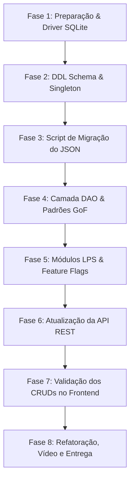

# 📋 PLANO DE AÇÃO TÉCNICO: TRANSIÇÃO PARA BANCO DE DADOS RELACIONAL E ATENDIMENTO AOS REQUISITOS ACADÊMICOS

**Projeto:** Praticom - Sistema Integrado de Gestão Condominial (ERP)  
**Objetivo:** Transformar a arquitetura atual de persistência em arquivo JSON local para um banco de dados relacional robusto, implementando padrões de projeto (GoF), Linha de Produtos de Software (LPS), telas CRUD por integrante, refatoração documentada e plano de testes completo.

---

## 1. Diagnóstico do Estado Atual do Projeto

### 1.1 Arquitetura Atual
* **Frontend:** Single Page Application (SPA) em **React 18** construída com **Vite 5**, estilizada via variáveis Vanilla CSS (`index.css`), utilizando componentes funcionais e ícones da biblioteca `lucide-react`.
* **Backend:** API RESTful em **Node.js + Express 4**, utilizando o middleware `cors` e roteamento em `server/server.js`.
* **Camada de Dados (Persistência em JSON):** O arquivo `server/database.js` gerencia um objeto em memória (`memoryDb`) sincronizado de forma síncrona/assíncrona no arquivo `server/condo_store.json`.
* **Inicialização:** Script PowerShell `start_app.ps1` ajustado para ser dinâmico (`$PSScriptRoot`) e utilizar o runtime local Node.js / NPM.

### 1.2 Entidades e Coleções Existentes em `condo_store.json`
Atualmente, o sistema gerencia 12 coleções de dados:
1. `units` (Unidades condominiais)
2. `residents` (Moradores)
3. `vehicles` (Veículos)
4. `pets` (Animais de estimação)
5. `deliveries` (Encomendas da portaria)
6. `access_logs` (Entrada e saída de visitantes/prestadores)
7. `spaces` (Áreas comuns para reserva)
8. `reservations` (Reservas efetuadas)
9. `financial_transactions` (Lançamentos e taxas condominiais)
10. `announcements` (Mural de comunicados)
11. `market_products` (Estoque do mercadinho autônomo)
12. `market_sales` (Vendas efetuadas no PDV do mercadinho)

### 1.3 Limitações Identificadas na Persistência em JSON
* **Ausência de Integridade Referencial:** Relacionamentos (ex: `resident_id` apontando para `units`) são tratados via Javascript (`Array.prototype.find` / `filter`), sem chaves estrangeiras (`FOREIGN KEY`) enforçadas pelo banco.
* **Riscos de Concorrência e Conflito I/O:** Toda mutação reescreve o arquivo `condo_store.json` inteiro no disco com `fs.writeFileSync`.
* **Falta de Transações de Banco:** Vendas do mercadinho e reservas não possuem controle transacional ACID nativo.

---

## 2. Escolha e Justificativa da Tecnologia de Banco de Dados

### 2.1 Comparativo de Tecnologias

| Critério | SQLite (`better-sqlite3` / `sqlite3`) | PostgreSQL | MySQL / MariaDB |
| :--- | :--- | :--- | :--- |
| **Instalação no Windows** | **Zero Instalação** (Arquivo local embutido via Node.js) | Requer instalador `.exe` e serviço rodando em segundo plano | Requer instalador ou XAMPP/WAMP |
| **Integridade Relacional** | **Suporte Total** (FKs, PKs, JOINs, ACID, Índices) | Suporte Total | Suporte Total |
| **Complexidade de Setup** | **Mínima** (`npm install better-sqlite3` ou `sqlite3`) | Alta (Portas, Usuários, PostgreSQL Service, PGAdmin) | Média/Alta (MySQL Workbench, serviços) |
| **Portabilidade no Git** | **Excelente** (Arquivo `.db` fica no próprio projeto) | Baixa (Exige dump SQL e reinstalação do SGBD) | Baixa (Exige exportação e importação `.sql`) |

### 2.2 Escolha Recomendada: **SQLite (via `better-sqlite3` ou `sqlite3` + `knex`)**

> **Justificativa Técnica:**  
> O **SQLite** atende integralmente a **todos os requisitos relacionais acadêmicos** (tabelas relacionadas, SQL DDL/DML, chaves primárias/estrangeiras, restrições e transações ACID) **sem exigir a instalação de serviços de banco pesados no Windows do usuário ou da banca avaliadora**. Toda a base de dados reside em um arquivo relacional `.sqlite` dentro da pasta `server/`, garantindo 100% de reprodutibilidade acadêmica.

---

## 3. Matriz de Instalações e Dependências

### 3.1 Lista Detalhada de Requisitos de Ambiente

| Categoria | Item | Finalidade | Método de Instalação | Diretório de Execução | Forma de Verificação |
| :--- | :--- | :--- | :--- | :--- | :--- |
| **1. Programa Windows** | **Node.js (v18+)** | Ambiente de execução JS | Instalador `.msi` oficial (já instalado) | Global | `node -v` |
| **2. Ferramenta Existente** | **NPM (v10+)** | Gerenciador de pacotes | Acompanha o Node.js | Global | `npm -v` |
| **3. Dependência do Backend** | **`better-sqlite3`** (ou `sqlite3`) | Driver nativo SQLite síncrono/assíncrono ultra-rápido | `npm install better-sqlite3` | `server/` | `node -e "require('better-sqlite3')"` |
| **4. Dependência Opcional** | **`knex`** | Query builder SQL relacional | `npm install knex` | `server/` | `npx knex --version` |
| **5. Ferramenta de GUI (Opcional)**| **DB Browser for SQLite** ou extensão VS Code *SQLite Viewer* | Visualização gráfica de tabelas e consultas | Extensão VS Code ou Download Portable | N/A | Abrir arquivo `.sqlite` na extensão |
| **6. Recursos Desnecessários** | Servidor PostgreSQL / MySQL externo | N/A | **NÃO INSTALAR** | N/A | Economiza recursos e evita falhas de conexão |

---

## 4. Modelagem do Banco de Dados Relacional (DDL e DML)

### 4.1 Diagrama de Entidade e Relacionamento (DER Lógico)

```text
+----------------+       +-------------------+       +--------------------+
|     UNITS      |1    N |     RESIDENTS     |1    N |      VEHICLES      |
+----------------+-------+-------------------+-------+--------------------+
| id (PK)        |       | id (PK)           |       | id (PK)            |
| block          |       | unit_id (FK)      |       | unit_id (FK)       |
| number         |       | name, email, phone|       | resident_id (FK)   |
+----------------+       +-------------------+       +--------------------+
        |                          |                          |
        | 1                        | 1                        | 1
        |                          |                          |
        | N                        | N                        | N
+----------------+       +-------------------+       +--------------------+
|   DELIVERIES   |       |   RESERVATIONS    |       |   MARKET_SALES     |
+----------------+       +-------------------+       +--------------------+
| id (PK)        |       | id (PK)           |       | id (PK)            |
| unit_id (FK)   |       | space_id (FK)     |       | unit_id (FK)       |
| resident_id(FK)|       | unit_id (FK)      |       | resident_id (FK)   |
+----------------+       +-------------------+       +--------------------+
```

### 4.2 Script DDL SQL de Criação de Tabelas (`server/schema.sql`)

```sql
-- Habilitar suporte a Chaves Estrangeiras no SQLite
PRAGMA foreign_keys = ON;

-- 1. Unidades Condominiais
CREATE TABLE IF NOT EXISTS units (
    id INTEGER PRIMARY KEY AUTOINCREMENT,
    block TEXT NOT NULL,
    number TEXT NOT NULL,
    floor INTEGER,
    type TEXT DEFAULT 'Residencial',
    created_at DATETIME DEFAULT CURRENT_TIMESTAMP,
    UNIQUE(block, number)
);

-- 2. Moradores
CREATE TABLE IF NOT EXISTS residents (
    id INTEGER PRIMARY KEY AUTOINCREMENT,
    unit_id INTEGER NOT NULL,
    name TEXT NOT NULL,
    email TEXT,
    phone TEXT,
    cpf TEXT UNIQUE,
    role TEXT DEFAULT 'Proprietário',
    emergency_contact TEXT,
    created_at DATETIME DEFAULT CURRENT_TIMESTAMP,
    FOREIGN KEY (unit_id) REFERENCES units(id) ON DELETE CASCADE
);

-- 3. Veículos
CREATE TABLE IF NOT EXISTS vehicles (
    id INTEGER PRIMARY KEY AUTOINCREMENT,
    unit_id INTEGER NOT NULL,
    resident_id INTEGER,
    plate TEXT UNIQUE NOT NULL,
    model TEXT NOT NULL,
    color TEXT,
    type TEXT DEFAULT 'Carro',
    parking_spot TEXT,
    FOREIGN KEY (unit_id) REFERENCES units(id) ON DELETE CASCADE,
    FOREIGN KEY (resident_id) REFERENCES residents(id) ON DELETE SET NULL
);

-- 4. Animais de Estimação (Pets)
CREATE TABLE IF NOT EXISTS pets (
    id INTEGER PRIMARY KEY AUTOINCREMENT,
    unit_id INTEGER NOT NULL,
    resident_id INTEGER,
    name TEXT NOT NULL,
    species TEXT NOT NULL,
    breed TEXT,
    size TEXT,
    FOREIGN KEY (unit_id) REFERENCES units(id) ON DELETE CASCADE,
    FOREIGN KEY (resident_id) REFERENCES residents(id) ON DELETE SET NULL
);

-- 5. Encomendas (Portaria)
CREATE TABLE IF NOT EXISTS deliveries (
    id INTEGER PRIMARY KEY AUTOINCREMENT,
    unit_id INTEGER NOT NULL,
    resident_id INTEGER,
    courier TEXT NOT NULL,
    tracking_code TEXT,
    description TEXT,
    status TEXT CHECK(status IN ('PENDING', 'PICKED_UP')) DEFAULT 'PENDING',
    pickup_code TEXT NOT NULL,
    notes TEXT,
    received_at DATETIME DEFAULT CURRENT_TIMESTAMP,
    picked_up_at DATETIME,
    picked_up_by TEXT,
    FOREIGN KEY (unit_id) REFERENCES units(id) ON DELETE CASCADE,
    FOREIGN KEY (resident_id) REFERENCES residents(id) ON DELETE SET NULL
);

-- 6. Controle de Acesso (Portaria)
CREATE TABLE IF NOT EXISTS access_logs (
    id INTEGER PRIMARY KEY AUTOINCREMENT,
    visitor_name TEXT NOT NULL,
    document TEXT NOT NULL,
    type TEXT CHECK(type IN ('Visitante', 'Prestador de Serviço', 'Entregador')) DEFAULT 'Visitante',
    destination_unit_id INTEGER NOT NULL,
    entry_time DATETIME DEFAULT CURRENT_TIMESTAMP,
    exit_time DATETIME,
    status TEXT CHECK(status IN ('IN_PROPERTY', 'EXITED')) DEFAULT 'IN_PROPERTY',
    notes TEXT,
    FOREIGN KEY (destination_unit_id) REFERENCES units(id) ON DELETE CASCADE
);

-- 7. Espaços Comuns
CREATE TABLE IF NOT EXISTS spaces (
    id INTEGER PRIMARY KEY AUTOINCREMENT,
    name TEXT NOT NULL,
    description TEXT,
    capacity INTEGER NOT NULL,
    price_per_hour REAL DEFAULT 0,
    rules TEXT
);

-- 8. Reservas de Espaços
CREATE TABLE IF NOT EXISTS reservations (
    id INTEGER PRIMARY KEY AUTOINCREMENT,
    space_id INTEGER NOT NULL,
    unit_id INTEGER NOT NULL,
    resident_id INTEGER NOT NULL,
    reservation_date DATE NOT NULL,
    start_time TEXT NOT NULL,
    end_time TEXT NOT NULL,
    total_price REAL DEFAULT 0,
    status TEXT CHECK(status IN ('CONFIRMED', 'CANCELLED', 'PENDING')) DEFAULT 'CONFIRMED',
    created_at DATETIME DEFAULT CURRENT_TIMESTAMP,
    FOREIGN KEY (space_id) REFERENCES spaces(id) ON DELETE CASCADE,
    FOREIGN KEY (unit_id) REFERENCES units(id) ON DELETE CASCADE,
    FOREIGN KEY (resident_id) REFERENCES residents(id) ON DELETE CASCADE
);

-- 9. Transações Financeiras
CREATE TABLE IF NOT EXISTS financial_transactions (
    id INTEGER PRIMARY KEY AUTOINCREMENT,
    unit_id INTEGER,
    description TEXT NOT NULL,
    amount REAL NOT NULL,
    type TEXT CHECK(type IN ('INCOME', 'EXPENSE')) NOT NULL,
    category TEXT NOT NULL,
    status TEXT CHECK(status IN ('PAID', 'PENDING', 'OVERDUE')) DEFAULT 'PENDING',
    due_date DATE NOT NULL,
    paid_at DATETIME,
    FOREIGN KEY (unit_id) REFERENCES units(id) ON DELETE SET NULL
);

-- 10. Mural de Comunicados
CREATE TABLE IF NOT EXISTS announcements (
    id INTEGER PRIMARY KEY AUTOINCREMENT,
    title TEXT NOT NULL,
    content TEXT NOT NULL,
    category TEXT DEFAULT 'Geral',
    priority TEXT CHECK(priority IN ('BAIXA', 'MEDIA', 'ALTA', 'URGENTE')) DEFAULT 'MEDIA',
    created_at DATETIME DEFAULT CURRENT_TIMESTAMP,
    created_by TEXT DEFAULT 'Administração'
);

-- 11. Mercadinho - Produtos
CREATE TABLE IF NOT EXISTS market_products (
    id INTEGER PRIMARY KEY AUTOINCREMENT,
    name TEXT NOT NULL,
    category TEXT NOT NULL,
    price REAL NOT NULL,
    stock_quantity INTEGER DEFAULT 0,
    barcode TEXT UNIQUE
);

-- 12. Mercadinho - Vendas (PDV)
CREATE TABLE IF NOT EXISTS market_sales (
    id INTEGER PRIMARY KEY AUTOINCREMENT,
    unit_id INTEGER NOT NULL,
    resident_id INTEGER NOT NULL,
    total_amount REAL NOT NULL,
    payment_method TEXT CHECK(payment_method IN ('PIX', 'CREDIT_CARD', 'CONDO_FEE')) NOT NULL,
    created_at DATETIME DEFAULT CURRENT_TIMESTAMP,
    items_json TEXT NOT NULL, -- Lista de itens vendidos em formato JSON
    FOREIGN KEY (unit_id) REFERENCES units(id) ON DELETE CASCADE,
    FOREIGN KEY (resident_id) REFERENCES residents(id) ON DELETE CASCADE
);

-- Índices Recomendados para Otimização de Consultas
CREATE INDEX IF NOT EXISTS idx_residents_unit ON residents(unit_id);
CREATE INDEX IF NOT EXISTS idx_deliveries_status ON deliveries(status);
CREATE INDEX IF NOT EXISTS idx_access_status ON access_logs(status);
CREATE INDEX IF NOT EXISTS idx_reservations_date ON reservations(reservation_date);
CREATE INDEX IF NOT EXISTS idx_financial_status ON financial_transactions(status);
```

---

## 5. Plano de Migração do JSON para o Banco Relacional

### 5.1 Script Automático de Migração (`server/migrate.js`)
Criaremos um script utilitário de uso único que:
1. Carrega os dados existentes em `server/condo_store.json`.
2. Cria o arquivo `server/condo_database.sqlite` e executa o `schema.sql`.
3. Popula ordenadamente as tabelas respeitando a integridade referencial:
   - Primeiro: `units`, `spaces`, `market_products`, `announcements`.
   - Segundo: `residents` (vinculados a `units`).
   - Terceiro: `vehicles`, `pets`, `deliveries`, `access_logs`, `reservations`, `financial_transactions`, `market_sales`.
4. Exibe log detalhado com o total de registros migrados por tabela.
5. Preserva o arquivo original `condo_store.json` em `condo_store.json.bak` como cópia de segurança.

---

## 6. Mapeamento Integral dos Requisitos Acadêmicos

### 6.1 Padrões de Projeto (GoF - 8 Exemplos Práticos)

| Padrão GoF | Categoria | Quantidade Exigida | Aplicação Prática no Praticom | Local no Código |
| :--- | :--- | :--- | :--- | :--- |
| **Singleton** | Criacional | **2 exemplos** | **1. DatabaseConnectionSingleton:** Instância única da conexão SQLite.<br>**2. AppConfigSingleton:** Gerenciador global de configurações e Feature Flags LPS. | `server/config/DatabaseSingleton.js`<br>`server/config/AppConfigSingleton.js` |
| **Template Method** | Comportamental | **3 exemplos** | **1. AbstractReportGenerator:** Template para relatórios (Financeiro, Portaria, Reservas).<br>**2. AbstractPaymentProcessor:** Template para fluxo de pagamento (PIX, Cartão, Cota Condominial).<br>**3. AbstractNotificationDispatcher:** Template para notificação (Encomenda, Aviso Urgente, Reserva). | `server/services/templates/ReportTemplate.js`<br>`server/services/templates/PaymentTemplate.js`<br>`server/services/templates/NotificationTemplate.js` |
| **DAO / Factory** | Estrutural/Criacional | **3 exemplos** | **1. ResidentDAOFactory:** Fabrica acessores de dados para Moradores.<br>**2. DeliveryDAOFactory:** Fabrica acessores para Encomendas.<br>**3. FinancialDAOFactory:** Fabrica acessores para Transações Financeiras. | `server/dao/ResidentDAO.js`<br>`server/dao/DeliveryDAO.js`<br>`server/dao/FinancialDAO.js` |

### 6.2 Linha de Produtos de Software (LPS - Feature Flags)

Definição de 2 Funcionalidades Opcionais Ativáveis/Desativáveis via Configuração (`server/config/features.json`):

1. **`ENABLE_MARKETPLACE` (Mercadinho Autônomo PDV):**
   - **Ativado:** Exibe a aba Mercadinho e libera endpoints `/api/market/*`.
   - **Desativado:** Oculta a aba na `Sidebar.jsx` e retorna `404 Feature Disabled` nos endpoints.
2. **`ENABLE_ADVANCED_DELIVERIES` (Notificação Inteligente de Encomendas com QR/PIN):**
   - **Ativado:** Gera códigos PIN para confirmação e baixa de entregas na portaria.
   - **Desativado:** Permite baixa simples direta sem exigência de código PIN.

### 6.3 Divisão de Telas CRUD por Integrante da Equipe

A aplicação conta com 8 visões completas conectadas ao banco de dados:

* **Integrante 1:**
  1. CRUD de Moradores & Unidades (`ResidentsView.jsx`)
  2. CRUD de Portaria & Controle de Acesso (`AccessControlView.jsx`)
* **Integrante 2:**
  3. CRUD de Encomendas & Deliveries (`DeliveriesView.jsx`)
  4. CRUD de Reservas de Espaços Comuns (`ReservationsView.jsx`)
* **Integrante 3 (opcional/expansão):**
  5. CRUD de Gestão Financeira (`FinancialView.jsx`)
  6. CRUD de Mural de Comunicados (`AnnouncementsView.jsx`)
* **Integrante 4 (opcional/expansão):**
  7. CRUD do Mercadinho Autônomo & Estabilização de Estoque (`MarketInventoryView.jsx`)
  8. Dashboard Consolidado de Métricas (`DashboardView.jsx`)

### 6.4 Refatoração Demonstrada (Antes vs Depois)

Serão preparados trechos explícitos no documento mostrando:
* **Antes:** Acesso direto a arrays em memória com `fs.writeFileSync` síncrono.
* **Depois:** Uso do padrão DAO + Singleton com prepared statements em SQL parametrizado.

---

## 7. Cronograma Sequencial por Fases



### **Fase 1: Preparação do Ambiente e Instalação de Driver**
* **Objetivo:** Adicionar o driver SQLite ao backend sem afetar a aplicação rodando.
* **Tarefas:** Instalar `better-sqlite3` no diretório `server/`.
* **Comando:** `cd server; npm install better-sqlite3`.
* **Resultado Esperado:** Pacote instalado no `server/package.json`.
* **Critério de Conclusão:** Teste `node -e "require('better-sqlite3')"` sem erros.

### **Fase 2: Criação do Schema DDL e Conexão Singleton**
* **Objetivo:** Estabelecer a estrutura relacional do banco de dados e a instância de conexão única.
* **Tarefas:** Criar `server/schema.sql` e `server/config/DatabaseSingleton.js`.
* **Arquivos Envolvidos:** `server/schema.sql`, `server/config/DatabaseSingleton.js`.
* **Resultado Esperado:** Arquivo `condo_database.sqlite` gerado com todas as 12 tabelas, FKs e índices.
* **Critério de Conclusão:** Consulta `.tables` no SQLite confirma a existência de todas as tabelas.

### **Fase 3: Script de Migração do JSON para SQLite**
* **Objetivo:** Transferir com segurança os dados de `condo_store.json` para o banco relacional.
* **Tarefas:** Desenvolver e rodar `server/migrate.js`.
* **Resultado Esperado:** 100% dos dados migrados com preservação de chaves primárias e estrangeiras.
* **Critério de Conclusão:** `SELECT COUNT(*) FROM residents` retorna exatamente o número de moradores do JSON.

### **Fase 4: Implementação dos Padrões de Projeto (GoF & DAO)**
* **Objetivo:** Estruturar as classes DAO, Template Method e Singleton no backend.
* **Tarefas:** Criar diretórios `server/dao/` e `server/services/templates/`.
* **Arquivos Envolvidos:** `ResidentDAO.js`, `DeliveryDAO.js`, `FinancialDAO.js`, `ReportTemplate.js`, etc.
* **Resultado Esperado:** Regras de negócio desacopladas do framework Express.
* **Critério de Conclusão:** Testes unitários das DAOs executados com sucesso.

### **Fase 5: Linha de Produtos de Software (LPS & Feature Flags)**
* **Objetivo:** Configurar ativação/desativação dinâmica dos módulos de Mercadinho e Encomendas Avançadas.
* **Tarefas:** Criar `server/config/features.json` e `AppConfigSingleton.js`. Atualizar `Sidebar.jsx` e `server.js`.
* **Resultado Esperado:** Alternar flag no arquivo JSON oculta/exibe a funcionalidade na interface e bloqueia a API.
* **Critério de Conclusão:** Com a flag `ENABLE_MARKETPLACE: false`, o menu do mercadinho desaparece.

### **Fase 6: Atualização dos Endpoints da API REST**
* **Objetivo:** Substituir as chamadas diretas de `database.js` pelas DAOs relacionais em `server/server.js`.
* **Arquivos Envolvidos:** `server/server.js`.
* **Resultado Esperado:** Os 14 endpoints da API REST consomem e gravam no SQLite.
* **Critério de Conclusão:** Bateria de testes HTTP (`scratch/test_api.js`) retorna 14/14 respostas `200 OK`.

### **Fase 7: Validação dos CRUDs e Interface Frontend**
* **Objetivo:** Garantir a funcionalidade das telas CRUD para cada integrante da equipe.
* **Tarefas:** Testar criação, leitura, atualização e exclusão em todas as telas (`ResidentsView`, `DeliveriesView`, `AccessControlView`, `ReservationsView`, `FinancialView`, `MarketInventoryView`).
* **Resultado Esperado:** Interface responsiva operando sobre o banco relacional em tempo real.
* **Critério de Conclusão:** Fluxo completo de cadastro e exclusão funcionando sem recarregar a página.

### **Fase 8: Refatoração, Roteiro do Vídeo e Documentação Final**
* **Objetivo:** Finalizar os entregáveis acadêmicos (documentação, comparativo antes/depois, roteiro do vídeo).
* **Tarefas:** Atualizar `README.md`, gerar o documento de refatoração e gravar o vídeo demonstrativo (publicação não listada no YouTube).
* **Critério de Conclusão:** Checklist acadêmico 100% verificado e repositório limpo.

---

## 8. Plano de Testes e Validação

1. **Teste de Integridade Relacional (FKs):** Tentar excluir uma unidade e verificar se os moradores vinculados são tratados conforme a regra (`CASCADE` ou `RESTRICT`).
2. **Teste de Transação no Mercadinho:** Realizar uma compra no PDV e validar se o saldo financeiro é lançado e o estoque do produto é reduzido de forma atômica.
3. **Teste de Feature Flags (LPS):** Desativar a flag de Mercadinho e verificar se o frontend e a API respondem adequadamente.
4. **Teste de Carga do SQLite:** Executar a suíte de testes HTTP (`test_api.js`) com 100 requisições consecutivas para validar que a conexão Singleton não estoura limites de I/O.

---

## 9. Checklist de Entrega Acadêmica

- [ ] Banco de dados relacional SQLite configurado com no mínimo 3 tabelas relacionadas (12 tabelas configuradas).
- [ ] Script DDL SQL de criação de tabelas e índices (`schema.sql`).
- [ ] Script de migração de dados mantendo cópia de segurança do JSON.
- [ ] Implementação de 2 Singletons (DatabaseConnection e AppConfig).
- [ ] Implementação de 3 Template Methods (Relatórios, Pagamentos, Notificações).
- [ ] Implementação de 3 DAOs / Factories (Moradores, Encomendas, Financeiro).
- [ ] Linha de Produtos de Software (LPS) com 2 funcionalidades opcionais ativáveis por configuração.
- [ ] Pelo menos 2 telas CRUD completas por integrante da equipe conectadas ao banco.
- [ ] Demonstração de refatoração de código (Antes vs Depois).
- [ ] Roteiro e vídeo de apresentação publicado como Não Listado no YouTube.
- [ ] README do repositório organizado com instruções completas de execução.
- [ ] Mais de 10 classes/módulos bem estruturados no backend e frontend.
