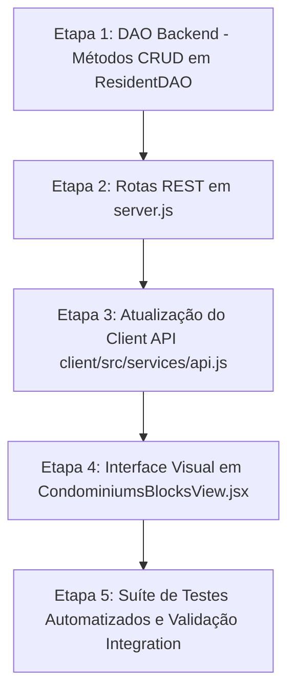

# 🏢 PLANO DE AÇÃO TÉCNICO: CRUD COMPLETO DE UNIDADES (APARTAMENTOS) NO PRATICOM ERP

**Documento:** Relatório Técnico de Diagnóstico, Especificação e Plano de Ação para Gestão de Unidades  
**Projeto:** Praticom ERP (Sistema Integrado de Gestão Condominial)  
**Data:** 10 de Outubro de 2026  
**Status:** Planejamento e Diagnóstico Concluídos (Aguardando Aprovação Humana para Implementação)  

---

## 1. Resumo Executivo

Este documento apresenta o diagnóstico completo e o plano de ação técnico para a implementação do **CRUD completo de Unidades Habitacionais (Apartamentos / Salas Comercial / Coberturas)** no Praticom ERP.

A auditoria realizada no código-fonte ([`server/server.js`](file:///c:/Users/Heitor/Praticom_Broken/server/server.js), [`server/dao/ResidentDAO.js`](file:///c:/Users/Heitor/Praticom_Broken/server/dao/ResidentDAO.js), [`server/schema.sql`](file:///c:/Users/Heitor/Praticom_Broken/server/schema.sql), [`client/src/views/CondominiumsBlocksView.jsx`](file:///c:/Users/Heitor/Praticom_Broken/client/src/views/CondominiumsBlocksView.jsx) e [`client/src/views/ResidentsView.jsx`](file:///c:/Users/Heitor/Praticom_Broken/client/src/views/ResidentsView.jsx)) revelou que **atualmente apenas a operação de Leitura (GET) de unidades está parcialmente implementada no backend**. As operações de Criação (POST), Edição (PATCH) e Exclusão Segura (DELETE) de unidades estão **ausentes** no servidor e na interface de usuário.

O plano detalha a especificação dos endpoints REST, os métodos da camada DAO, os controles de integridade referencial (impedindo a exclusão física de apartamentos com moradores ou históricos ativos) e a integração visual no componente existente de Gestão Territorial sem a criação de telas redundantes.

---

## 2. Diagnóstico da Página e Interface Atual

### 2.1 Componente Frontend Existente
A gestão territorial e de pessoas do Praticom ERP é dividida em duas visões principais:
1. **[`CondominiumsBlocksView.jsx`](file:///c:/Users/Heitor/Praticom_Broken/client/src/views/CondominiumsBlocksView.jsx) ("Condomínios & Blocos"):**
   - *Estado Atual:* Gerencia o CRUD de Condomínios (Criar, Editar, Excluir, Alternar Status) e o CRUD de Blocos (Criar, Editar, Excluir). Também possui um formulário de mapeamento de unidades legadas (`mapPendingUnits`).
   - *Lacuna:* Não possui atualmente a tabela nem os modais para criar, editar ou excluir unidades diretamente vinculadas aos blocos daquele condomínio.
2. **[`ResidentsView.jsx`](file:///c:/Users/Heitor/Praticom_Broken/client/src/views/ResidentsView.jsx) ("Moradores & Unidades"):**
   - *Estado Atual:* Consome `api.getUnits()` para preencher os seletores `<select>` nos formulários de cadastro de moradores, veículos e pets.
   - *Lacuna:* Não permite cadastrar novas unidades nem alterar dados estruturais (bloco, número, andar, tipo).

### 2.2 Decisão de Design de Interface
- **Evolução da Tela Existente:** O CRUD de Unidades será incorporado diretamente na visão [`CondominiumsBlocksView.jsx`](file:///c:/Users/Heitor/Praticom_Broken/client/src/views/CondominiumsBlocksView.jsx), expandindo a hierarquia visual natural: **Condomínio ➔ Bloco ➔ Unidade/Apartamento**.
- Preserva-se 100% dos padrões visuais do Design System (`index.css`), incluindo estatísticas resumidas, botões de ação com ícones `lucide-react` (`Plus`, `Edit3`, `Trash2`, `Eye`), modais responsivos e badges de status.

---

## 3. Inventário dos Componentes Frontend e Backend

| Componente / Arquivo | Camada | Função Atual em Relação a Unidades | Estado Auditado |
| :--- | :--- | :--- | :--- |
| [`server/schema.sql`](file:///c:/Users/Heitor/Praticom_Broken/server/schema.sql#L31) | Banco DDL | Tabela `units` (`id`, `block`, `block_id`, `number`, `floor`, `type`, `created_at`) | ✅ Existente no Schema |
| [`server/dao/ResidentDAO.js`](file:///c:/Users/Heitor/Praticom_Broken/server/dao/ResidentDAO.js#L12) | Backend DAO | Método `getUnits({ condominiumId })` | ⚠️ Parcial (Apenas GET) |
| [`server/server.js`](file:///c:/Users/Heitor/Praticom_Broken/server/server.js#L166) | Backend Rotas | Rota `GET /api/units` com middleware `tenantContextMiddleware` | ⚠️ Parcial (Apenas GET) |
| [`client/src/services/api.js`](file:///c:/Users/Heitor/Praticom_Broken/client/src/services/api.js#L64) | API Client | Método `api.getUnits()` | ⚠️ Parcial (Apenas GET) |
| [`client/src/views/CondominiumsBlocksView.jsx`](file:///c:/Users/Heitor/Praticom_Broken/client/src/views/CondominiumsBlocksView.jsx) | Frontend View | Mapeamento de blocos e unidades legadas pendentes | ⚠️ Parcial |
| [`client/src/views/ResidentsView.jsx`](file:///c:/Users/Heitor/Praticom_Broken/client/src/views/ResidentsView.jsx) | Frontend View | Leitura de unidades nos dropdowns de cadastro de morador | ⚠️ Apenas Leitura |

---

## 4. Estado Atual de Cada Operação do CRUD de Unidades

| Operação CRUD | Endpoint REST Proposto | Método DAO Necessário | Status no Código Auditado | Justificativa Técnica |
| :---: | :--- | :--- | :---: | :--- |
| **Create (Criar)** | `POST /api/units` | `residentDAO.createUnit(data)` | ❌ **Ausente** | Não existe rota POST nem formulário de cadastro de nova unidade. |
| **Read (Listar)** | `GET /api/units` | `residentDAO.getUnits({ condominiumId })` | ✅ **Implementado** | Funcional, retorna lista filtrada por condomínio com contadores. |
| **Read (Detalhe)**| `GET /api/units/:id` | `residentDAO.getUnit(id)` | ❌ **Ausente** | Não existe consulta de unidade individual por ID. |
| **Update (Editar)**| `PATCH /api/units/:id` | `residentDAO.updateUnit(id, data)` | ❌ **Ausente** | Não existe rota PATCH nem modal de edição de unidade. |
| **Delete (Excluir)**| `DELETE /api/units/:id` | `residentDAO.deleteUnit(id)` | ❌ **Ausente** | Não existe rota DELETE nem verificação de segurança de exclusão. |

---

## 5. Modelo de Dados e Regras de Validação

### 5.1 Campos da Tabela `units`

| Campo | Tipo SQL | Chave / Restrição | Origem | Obrigatório | Regra de Validação |
| :--- | :--- | :--- | :--- | :---: | :--- |
| `id` | `INTEGER` | `PRIMARY KEY AUTOINCREMENT` | Banco | Sim | Gerado automaticamente. |
| `block_id` | `INTEGER` | `FK -> blocks(id) ON DELETE RESTRICT` | Form / Contexto | Sim | Deve pertencer a um bloco ativo do condomínio ativo. |
| `block` | `TEXT` | `NOT NULL` | Denormalizado | Sim | Nome textual do bloco (ex.: "Bloco A", "Torre 1"). |
| `number` | `TEXT` | `NOT NULL` | Form | Sim | Número do apartamento/sala (ex.: "101", "12B"). Texto não vazio. |
| `floor` | `INTEGER` | Opcional | Form | Não | Número do andar (ex.: 1, 2, 10). Inteiro $\ge 0$. |
| `type` | `TEXT` | `DEFAULT 'Residencial'` | Form | Sim | Enum: `'Residencial'`, `'Comercial'`, `'Cobertura'`, `'Garagem'`. |
| `created_at` | `DATETIME` | `DEFAULT CURRENT_TIMESTAMP` | Banco | Sim | Data e hora de criação. |

### 5.2 Regras de Unicidade e Integridade de Negócio
1. **Unicidade de Unidade:** A combinação `(block_id, number)` deve ser **única por condomínio**. Duas unidades no mesmo bloco com o mesmo número (ex.: Bloco A, Apto 101) devem ser rejeitadas com erro HTTP `409 Conflict`.
2. **Integridade em Exclusão:** A exclusão física de uma unidade é **bloqueada** se houver registros vinculados em:
   - `residents` (`unit_id`)
   - `vehicles` (`unit_id`)
   - `pets` (`unit_id`)
   - `deliveries` (`unit_id`)
   - `access_logs` (`destination_unit_id`)
   - `reservations` (`unit_id`)
   - `financial_transactions` (`unit_id`)
   - `market_sales` (`unit_id`)
   Se houver vínculos, a API responderá com HTTP `409 Conflict` informando o motivo do bloqueio (ex.: *"Não é possível excluir unidade com moradores ou histórico vinculado"*).

---

## 6. Matriz de Dependências com Outros Módulos

```mermaid
graph TD
    Condo[Condomínio Ativo] --> Block[Bloco / Torre]
    Block --> Unit[Unidade / Apto]
    
    Unit --> Resident[Moradores (residents)]
    Unit --> Vehicle[Veículos (vehicles)]
    Unit --> Pet[Pets (pets)]
    Unit --> Delivery[Encomendas (deliveries)]
    Unit --> Access[Portaria / Acessos (access_logs)]
    Unit --> Reservation[Reservas de Espaços (reservations)]
    Unit --> Financial[Financeiro / Boletos (financial_transactions)]
    Unit --> Market[Vendas Mercadinho (market_sales)]
```

| Módulo Dependente | Tipo de Dependência | Impacto de Alterar a Unidade | Impacto de Excluir a Unidade |
| :--- | :--- | :--- | :--- |
| **Moradores (`residents`)** | FK `unit_id -> units.id` | O morador continua vinculado ao ID da unidade. | Exclusão BLOQUEADA se houver moradores. |
| **Veículos & Pets** | FK `unit_id -> units.id` | Atualizações de número de bloco refletem na exibição. | Exclusão BLOQUEADA se houver veículos/pets. |
| **Portaria (`deliveries` / `access_logs`)** | FK `unit_id` / `destination_unit_id` | Histórico preservado por FK intacta. | Exclusão BLOQUEADA se houver entregas ou acessos. |
| **Reservas (`reservations`)** | FK `unit_id` | Regras de limite de reserva por pessoa continuam válidas. | Exclusão BLOQUEADA se houver reservas no histórico. |
| **Financeiro (`financial_transactions`)**| FK `unit_id` | Cobranças anteriores mantêm o histórico da unidade. | Exclusão BLOQUEADA se houver débitos/transações. |
| **Mercadinho (`market_sales`)** | FK `unit_id` | Vendas do PDV mantêm rastreabilidade da compra. | Exclusão BLOQUEADA se houver compras registradas. |

---

## 7. Estratégia de Isolamento Multi-Tenant por Condomínio

O CRUD de Unidades seguirá estritamente o isolamento multi-tenant já configurado no projeto:

1. **Injeção do Contexto no Backend:** Todas as rotas de unidades em `server/server.js` serão protegidas pelo middleware [`tenantContextMiddleware`](file:///c:/Users/Heitor/Praticom_Broken/server/middleware/tenantContext.js), garantindo que `req.condominiumId` represente o condomínio validado.
2. **Validação Estrita de Bloco:** No cadastro ou edição de unidade (`POST /api/units` e `PATCH /api/units/:id`), o backend verificará se o `block_id` informado pertence expressamente ao condomínio ativo:
   ```sql
   SELECT id FROM blocks WHERE id = ? AND condominium_id = ?
   ```
   Caso o bloco pertença a outro condomínio, a requisição será sumariamente rejeitada com `403 Forbidden`.
3. **Impossibilidade de Troca de Condomínio:** A edição de unidade (`PATCH`) **não permitirá** alterar o `condominium_id` nem mover uma unidade existente para um bloco de outro condomínio.

---

## 8. Plano de Implementação por Etapas (Roteiro Faseado)



### Etapa 1: Métodos CRUD na Camada DAO ([`server/dao/ResidentDAO.js`](file:///c:/Users/Heitor/Praticom_Broken/server/dao/ResidentDAO.js))
- **Objetivo:** Adicionar os métodos `createUnit`, `getUnit`, `updateUnit` e `deleteUnit` na classe `ResidentDAO`.
- **Ações:**
  - `createUnit(data)`: Valida bloco e insere unidade vinculando `block_id` e nome do bloco.
  - `getUnit(id)`: Retorna unidade individual com estatísticas de ocupação.
  - `updateUnit(id, data)`: Atualiza `number`, `floor`, `type` e `block_id`.
  - `deleteUnit(id)`: Executa checagem de dependências antes de remover.
- **Critério de Aceite:** Inserção, edição e remoção de unidades funcionando isoladamente via DAO.

### Etapa 2: Endpoints REST no Backend ([`server/server.js`](file:///c:/Users/Heitor/Praticom_Broken/server/server.js))
- **Objetivo:** Expor os endpoints RESTful para gestão de unidades sob a proteção do middleware multi-tenant.
- **Rotas:**
  - `POST /api/units`: Cadastra nova unidade (valida campos obrigatórios e duplicidade).
  - `GET /api/units/:id`: Retorna detalhes de uma unidade.
  - `PATCH /api/units/:id`: Atualiza unidade existente.
  - `DELETE /api/units/:id`: Remove unidade com checagem de integridade referencial.
- **Critério de Aceite:** Respostas HTTP adequadas (`201 Created`, `200 OK`, `400 Bad Request`, `409 Conflict`, `404 Not Found`).

### Etapa 3: Métodos no Client de API ([`client/src/services/api.js`](file:///c:/Users/Heitor/Praticom_Broken/client/src/services/api.js))
- **Objetivo:** Expor métodos assíncronos para o React SPA.
- **Métodos:**
  - `api.createUnit(data)`
  - `api.updateUnit(id, data)`
  - `api.deleteUnit(id)`
- **Critério de Aceite:** Chamadas REST integradas com cabeçalho `X-Condominium-Id`.

### Etapa 4: Interface Visual no Frontend ([`CondominiumsBlocksView.jsx`](file:///c:/Users/Heitor/Praticom_Broken/client/src/views/CondominiumsBlocksView.jsx))
- **Objetivo:** Adicionar a seção/tabela e modais visuais para gerenciamento completo de unidades por bloco.
- **Componentes Visuais:**
  - Formulário/Modal de Cadastro de Unidade (Seleção do Bloco, Número, Andar, Tipo).
  - Tabela de Unidades do Bloco Selecionado (com botões de Visualizar, Editar e Excluir).
  - Modal de Edição de Unidade.
  - Modal de Confirmação de Exclusão com aviso de bloqueio de dependências.
- **Critério de Aceite:** Interface responsiva, com feedback de erro/sucesso via Toast e atualização reativa.

### Etapa 5: Suíte de Testes Automatizados e Validação
- **Objetivo:** Garantir a ausência de regressões e a segurança da integridade relacional.
- **Testes:** Atualização do script [`server/tests/suite.js`](file:///c:/Users/Heitor/Praticom_Broken/server/tests/suite.js) incluindo testes de CRUD de Unidades.

---

## 9. Arquivos e Componentes que Precisarão de Alteração

1. [`server/dao/ResidentDAO.js`](file:///c:/Users/Heitor/Praticom_Broken/server/dao/ResidentDAO.js):
   - *Justificativa:* Adição dos métodos `createUnit`, `getUnit`, `updateUnit` e `deleteUnit` com verificações de integridade.
2. [`server/server.js`](file:///c:/Users/Heitor/Praticom_Broken/server/server.js):
   - *Justificativa:* Declaração das rotas `POST /api/units`, `GET /api/units/:id`, `PATCH /api/units/:id` e `DELETE /api/units/:id`.
3. [`client/src/services/api.js`](file:///c:/Users/Heitor/Praticom_Broken/client/src/services/api.js):
   - *Justificativa:* Exposição das funções `createUnit`, `updateUnit` e `deleteUnit`.
4. [`client/src/views/CondominiumsBlocksView.jsx`](file:///c:/Users/Heitor/Praticom_Broken/client/src/views/CondominiumsBlocksView.jsx):
   - *Justificativa:* Adição da seção visual e modais de gerenciamento de unidades por bloco.
5. [`server/tests/suite.js`](file:///c:/Users/Heitor/Praticom_Broken/server/tests/suite.js):
   - *Justificativa:* Inclusão dos testes automatizados de CRUD de unidades no pipeline de testes.

---

## 10. Estratégia de Testes e Critérios de Aceitação

| Teste | Descrição da Validação | Resultado Esperado (Aprovação) | Resultado de Reprovação |
| :--- | :--- | :--- | :--- |
| **T1. Criação Válida** | Inserir unidade "Apto 101" no Bloco A do Condomínio Ativo | HTTP `201 Created` e unidade persistida no SQLite. | HTTP `500` ou unidade criada no condomínio errado. |
| **T2. Bloqueio de Duplicidade** | Tentar cadastrar "Apto 101" novamente no mesmo Bloco A | HTTP `409 Conflict` com mensagem clara. | Unidade duplicada criada no banco. |
| **T3. Edição de Unidade** | Alterar o andar da unidade 101 de `1` para `2` | HTTP `200 OK` e dados atualizados na interface. | Falha de atualização ou alteração de ID indevida. |
| **T4. Exclusão Bloqueada** | Tentar excluir unidade que possui morador cadastrado | HTTP `409 Conflict` exibindo aviso de moradores vinculados. | Exclusão da unidade deixando o morador órfão. |
| **T5. Exclusão Limpa** | Excluir unidade sem nenhum morador ou registro filho | HTTP `204 No Content` / `200 OK` e remoção da lista. | Erro de SQL ou unidade não removida. |
| **T6. Isolamento Multi-Tenant** | Consultar unidades com `X-Condominium-Id` de outro condomínio | Exibe apenas unidades do condomínio especificado no header. | Vazamento de unidades de condomínios alheios. |

---

## 11. Riscos e Medidas Preventivas

1. **Risco de Exclusão de Unidades em Cascata Desordenada:**
   - *Prevenção:* O banco SQLite possui `ON DELETE RESTRICT` na chave de blocos e unidades. A camada DAO executará verificação explícita em `residents`, `vehicles`, `deliveries`, `access_logs`, `reservations`, `financial_transactions` e `market_sales` antes de permitir qualquer comando `DELETE`.
2. **Risco de Inconsistência do Nome do Bloco Denormalizado:**
   - *Prevenção:* A tabela `units` guarda a coluna denormalizada `block` para exibição rápida. Ao alterar o nome de um bloco, o sistema atualizará em transação atômica o campo `block` de todas as unidades filhas daquele `block_id`.

---

## 12. Dúvidas e Decisões que Exigem Aprovação Humana

1. **Localização Exata da Interface Visual:**
   - *Proposta:* Incorporar o CRUD de Unidades dentro da visão existente [`CondominiumsBlocksView.jsx`](file:///c:/Users/Heitor/Praticom_Broken/client/src/views/CondominiumsBlocksView.jsx) (agrupado por bloco), evitando a criação de páginas duplicadas.
2. **Regra de Exclusão de Unidades com Histórico Antigo:**
   - *Proposta:* Exclusão física permitida **somente para unidades sem nenhum registro**. Para unidades com histórico (ex.: moradores antigos ou transações encerradas), a exclusão física é bloqueada por segurança de integridade relacional.

---

## 13. Checklist Final de Conclusão do Plano

- [x] Auditoria completa realizada no código real (`schema.sql`, `ResidentDAO.js`, `server.js`, `CondominiumsBlocksView.jsx`).
- [x] Zero código destrutivo executado nesta etapa de planejamento.
- [x] Modelo de dados e restrições da tabela `units` detalhados.
- [x] Lacunas de CRUD backend e frontend mapeadas.
- [x] Regras de unicidade e bloqueio de exclusão por integridade relacional definidas.
- [x] Estratégia de isolamento multi-tenant confirmada com `tenantContextMiddleware`.
- [x] Plano de testes automatizados e critérios de aceitação formalizados.
- [x] Arquivo `PLANO_ACAO_CRUD_UNIDADES.md` gravado no repositório.
