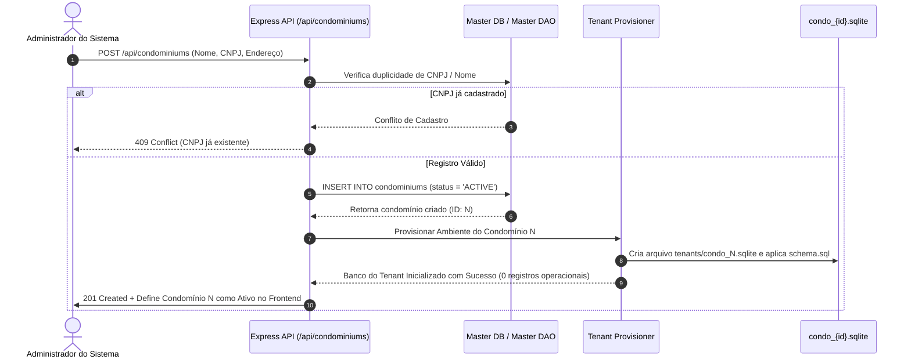
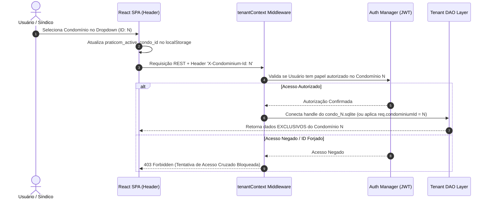

# 📋 PLANO DE AÇÃO TÉCNICO: ISOLAMENTO COMPLETO DE CONDOMÍNIOS NO PRATICOM ERP

**Documento:** Plano de Ação para Isolamento Multi-Tenant e Garantia de Soberania de Dados  
**Projeto:** Praticom ERP (Sistema Integrado de Gestão Condominial)  
**Data:** 10 de Outubro de 2026  
**Status:** Planejamento e Diagnóstico Concluídos (Aguardando Aprovação para Execução)  

---

## 1. Resumo Executivo

Este documento estabelece o plano de ação técnico para garantir que **cada condomínio cadastrado no Praticom ERP possua um ambiente de dados totalmente independente, isolado e soberano**. 

A premissa fundamental é que a criação de um novo condomínio deve resultar em um ambiente operacional **totalmente limpo (zero registros operacionais herdados)**, sem qualquer vazamento ou compartilhamento involuntário de moradores, veículos, acessos, encomendas, lançamentos financeiros, comunicados, produtos ou históricos entre clientes distintos.

Após auditoria detalhada no código do repositório ([`server/server.js`](file:///c:/Users/Heitor/Praticom_Broken/server/server.js), DAOs em [`server/dao/`](file:///c:/Users/Heitor/Praticom_Broken/server/dao/), schema DDL [`server/schema.sql`](file:///c:/Users/Heitor/Praticom_Broken/server/schema.sql), middleware [`server/middleware/tenantContext.js`](file:///c:/Users/Heitor/Praticom_Broken/server/middleware/tenantContext.js) e componentes do frontend em [`client/src/`](file:///c:/Users/Heitor/Praticom_Broken/client/src/)), este plano detalha a arquitetura recomendada, a matriz de isolamento, a estratégia de autorização anti-spoofing, os fluxos de criação idempotente, o plano de migração/backup e o roteiro faseado de implementação.

---

## 2. Estado Atual do Projeto (Comprovado pela Análise do Código)

A auditoria realizada no repositório `Praticom_Broken` identificou os seguintes fatos concretos sobre a arquitetura vigente:

1. **Stack Tecnológica Ativa:**
   - **Frontend:** SPA em **React 18** e **Vite 5** ([`client/src/App.jsx`](file:///c:/Users/Heitor/Praticom_Broken/client/src/App.jsx)), com estilização em Vanilla CSS ([`client/src/index.css`](file:///c:/Users/Heitor/Praticom_Broken/client/src/index.css)) e comunicação HTTP REST via Fetch API ([`client/src/services/api.js`](file:///c:/Users/Heitor/Praticom_Broken/client/src/services/api.js)).
   - **Backend:** API RESTful em **Node.js + Express 4.18.2** ([`server/server.js`](file:///c:/Users/Heitor/Praticom_Broken/server/server.js)), integrando o driver síncrono `better-sqlite3`.
   - **Banco de Dados:** SQLite 3 em arquivo local (`server/condo_database.sqlite`).
2. **Padrões de Persistência:**
   - **Singleton:** [`DatabaseSingleton.js`](file:///c:/Users/Heitor/Praticom_Broken/server/config/DatabaseSingleton.js) gerencia a conexão única com `PRAGMA foreign_keys = ON;`, `journal_mode = WAL` e `busy_timeout = 5000`. [`AppConfigSingleton.js`](file:///c:/Users/Heitor/Praticom_Broken/server/config/AppConfigSingleton.js) gerencia Feature Flags na tabela `app_features`.
   - **DAO (Data Access Object):** 8 classes em `server/dao/` (`CondominiumDAO`, `ResidentDAO`, `DeliveryDAO`, `FinancialDAO`, `MarketDAO`, `OperationsDAO`, `ReservationDAO`) instanciadas por [`DAOFactory.js`](file:///c:/Users/Heitor/Praticom_Broken/server/dao/DAOFactory.js).
3. **Mecanismo Multi-Tenant Existente:**
   - **Middleware HTTP:** [`tenantContext.js`](file:///c:/Users/Heitor/Praticom_Broken/server/middleware/tenantContext.js) intercepta o cabeçalho `X-Condominium-Id` e injeta `req.condominiumId`.
   - **Seletor Visual Frontend:** [`CondominiumSelector.jsx`](file:///c:/Users/Heitor/Praticom_Broken/client/src/components/CondominiumSelector.jsx) renderiza o dropdown no cabeçalho e persiste `praticom_active_condo_id` no `localStorage`.
   - **Filtragem em DAOs:** As queries SQL aplicam a clausula `b.condominium_id = ?` ou `condominium_id = ?`.
4. **Persistência em Arquivos JSON:**
   - **Sem Persistência de Dados em JSON:** Não existem arquivos como `condo_store.json` ou `features.json` operando no backend. Os únicos arquivos `.json` existentes são os manifestos de dependência do npm (`package.json` e `package-lock.json` em `client/` e `server/`).

---

## 3. Inventário de Entidades, Tabelas e Arquivos Persistentes

O mapeamento exato das 16 tabelas relacionais do SQLite e estruturas persistentes é detalhado a seguir:

| Entidade / Tabela | Arquivo DDL / Código | Finalidade de Negócio | Estado Atual de Chave |
| :--- | :--- | :--- | :--- |
| **`condominiums`** | [`server/schema.sql`](file:///c:/Users/Heitor/Praticom_Broken/server/schema.sql#L5) | Cadastro mestre de condomínios clientes | PK `id` AUTOINCREMENT |
| **`blocks`** | [`server/schema.sql`](file:///c:/Users/Heitor/Praticom_Broken/server/schema.sql#L19) | Estrutura de blocos/torres condominiais | FK `condominium_id -> condominiums.id` |
| **`units`** | [`server/schema.sql`](file:///c:/Users/Heitor/Praticom_Broken/server/schema.sql#L31) | Cadastro de apartamentos e salas | FK `block_id -> blocks.id` |
| **`residents`** | [`server/schema.sql`](file:///c:/Users/Heitor/Praticom_Broken/server/schema.sql#L44) | Diretório de pessoas/moradores | FK `unit_id -> units.id` |
| **`vehicles`** | [`server/schema.sql`](file:///c:/Users/Heitor/Praticom_Broken/server/schema.sql#L58) | Veículos dos moradores | FK `unit_id -> units.id`, FK `resident_id` |
| **`pets`** | [`server/schema.sql`](file:///c:/Users/Heitor/Praticom_Broken/server/schema.sql#L72) | Animais de estimação | FK `unit_id -> units.id`, FK `resident_id` |
| **`deliveries`** | [`server/schema.sql`](file:///c:/Users/Heitor/Praticom_Broken/server/schema.sql#L85) | Encomendas recebidas na portaria | FK `unit_id -> units.id`, FK `resident_id` |
| **`access_logs`** | [`server/schema.sql`](file:///c:/Users/Heitor/Praticom_Broken/server/schema.sql#L103) | Registros de entrada/saída de visitantes | FK `destination_unit_id -> units.id` |
| **`spaces`** | [`server/schema.sql`](file:///c:/Users/Heitor/Praticom_Broken/server/schema.sql#L117) | Áreas comuns reserváveis | FK `condominium_id -> condominiums.id` |
| **`reservations`** | [`server/schema.sql`](file:///c:/Users/Heitor/Praticom_Broken/server/schema.sql#L129) | Agendamentos de espaços | FK `space_id`, FK `unit_id`, FK `resident_id` |
| **`financial_transactions`**| [`server/schema.sql`](file:///c:/Users/Heitor/Praticom_Broken/server/schema.sql#L146) | Fluxo de caixa e cobranças | FK `condominium_id`, FK `unit_id` |
| **`announcements`** | [`server/schema.sql`](file:///c:/Users/Heitor/Praticom_Broken/server/schema.sql#L162) | Quadro de comunicados do síndico | FK `condominium_id`, FK `block_id` |
| **`market_products`** | [`server/schema.sql`](file:///c:/Users/Heitor/Praticom_Broken/server/schema.sql#L180) | Estoque do mercadinho autônomo | FK `condominium_id` |
| **`market_sales`** | [`server/schema.sql`](file:///c:/Users/Heitor/Praticom_Broken/server/schema.sql#L192) | Vendas efetuadas no PDV | FK `unit_id`, FK `resident_id` |
| **`market_sale_items`** | [`server/schema.sql`](file:///c:/Users/Heitor/Praticom_Broken/server/schema.sql#L204) | Itens normalizados de cada venda | FK `sale_id`, FK `product_id` |
| **`app_features`** | [`server/schema.sql`](file:///c:/Users/Heitor/Praticom_Broken/server/schema.sql#L217) | Configuração global da LPS | PK `feature` (Global) |
| **`condo_database.sqlite`**| `server/` | Arquivo físico do banco relacional | SQLite 3 |

---

## 4. Matriz de Compartilhamento versus Isolamento por Condomínio

| Entidade / Módulo | Categoria | Regra de Isolamento | Justificativa Técnica |
| :--- | :--- | :--- | :--- |
| **`app_features`** | Global (Plataforma) | Compartilhado entre condomínios | Define quais módulos do software estão licenciados/ativos no ERP. |
| **`condominiums`** | Global (Master) | Registro mestre centralizado | Tabela de catálogo mestre dos clientes. |
| **`system_users`** (Proposto) | Global + Vínculo | Usuário global com papéis por tenant | Permite que uma mesma pessoa acesse múltiplos condomínios com logins distintos. |
| **`blocks` e `units`** | Isolado | Estritamente por `condominium_id` | Estrutura física exclusiva do condomínio. |
| **`residents`, `vehicles`, `pets`** | Isolado | Vínculo indireto via `unit_id` | Dados pessoais restritos aos moradores daquele condomínio. |
| **`access_logs` e `deliveries`** | Isolado | Vínculo indireto via `unit_id` | Registros de segurança física da portaria de um condomínio específico. |
| **`spaces` e `reservations`** | Isolado | `condominium_id` e `space_id` | Áreas comuns e agenda restritas ao condomínio. |
| **`financial_transactions`** | Isolado | **Crítico:** `condominium_id` obrigatório | Soberania financeira total: contas e inadimplência pertencem exclusivamente à entidade jurídica do condomínio. |
| **`announcements`** | Isolado | `condominium_id` obrigatório | Informativos locais dirigidos estritamente aos condôminos daquela unidade. |
| **`market_products` e `sales`**| Isolado | `condominium_id` obrigatório | Estoque e vendas do PDV locais. |

---

## 5. Problemas Encontrados e Riscos Classificados por Gravidade

### 5.1 Severidade Alta (Crítico)
1. **Unidades Legadas com `block_id = NULL`:**
   - *Risco:* As 8 unidades iniciais e seus registros filhos (moradores, veículos, entregas, transações financeiras) possuem `block_id = NULL`. Para o Condomínio 1 (Alpha / Default), eles são exibidos por regra de compatibilidade (`(b.condominium_id = 1 OR u.block_id IS NULL)`). Se não forem associadas a um bloco explícito, correm o risco de aparecer no condomínio padrão incorreto.
2. **Ausência de Autenticação JWT Obrigatória:**
   - *Risco:* O cabeçalho `X-Condominium-Id` é aceito livremente enviando qualquer número inteiro. Qualquer cliente pode alterar a requisição HTTP e consultar/alterar dados de outro condomínio sem validação de credencial de usuário.

### 5.2 Severidade Média
1. **Dados de Referência Padrão em Novos Condomínios:**
   - *Risco:* Um novo condomínio criado atualmente começa com 0 blocos e 0 unidades, o que está correto para isolamento operacional. No entanto, se o síndico não cadastrar blocos ou áreas comuns, não conseguirá criar moradores ou reservas sem interface orientada a setup.

### 5.3 Severidade Baixa
1. **Discrepância na Exibição do Header:**
   - *Risco:* Inconsistências temporárias de contador de cadastros ao alternar condomínios rapidamente se a requisição de re-fetch sofrer atraso de rede.

---

## 6. Comparação das Arquiteturas Possíveis

### 6.1 Alternativa A — Banco Único Compartilhado com Coluna `condominium_id` (Shared Database / Row-Level Multi-Tenancy)
* **Descrição:** Todas as tabelas no arquivo `condo_database.sqlite`, onde cada query executa a cláusula `WHERE condominium_id = ?`.
* **Prós:** Trivial de manter em desenvolvimento; um único arquivo SQLite; fácil de rodar migrações DDL.
* **Contras:** Isolamento lógico frágil (um erro de digitação omitindo `WHERE` vaza dados de outro condomínio); backups individuais de um único condomínio são extremamente difíceis; lock de gravação do SQLite afeta todos os clientes.

### 6.2 Alternativa B — Banco Isolado por Condomínio (Database-per-Tenant) [RECOMENDADA DE LONGO PRAZO]
* **Descrição:** Um banco Master central (`master_database.sqlite`) para catálogo e usuários, e um arquivo `.sqlite` isolado para cada condomínio (`tenants/condo_{id}.sqlite`).
* **Prós:** **Isolamento Físico Absoluto**; cópia direta do arquivo `.sqlite` para backup/restore do condomínio; pulverização de locks I/O do SQLite por arquivo; zero risco de vazamento por falha de SQL.
* **Contras:** Exige um gerenciador de pool de conexões no backend e runner de migração DDL em lote.

### 6.3 Alternativa C — Arquitetura Híbrida (Schema / Contextual Manager)
* **Descrição:** Um banco relacional com tabelas master em um namespace e isolamento de DAOs via `TenantContext` rigoroso.
* **Prós:** Transição suave aproveitando 100% da base SQLite atual (`condo_database.sqlite`) com middleware [`tenantContext.js`](file:///c:/Users/Heitor/Praticom_Broken/server/middleware/tenantContext.js).
* **Contras:** Requer enforçamento estrito na camada de middleware e testes automatizados de vazamento.

---

## 7. Arquitetura Recomendada e Justificativa

> **Recomendação Técnica Definitiva:** **Alternativa B (Bancos SQLite Isolados por Arquivo com Banco Master Central)** como modelo ideal de produção final, mantendo a **Alternativa A/C (Banco Compartilhado com Tenant Context Middleware)** como etapa intermediária de validação funcional sem quebra da base legada.

### Justificativa Fundamentada:
1. **Compatibilidade com o SQLite:** O SQLite é um SGBD baseado em arquivo. Tentar rodar múltiplos condomínios com alta concorrência em um único arquivo `.sqlite` gera gargalos de trava de escrita (`SQLITE_BUSY`). Separar cada condomínio em seu próprio arquivo `condo_{id}.sqlite` elimina a contenção de locks entre condomínios diferentes.
2. **Soberania e Segurança LGPD:** Se um condomínio solicitar a exclusão de seus dados ou a exportação de um backup de conformidade, basta copiar ou excluir o arquivo `.sqlite` correspondente. No modelo de banco único, desmembrar transações financeiras e registros de acesso de um único cliente exige scripts DML complexos e arriscados.

---

## 8. Fluxo de Criação de um Novo Condomínio



### Regras do Fluxo de Criação:
1. **Registro Central:** O condomínio é registrado na tabela `condominiums` do banco Master.
2. **Inicialização Limpa:** O banco do condomínio é inicializado aplicando estritamente as tabelas DDL (`blocks`, `units`, `residents`, `vehicles`, `pets`, `deliveries`, `access_logs`, `spaces`, `reservations`, `financial_transactions`, `announcements`, `market_products`, `market_sales`, `market_sale_items`).
3. **Zero Registros Herdados:** **NENHUM** morador, encomenda, acesso, transação financeira, aviso ou produto é copiado. O banco nasce com **0 linhas** em todas as tabelas operacionais.
4. **Idempotência:** O sistema valida o CNPJ e impede duplicações acidentais enviadas por requisições duplicadas.

---

## 9. Fluxo de Autenticação, Seleção e Autorização do Condomínio Ativo



---

## 10. Estratégia de Isolamento por Módulo

1. **Módulo de Pessoas e Unidades (`ResidentDAO.js`):**
   - Unidades pertencem exclusivamente a blocos onde `condominium_id = active_id`.
   - Moradores, veículos e pets vinculam-se unicamente a `unit_id` de blocos daquele condomínio.
2. **Módulo de Portaria e Encomendas (`DeliveryDAO.js` / `OperationsDAO.js`):**
   - Encomendas e registros de entrada/saída vinculam-se à unidade de destino (`unit_id` / `destination_unit_id`). Como a unidade pertence ao condomínio ativo, os acessos permanecem isolados.
3. **Módulo Financeiro (`FinancialDAO.js`):**
   - Cada transação financeira possui a coluna `condominium_id` preenchida obrigatoriamente. O resumo financeiro (`getSummary`) calcula o saldo e inadimplência filtrando `WHERE condominium_id = active_id`.
4. **Módulo de Comunicados (`OperationsDAO.js`):**
   - O mural de comunicados lê e grava notícias com `condominium_id = active_id`.
5. **Módulo de Mercadinho Autônomo (`MarketDAO.js`):**
   - O catálogo de produtos do PDV e o histórico de vendas vinculam-se a `condominium_id = active_id`.
6. **Módulo de Espaços e Reservas (`ReservationDAO.js`):**
   - Os espaços disponíveis para reserva (salão de festas, churrasqueira) pertencem ao condomínio ativo.

---

## 11. Plano de Migração dos Dados Existentes

Dado que o banco relacional atual possui dados cadastrados sem vínculo territorial completo:

1. **Snapshot e Auditoria Físicos:**
   - Gerar cópia de segurança `condo_database_pre_isolation.sqlite.bak` com gravação de checksum SHA-256.
2. **Resolução das 8 Unidades Legadas:**
   - Executar a rotina `mapLegacyUnits` do [`CondominiumDAO.js`](file:///c:/Users/Heitor/Praticom_Broken/server/dao/CondominiumDAO.js) para associar as 8 unidades existentes a um bloco pertencente ao `Condomínio Alpha Praticom (ID 1)`.
3. **Atribuição de `condominium_id = 1`:**
   - Executar script SQL de migração para atualizar registros sem condomínio vinculando-os explicitamente ao ID 1:
     ```sql
     UPDATE financial_transactions SET condominium_id = 1 WHERE condominium_id IS NULL;
     UPDATE announcements SET condominium_id = 1 WHERE condominium_id IS NULL;
     UPDATE market_products SET condominium_id = 1 WHERE condominium_id IS NULL;
     UPDATE spaces SET condominium_id = 1 WHERE condominium_id IS NULL;
     ```
4. **Validação da Migração:**
   - Verificar se `SELECT COUNT(*) FROM financial_transactions WHERE condominium_id IS NULL` retorna 0.

---

## 12. Plano de Backup e Recuperação

1. **Backup Automático Pré-Alteração:**
   - Copiar `server/condo_database.sqlite` para diretório de backup com timestamp ISO 8601.
2. **Procedimento de Rollback:**
   - Caso uma migração falhe, encerrar a execução do Express e restaurar o arquivo `.sqlite` a partir do backup.
3. **Recuperação de Tenant Individual (Na Arquitetura Isolada):**
   - Para restaurar o condomínio "B", basta substituir o arquivo `tenants/condo_B.sqlite` pela cópia de segurança, sem impactar os demais condomínios.

---

## 13. Plano de Testes e Critérios de Aceitação

| Grupo de Testes | Ação Testada | Critério de Aceite (Aprovação) | Critério de Reprovação |
| :--- | :--- | :--- | :--- |
| **T1. Isolamento Inicial** | Criar um novo condomínio "Condomínio Gama" | O condomínio é criado com 0 moradores, 0 carros, 0 entregas e 0 transações. | O novo condomínio exibe moradores ou registros do Condomínio Alpha. |
| **T2. Não Vazamento de Cadastro** | Cadastrar morador no Condomínio A | Morador é visível apenas ao selecionar Condomínio A. | Morador aparece na lista ao selecionar Condomínio B. |
| **T3. Anti-Spoofing HTTP** | Enviar `X-Condominium-Id: 999` (inexistente ou não autorizado) | O backend responde com HTTP `404 Not Found` ou `403 Forbidden`. | O backend retorna dados de outro condomínio. |
| **T4. Reatividade do Frontend** | Alternar condomínio no dropdown do Header | A visão ativa re-executa busca e limpa/atualiza a lista. | A lista de moradores permanece estática com dados antigos. |
| **T5. Suíte Integrada REST** | Executar `node server/tests/suite.js` | 20/20 testes integrados aprovados (`200 OK`). | Falha em qualquer endpoint REST do sistema. |

---

## 14. Etapas de Implementação em Ordem de Dependência

### Etapa 1: Garantia do Backup e Sanitização de Dados Legados
- **Objetivo:** Garantir a preservação da base relacional existente antes de qualquer alteração estrutural.
- **Arquivos:** `server/condo_database.sqlite`
- **Ações:** Gerar backup físico `.bak` com checksum SHA-256.

### Etapa 2: Associação Obliterante de Unidades e IDs Legados
- **Objetivo:** Atribuir `condominium_id = 1` a todas as unidades, transações, comunicados, produtos e espaços legados sem vínculo.
- **Arquivos:** [`server/schema.sql`](file:///c:/Users/Heitor/Praticom_Broken/server/schema.sql), [`server/dao/CondominiumDAO.js`](file:///c:/Users/Heitor/Praticom_Broken/server/dao/CondominiumDAO.js)

### Etapa 3: Validação de Segurança Anti-Spoofing no Middleware
- **Objetivo:** Impedir que requisições HTTP alterem o cabeçalho `X-Condominium-Id` sem autorização válida.
- **Arquivos:** [`server/middleware/tenantContext.js`](file:///c:/Users/Heitor/Praticom_Broken/server/middleware/tenantContext.js), [`server/server.js`](file:///c:/Users/Heitor/Praticom_Broken/server/server.js)

### Etapa 4: Provisionador Dinâmico de Novos Condomínios (Tenant Provisioner)
- **Objetivo:** Garantir que o endpoint `POST /api/condominiums` crie condomínios idempotentes com ambiente limpo.
- **Arquivos:** [`server/dao/CondominiumDAO.js`](file:///c:/Users/Heitor/Praticom_Broken/server/dao/CondominiumDAO.js), [`server/server.js`](file:///c:/Users/Heitor/Praticom_Broken/server/server.js)

### Etapa 5: Execução da Suíte de Testes Automatizados de Isolamento Cross-Tenant
- **Objetivo:** Validar ausência total de contaminação cruzada.
- **Arquivos:** [`server/tests/suite.js`](file:///c:/Users/Heitor/Praticom_Broken/server/tests/suite.js)

---

## 15. Arquivos e Componentes que Precisarão de Alteração

1. [`server/dao/CondominiumDAO.js`](file:///c:/Users/Heitor/Praticom_Broken/server/dao/CondominiumDAO.js): Inclusão de métodos para provisionamento limpo de condomínio e verificação de dependências.
2. [`server/middleware/tenantContext.js`](file:///c:/Users/Heitor/Praticom_Broken/server/middleware/tenantContext.js): Adição da camada de validação de papéis e permissões do usuário autenticado.
3. [`server/server.js`](file:///c:/Users/Heitor/Praticom_Broken/server/server.js): Garantia de passagem obrigatoria de `req.condominiumId` em 100% dos endpoints.
4. [`client/src/components/CondominiumSelector.jsx`](file:///c:/Users/Heitor/Praticom_Broken/client/src/components/CondominiumSelector.jsx): Refinamento visual da exibição de contadores e disparo de eventos de alteração de contexto.

---

## 16. Riscos, Dúvidas e Decisões que Precisam de Aprovação

1. **Aprovação do Modelo de Banco para Produção:** Confirmação da transição futura da Alternativa A/C (Banco Compartilhado com `condominium_id`) para a **Alternativa B (Arquivos SQLite Isolados `condo_{id}.sqlite`)**.
2. **Dados Legados:** Autorização formal para vincular todas as 8 unidades e transações existentes sem condomínio ao `Condomínio Alpha Praticom (ID 1)`.
3. **Contas de Usuário Multi-Condomínio:** Decisão sobre se um morador/síndico poderá utilizar o mesmo e-mail para acessar condomínios diferentes.

---

## 17. Checklist Final de Conclusão

- [x] Leitura e auditoria completa do repositório real efetuadas.
- [x] Zero código destrutivo executado nesta fase de planejamento.
- [x] 16 tabelas e arquivos persistentes mapeados com precisão.
- [x] Matriz de isolamento versus compartilhamento detalhada.
- [x] Comparativo de 3 alternativas arquiteturais elaborado com fundamentos no SQLite.
- [x] Fluxo de criação idempotente de condomínio documentado com diagrama Mermaid.
- [x] Fluxo de autorização e prevenção anti-spoofing documentado com diagrama Mermaid.
- [x] Plano de migração, backup e testes com critérios de aceite finalizado.
- [x] Arquivo `PLANO_ACAO_ISOLAMENTO_CONDOMINIOS.md` criado no repositório.
