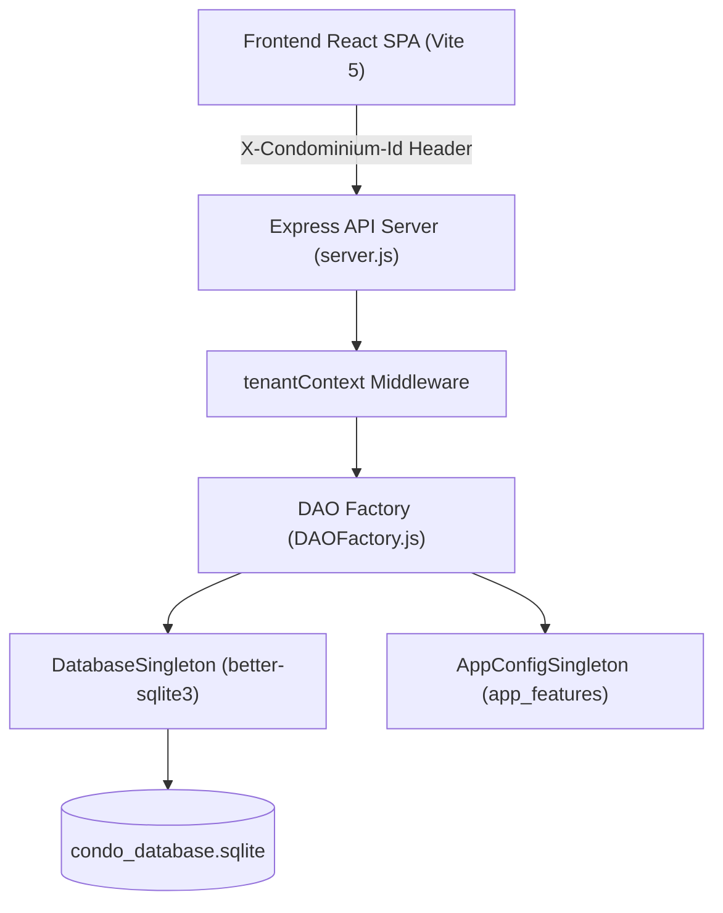
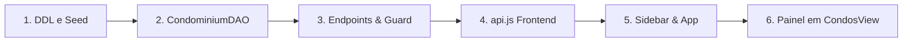
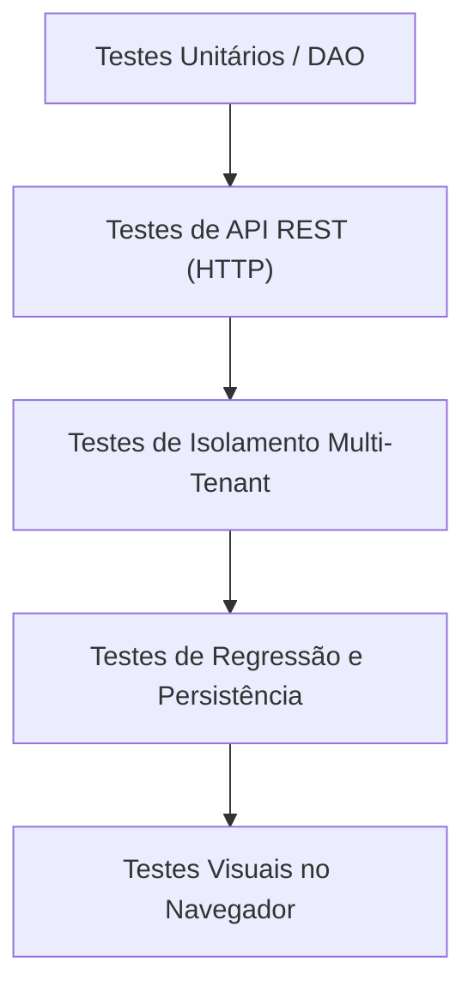

# 📋 PLANO DE AÇÃO TÉCNICO: MÓDULOS ATIVÁVEIS POR CONDOMÍNIO NO PRATICOM ERP

**Documento:** Plano de Ação e Auditoria Arquitetural para Modularização por Tenant  
**Projeto:** Praticom ERP (Sistema de Gestão Condominial Multi-Tenant)  
**Versão:** 1.0 — Auditoria Técnica e Planejamento  
**Data:** 12 de Outubro de 2026  
**Status:** Auditoria Concluída — Aguardando Aprovação Humana para Implementação  

---

## 1. Resumo Executivo

O **Praticom ERP** opera atualmente como uma plataforma de gestão condominial multi-tenant baseada em **React 18 + Vite** (frontend SPA em Vanilla CSS) e **Node.js + Express 4.18 + SQLite 3** (`better-sqlite3`, arquitetura com DAOs GoF, Singleton e middleware de contexto territorial).

O objetivo deste plano de ação é estabelecer as bases técnicas e arquiteturais para que o administrador do sistema possa **habilitar, desabilitar e editar a disponibilidade de módulos de forma independente para cada condomínio**, garantindo que:
1. Usuários de um condomínio visualizem e utilizem **somente** os módulos contratados/disponibilizados para a sua respectiva unidade condominial.
2. A configuração de disponibilidade de um condomínio seja **100% isolada e soberana**, sem contaminar outros condomínios.
3. As **3 áreas estruturais obrigatórias** permaneçam sempre ativas e disponíveis para qualquer condomínio.
4. A desativação de um módulo **nunca apague dados**, permitindo reativação íntegra a qualquer momento.
5. A restrição de módulos seja aplicada **tanto no frontend quanto no backend**, bloqueando chamadas diretas via API com códigos de status HTTP apropriados.
6. A solução seja **sutil, minimalista e exija o menor número possível de alterações** no código existente, reaproveitando as estruturas de dados e padrões já consolidados no repositório.

> **Regra de Ouro desta Etapa:** Conforme diretriz estrita, este documento compreende exclusivamente auditoria, diagnóstico e planejamento. **Nenhum arquivo de código existente foi alterado e o banco de dados operacional não sofreu modificações.**

---

## 2. Diagnóstico da Arquitetura Atual

A auditoria exaustiva realizada no repositório real identificou as seguintes características e fatos comprovados no código:

### 2.1 Stack e Padrões Estruturais Confirmados



* **Frontend (`client/`):**
  * SPA React 18 sem roteador externo (`react-router-dom` não é utilizado). A navegação ocorre por controle de estado interno `currentView` no componente raiz [`App.jsx`](file:///c:/Users/Heitor/Praticom_Broken/client/src/App.jsx).
  * Menu de navegação lateral gerenciado em [`Sidebar.jsx`](file:///c:/Users/Heitor/Praticom_Broken/client/src/components/Sidebar.jsx).
  * Cabeçalho [`Header.jsx`](file:///c:/Users/Heitor/Praticom_Broken/client/src/components/Header.jsx) com seletor de condomínio ativo [`CondominiumSelector.jsx`](file:///c:/Users/Heitor/Praticom_Broken/client/src/components/CondominiumSelector.jsx) e alternador visual de perfil (`role-switcher`).
  * Chamadas HTTP encapsuladas em [`api.js`](file:///c:/Users/Heitor/Praticom_Broken/client/src/services/api.js), que injeta automaticamente o cabeçalho `X-Condominium-Id: <id>` a partir do valor armazenado no `localStorage` (`praticom_active_condo_id`).
* **Backend (`server/`):**
  * Servidor Express único em [`server.js`](file:///c:/Users/Heitor/Praticom_Broken/server/server.js).
  * Middleware [`tenantContext.js`](file:///c:/Users/Heitor/Praticom_Broken/server/middleware/tenantContext.js) intercepta todas as requisições, valida o ID do condomínio no SQLite e injeta `req.condominiumId` e `req.condominiumName`.
  * Padrão **GoF Data Access Object (DAO)** em [`server/dao/`](file:///c:/Users/Heitor/Praticom_Broken/server/dao/), instanciado via [`DAOFactory.js`](file:///c:/Users/Heitor/Praticom_Broken/server/dao/DAOFactory.js).
  * Padrão **GoF Singleton** em [`DatabaseSingleton.js`](file:///c:/Users/Heitor/Praticom_Broken/server/config/DatabaseSingleton.js) (conexão SQLite única com foreign keys ativas e WAL mode) e [`AppConfigSingleton.js`](file:///c:/Users/Heitor/Praticom_Broken/server/config/AppConfigSingleton.js) (gerenciamento de Feature Flags).
* **Persistência de Dados:**
  * Banco relacional local `condo_database.sqlite` regulado por [`schema.sql`](file:///c:/Users/Heitor/Praticom_Broken/server/schema.sql).
  * Ausência total de arquivos JSON para persistência de dados de negócio (`features.json` e `condo_store.json` foram eliminados em refatorações anteriores registradas em `0md.md`).

---

## 3. Inventário dos Módulos e Suas Rotas

O sistema possui 9 visões/áreas principais. Abaixo está o mapeamento dos **seis módulos opcionais** especificados no requisito contra o código-fonte real:

| # | Módulo (Requisito) | ID no Frontend (`Sidebar.jsx` / `App.jsx`) | Componente View (`client/src/views/`) | DAO Responsável | Rotas Backend Associadas (`server.js`) |
| :-: | :--- | :--- | :--- | :--- | :--- |
| **1** | **Dashboard** | `dashboard` | [`DashboardView.jsx`](file:///c:/Users/Heitor/Praticom_Broken/client/src/views/DashboardView.jsx) | Agrega múltiplos DAOs (`DeliveryDAO`, `AccessDAO`, `FinancialDAO`, `AnnouncementDAO`, `ReservationDAO`) | `GET /api/dashboard` |
| **2** | **Portaria e acessos** | `access` | [`AccessControlView.jsx`](file:///c:/Users/Heitor/Praticom_Broken/client/src/views/AccessControlView.jsx) | `AccessDAO` ([`OperationsDAO.js`](file:///c:/Users/Heitor/Praticom_Broken/server/dao/OperationsDAO.js)) | `GET /api/access`<br>`POST /api/access/entry`<br>`PATCH /api/access/:id/exit`<br>`DELETE /api/access/:id` |
| **3** | **Controle de encomendas** | `deliveries` | [`DeliveriesView.jsx`](file:///c:/Users/Heitor/Praticom_Broken/client/src/views/DeliveriesView.jsx) | [`DeliveryDAO.js`](file:///c:/Users/Heitor/Praticom_Broken/server/dao/DeliveryDAO.js) | `GET /api/deliveries`<br>`POST /api/deliveries`<br>`PATCH /api/deliveries/:id/pickup` |
| **4** | **Reservas** | `reservations` | [`ReservationsView.jsx`](file:///c:/Users/Heitor/Praticom_Broken/client/src/views/ReservationsView.jsx) | [`ReservationDAO.js`](file:///c:/Users/Heitor/Praticom_Broken/server/dao/ReservationDAO.js) | `GET /api/spaces`<br>`GET /api/reservations`<br>`POST /api/reservations`<br>`PATCH /api/reservations/:id/cancel` |
| **5** | **Financeiro e taxas** | `financial` | [`FinancialView.jsx`](file:///c:/Users/Heitor/Praticom_Broken/client/src/views/FinancialView.jsx) | [`FinancialDAO.js`](file:///c:/Users/Heitor/Praticom_Broken/server/dao/FinancialDAO.js) | `GET /api/financial/summary`<br>`GET /api/financial/transactions`<br>`POST /api/financial/transactions`<br>`PATCH /api/financial/transactions/:id/pay`<br>`GET /api/financial/report` |
| **6** | **Mercadinho e estoque** | `market` | [`MarketInventoryView.jsx`](file:///c:/Users/Heitor/Praticom_Broken/client/src/views/MarketInventoryView.jsx) | [`MarketDAO.js`](file:///c:/Users/Heitor/Praticom_Broken/server/dao/MarketDAO.js) | `GET /api/market/products`<br>`POST /api/market/products`<br>`PATCH /api/market/products/:id/stock`<br>`POST /api/market/checkout`<br>`GET /api/market/sales` |

> [!NOTE]
> **Mapeamento de Nomenclatura:** Os identificadores canônicos já existentes no código para os 6 módulos opcionais são: **`dashboard`**, **`access`**, **`deliveries`**, **`reservations`**, **`financial`** e **`market`**. Para evitar código duplicado e garantir o mínimo impacto, **recomenda-se manter esses 6 identificadores exatos** como chaves internas do sistema.

---

## 4. Identificação das Três Áreas Obrigatórias

As **três áreas estruturais** abaixo devem permanecer **sempre disponíveis** para todos os condomínios, não sujeitas à desativação pelos switches de módulos:

| Área Obrigatória | ID no Frontend | Componente View | Justificativa de Obrigatoriedade | Rotas Backend Associadas |
| :--- | :--- | :--- | :--- | :--- |
| **1. Cadastro de Pessoas** | `residents` | [`ResidentsView.jsx`](file:///c:/Users/Heitor/Praticom_Broken/client/src/views/ResidentsView.jsx) | Base fundamental para identificar condôminos, proprietários, inquilinos, unidades habitacionais, veículos e pets. Sem pessoas e unidades, nenhuma operação condominial é possível. | `GET/POST/PATCH/DELETE /api/units*`<br>`GET/POST/PATCH/DELETE /api/residents*`<br>`GET/POST /api/vehicles`<br>`GET /api/pets` |
| **2. Condomínios e Blocos** | `territory` | [`CondominiumsBlocksView.jsx`](file:///c:/Users/Heitor/Praticom_Broken/client/src/views/CondominiumsBlocksView.jsx) | Gestão territorial mestre do sistema. É onde o administrador cadastra novos condomínios, gerencia blocos, associa unidades e gerencia a própria configuração de módulos. | `GET/POST/PATCH/DELETE /api/condominiums*`<br>`GET/POST/PATCH/DELETE /api/blocks*`<br>`GET /api/territory/pending-units`<br>`PATCH /api/blocks/:id/map-legacy-units` |
| **3. Mural de Avisos** | `announcements` | [`AnnouncementsView.jsx`](file:///c:/Users/Heitor/Praticom_Broken/client/src/views/AnnouncementsView.jsx) | Canal primário de comunicação formal e legal do condomínio (convocações de assembleias, avisos de emergência e comunicados gerais). | `GET/POST/DELETE /api/announcements*` |

### Regra de Incorporação à Navegação
Na [`Sidebar.jsx`](file:///c:/Users/Heitor/Praticom_Broken/client/src/components/Sidebar.jsx), esses três itens serão marcados como imutáveis/obrigatórios (`isMandatory: true`). Eles não serão filtrados pela lista de módulos opcionais ativos, garantindo que mesmo se um condomínio estiver com todos os 6 módulos opcionais desativados, o usuário ainda poderá navegar entre Pessoas, Estrutura Territorial e Comunicados.

---

## 5. Estado Atual do Sistema de Funcionalidades e Permissões

A auditoria realizou uma checagem rigorosa de cada componente exigido:

| Item Auditado | Classificação | Constatação Comprovada no Código |
| :--- | :---: | :--- |
| **Menu Lateral (`Sidebar.jsx`)** | **Confirmada no código** | Lista estática em `Sidebar.jsx` (linhas 16-26) mapeando os 9 itens com ícones e badges, sem nenhum filtro de permissão ou disponibilidade. |
| **Proteção de Rotas no Frontend** | **Ausente** | `App.jsx` realiza renderização condicional baseada apenas no estado `currentView`. Se o estado for setado, a tela é renderizada sem checar permissões. |
| **Contexto do Condomínio Ativo** | **Confirmada no código** | Armazenado em `localStorage('praticom_active_condo_id')` e injetado via header HTTP `X-Condominium-Id` em [`api.js`](file:///c:/Users/Heitor/Praticom_Broken/client/src/services/api.js). |
| **Sistema de Autenticação Real** | **Ausente** | Não existem tabelas de usuários do sistema (`system_users`), senhas, hashing bcrypt, tokens JWT ou sessões ativas no backend. |
| **Perfis de Usuários no Frontend** | **Parcialmente implementada** | [`Header.jsx`](file:///c:/Users/Heitor/Praticom_Broken/client/src/components/Header.jsx) possui um seletor visual (`admin`, `portaria`, `morador`), mas ele é apenas um mock de interface. O valor não altera regras de acesso nem é enviado ao backend. |
| **Perfis no Banco de Dados** | **Confirmada no código** | Tabela `residents` possui a coluna `role TEXT DEFAULT 'Proprietário'` (indica relação do morador com o imóvel), sem relação com login administrativo. |
| **Feature Flags Globais (LPS)** | **Confirmada no código** | Tabela `app_features` e classe [`AppConfigSingleton.js`](file:///c:/Users/Heitor/Praticom_Broken/server/config/AppConfigSingleton.js) controlam duas flags **globais** da Linha de Produtos de Software (`ENABLE_MARKETPLACE` e `ENABLE_ADVANCED_DELIVERIES`). **Não operam por condomínio**. |
| **Arquivo `features.json`** | **Ausente (Eliminado)** | O arquivo `server/config/features.json` foi excluído em refatorações passadas. As flags agora residem exclusivamente no SQLite (`app_features`). |
| **Middleware de Tenant Context** | **Confirmada no código** | [`tenantContext.js`](file:///c:/Users/Heitor/Praticom_Broken/server/middleware/tenantContext.js) valida `X-Condominium-Id` e injeta `req.condominiumId`. |
| **Isolamento de Dados nos DAOs** | **Confirmada no código** | DAOs filtram registros por `condominium_id` ou via `units -> blocks -> condominiums`. |
| **Testes Automatizados** | **Confirmada no código** | `server/tests/suite.js` (endpoints REST e flags globais), `verify_isolation.js` (isolamento cross-tenant) e `verify_multitenant_c.mjs`. |

---

## 6. Arquitetura Recomendada para Persistência

### 6.1 Comparação das Alternativas

Três alternativas de persistência foram comparadas para atender à necessidade:

```mermaid
classDiagram
    class Alternativa1_TabelaAssociação {
        +condominium_id : INTEGER (FK)
        +module_key : TEXT (PK)
        +enabled : INTEGER (0|1)
        +updated_at : DATETIME
    }
    class Alternativa2_ColunasBooleanas {
        +condominiums.module_dashboard : INTEGER
        +condominiums.module_access : INTEGER
        +condominiums.module_financial : INTEGER
        +...outras colunas fixas
    }
    class Alternativa3_Reaproveitar_app_features {
        +app_features.feature : TEXT
        +app_features.enabled : INTEGER
        +(Quebra padrão LPS Global)
    }
```

1. **Alternativa 1 — Tabela de Associação Relacional `condominium_modules` (RECOMENDADA):**
   * *Estrutura:* Tabela dedicada com chave primária composta `(condominium_id, module_key)`.
   * *Vantagens:* Padrão relacional normalizado; chave estrangeira com `ON DELETE CASCADE` limpa configurações ao excluir um condomínio; flexível para novos módulos sem alterar o schema da tabela `condominiums`; totalmente alinhada à política "zero JSON para dados operacionais".
   * *Desvantagens:* Requer uma tabela adicional e uma query de consulta.
2. **Alternativa 2 — Colunas Booleanas em `condominiums`:**
   * *Estrutura:* Adicionar 6 colunas (`has_dashboard`, `has_access`, etc.) na tabela `condominiums`.
   * *Vantagens:* Uma única query traz o condomínio e seus módulos.
   * *Desvantagens:* Schema rígido; polui a tabela mestre de condomínios com detalhes de licenciamento; cada novo módulo requer DDL `ALTER TABLE`.
3. **Alternativa 3 — Expandir `app_features`:**
   * *Estrutura:* Modificar a PK de `app_features` para `(condominium_id, feature)`.
   * *Vantagens:* Reaproveita tabela existente.
   * *Desvantagens:* **Não recomendada.** `app_features` foi concebida para a Linha de Produtos de Software (LPS) global da aplicação. Misturar flags de compilação/plataforma com módulos licenciáveis por cliente causa acoplamento e quebra o padrão Singleton de configuração global.

### 6.2 Especificação da Tabela Recomendada

A recomendação técnica definitiva é criar a tabela relacional **`condominium_modules`** no SQLite:

```sql
CREATE TABLE IF NOT EXISTS condominium_modules (
    condominium_id INTEGER NOT NULL,
    module_key TEXT NOT NULL CHECK (module_key IN ('dashboard', 'access', 'deliveries', 'reservations', 'financial', 'market')),
    enabled INTEGER NOT NULL DEFAULT 1 CHECK (enabled IN (0, 1)),
    updated_at DATETIME NOT NULL DEFAULT CURRENT_TIMESTAMP,
    PRIMARY KEY (condominium_id, module_key),
    FOREIGN KEY (condominium_id) REFERENCES condominiums(id) ON DELETE CASCADE
);

CREATE INDEX IF NOT EXISTS idx_condo_modules_lookup 
ON condominium_modules(condominium_id, module_key, enabled);
```

### 6.3 Comportamento do Ciclo de Vida da Configuração

* **Criação de Novo Condomínio (`POST /api/condominiums`):**
  * O condomínio é criado no banco.
  * O sistema executa um seed explícito na tabela `condominium_modules`.
  * **Regra Inicial:** Por padrão, um novo condomínio recebe seus 6 registros explicitamente criados com `enabled = 0` (todos opcionais desativados, ou conforme regra homologada na [Seção 15](#15-questões-pendentes-e-decisões-para-aprovação)).
  * As 3 áreas obrigatórias permanecem ativas por regra de negócio.
* **Migração do Condomínio Padrão Existente (ID 1 - Alpha):**
  * Para manter a compatibilidade retroativa e evitar regressões imediatas, o condomínio ID 1 recebe todos os 6 módulos como `enabled = 1`.
* **Persistência a Reinicializações:**
  * Como a tabela é gravada em disco no arquivo `condo_database.sqlite`, a configuração sobrevive a qualquer reinicialização do Node.js sem depender de memória ou cache volátil.
* **Exclusão de Condomínio:**
  * O `ON DELETE CASCADE` garante que a remoção de um condomínio apague automaticamente seus registros de módulos associados.

---

## 7. Fluxo Administrativo de Habilitação e Desabilitação

Para atender ao requisito de **impacto mínimo** e evitar a criação de novas páginas, a interface administrativa será integrada diretamente à tela já existente de **Condomínios & Blocos** ([`CondominiumsBlocksView.jsx`](file:///c:/Users/Heitor/Praticom_Broken/client/src/views/CondominiumsBlocksView.jsx)).

### 7.1 Experiência do Administrador

```
+------------------------------------------------------------------------------+
| Condomínios & Blocos > "Condomínio Alpha Praticom"                           |
+------------------------------------------------------------------------------+
| [Diretório de Condomínios]  | [Blocos do Condomínio]                         |
|                             |                                                |
|                             | [NOVO PAINEL] Módulos Ativos do Condomínio     |
|                             | ---------------------------------------------- |
|                             | [x] Dashboard & Visão Geral      (Ativo)       |
|                             | [x] Portaria & Controle Acessos  (Ativo)       |
|                             | [ ] Controle de Encomendas       (Inativo)     |
|                             | [x] Reservas de Áreas Comuns     (Ativo)       |
|                             | [ ] Gestão Financeira & Taxas    (Inativo)     |
|                             | [x] Mercadinho & Estoque         (Ativo)       |
|                             | ---------------------------------------------- |
|                             | Áreas Estruturais Obrigatórias:                |
|                             | (V) Cadastro de Pessoas  (V) Mural de Avisos   |
|                             | (V) Condomínios e Blocos                       |
|                             |                                                |
|                             | [ Cancelar ]          [ Salvar Módulos ]       |
+------------------------------------------------------------------------------+
```

### 7.2 Passos do Fluxo Administrativo

1. **Seleção:** O administrador clica em um condomínio na tabela do diretório em `CondominiumsBlocksView`.
2. **Visualização:** Uma nova seção discreta ("Módulos Disponíveis para este Condomínio") exibe os 6 módulos opcionais com switches de ativação e indicadores de status claros (`Ativo` / `Inativo`).
3. **Edição:** O administrador alterna os módulos desejados sem sair da página.
4. **Salvamento:** Ao clicar em "Salvar Módulos", uma requisição `PUT /api/condominiums/:id/modules` envia a lista de módulos atualizada.
5. **Feedback Visual:** Um toast de sucesso (`"Módulos do condomínio atualizados com sucesso!"`) é exibido. Se houver falha, um toast de perigo detalha o erro sem alterar o estado da tela.
6. **Sincronização em Tempo Real:**
   * Se o condomínio editado for o condomínio atualmente ativo no topo da tela, um evento global (`window.dispatchEvent(new Event('condo-modules-updated'))`) notifica o componente `Sidebar.jsx`, que re-renderiza o menu imediatamente.

---

## 8. Regras de Exibição da Navegação

### 8.1 Carregamento e Estado no Frontend

O componente [`App.jsx`](file:///c:/Users/Heitor/Praticom_Broken/client/src/App.jsx) manterá uma lista de módulos disponíveis para o condomínio ativo:

```javascript
// Exemplo conceitual da integração em App.jsx
const [availableModules, setAvailableModules] = useState(['dashboard', 'access', 'deliveries', 'reservations', 'financial', 'market']);
```

Sempre que o condomínio for alterado via `CondominiumSelector.jsx` ou recarregado:
1. Uma requisição `GET /api/condominiums/active/modules` busca a lista de módulos ativos para o `activeCondominiumId`.
2. A lista é repassada como prop para a [`Sidebar.jsx`](file:///c:/Users/Heitor/Praticom_Broken/client/src/components/Sidebar.jsx).

### 8.2 Filtragem no Menu Lateral (`Sidebar.jsx`)

Na [`Sidebar.jsx`](file:///c:/Users/Heitor/Praticom_Broken/client/src/components/Sidebar.jsx), a lista `menuItems` será filtrada antes da renderização:

```javascript
// Regra de filtragem sutil
const visibleMenuItems = menuItems.filter(item => {
  // 1. Áreas obrigatórias SEMPRE visíveis
  if (['residents', 'territory', 'announcements'].includes(item.id)) {
    return true;
  }
  // 2. Módulos opcionais dependem da configuração do condomínio ativo
  return availableModules.includes(item.id);
});
```

### 8.3 Proteção Contra Visualização Inconsistente em `App.jsx`

Se o usuário estiver visualizando uma tela (por exemplo, `financial`) e trocar para um condomínio onde `financial` está desativado:
1. O `App.jsx` detecta que `currentView` não consta em `visibleMenuItems`.
2. O sistema faz um fallback suave para uma área obrigatória segura:
   ```javascript
   if (!isViewAvailable(currentView, availableModules)) {
     setCurrentView('residents'); // Fallback para Cadastro de Pessoas
     showToast('O módulo anterior não está disponível no condomínio selecionado.', 'info');
   }
   ```
3. Se um usuário tentar forçar uma rota inexistente, o `App.jsx` exibe um componente de bloqueio informativo:
   > *"Módulo não contratado ou desativado para este condomínio. Entre em contato com a administração."*

---

## 9. Regras de Autorização do Backend

A segurança no backend é indispensável para evitar que requisições forçadas (via Postman, cURL ou script) acessem dados de módulos desativados.

### 9.1 Middleware Express: `checkModuleAvailability`

Em vez de espalhar checagens repetidas em cada rota, um middleware reutilizável será registrado em [`server/middleware/moduleGuard.js`](file:///c:/Users/Heitor/Praticom_Broken/server/middleware/):

```javascript
// server/middleware/moduleGuard.js (Conceito de Implementação Mínima)
import { DAOFactory } from '../dao/DAOFactory.js';

export const checkModuleAvailability = (moduleKey) => (req, res, next) => {
  const condominiumId = req.condominiumId; // Injetado previamente pelo tenantContextMiddleware
  const condoDAO = DAOFactory.getDAO('condominium');
  
  const isEnabled = condoDAO.isModuleEnabled(condominiumId, moduleKey);
  
  if (!isEnabled) {
    return res.status(403).json({
      error: `Acesso negado: o módulo '${moduleKey}' está desativado para este condomínio.`,
      module: moduleKey,
      disabled: true
    });
  }
  
  next();
};
```

### 9.2 Mapeamento de Proteção das Rotas da API

As seguintes rotas em [`server/server.js`](file:///c:/Users/Heitor/Praticom_Broken/server/server.js) serão protegidas pelo middleware correspondente:

| Módulo | Middleware de Proteção | Rotas Afetadas em `server.js` |
| :--- | :--- | :--- |
| **`dashboard`** | `checkModuleAvailability('dashboard')` | `GET /api/dashboard` |
| **`access`** | `checkModuleAvailability('access')` | `GET /api/access`<br>`POST /api/access/entry`<br>`PATCH /api/access/:id/exit`<br>`DELETE /api/access/:id` |
| **`deliveries`** | `checkModuleAvailability('deliveries')` | `GET /api/deliveries`<br>`POST /api/deliveries`<br>`PATCH /api/deliveries/:id/pickup` |
| **`reservations`**| `checkModuleAvailability('reservations')`| `GET /api/spaces`<br>`GET /api/reservations`<br>`POST /api/reservations`<br>`PATCH /api/reservations/:id/cancel` |
| **`financial`** | `checkModuleAvailability('financial')` | `GET /api/financial/summary`<br>`GET /api/financial/transactions`<br>`POST /api/financial/transactions`<br>`PATCH /api/financial/transactions/:id/pay`<br>`GET /api/financial/report` |
| **`market`** | `checkModuleAvailability('market')` | `GET /api/market/products`<br>`POST /api/market/products`<br>`PATCH /api/market/products/:id/stock`<br>`POST /api/market/checkout`<br>`GET /api/market/sales` |

### 9.3 Tratamento Especial: Rota Agregadora `GET /api/dashboard`

A rota `GET /api/dashboard` consolida dados de múltiplos DAOs (entregas, portaria, financeiro, reservas, avisos).
* **Se o módulo `dashboard` estiver desativado:** O endpoint responde `403 Forbidden`.
* **Se o módulo `dashboard` estiver ATIVO, mas algum submódulo (ex: `financial`) estiver DESATIVADO:**
  * O dashboard **não deve falhar**.
  * A rota consulta os módulos ativos do condomínio e suprime os cálculos do submódulo inativo:
    ```javascript
    // No endpoint do dashboard:
    const hasFinancial = condoDAO.isModuleEnabled(condominiumId, 'financial');
    const hasDeliveries = condoDAO.isModuleEnabled(condominiumId, 'deliveries');
    
    const summary = hasFinancial ? financialDAO.getSummary({ condominiumId }) : { default_amount: 0, default_rate: 0 };
    const deliveries = hasDeliveries ? deliveryDAO.getDeliveries({ condominiumId }) : [];
    ```
  * O frontend do dashboard renderiza apenas os cards dos submódulos disponíveis, sem erros no console.

---

## 10. Estratégia de Isolamento Entre Condomínios

### 10.1 Isolamento Físico e Lógico no Banco

Cada linha da tabela `condominium_modules` possui como chave primária `(condominium_id, module_key)`.
* Atualizações executadas pelo administrador do Condomínio A operam estritamente com `WHERE condominium_id = A`.
* É impossível que a alteração de módulos do Condomínio A modifique registros de módulos do Condomínio B.
* Um condomínio novo inicia com seu próprio conjunto de tuplas, sem compartilhar apontamentos ou ponteiros em memória.

### 10.2 Preservação Integral dos Dados ao Desativar

Desativar um módulo altera apenas a flag de disponibilidade (`enabled = 0` na tabela `condominium_modules`).
* **Nenhum registro operacional é excluído:** As tabelas `deliveries`, `access_logs`, `reservations`, `financial_transactions` e `market_products` continuam com todos os dados históricos salvos.
* **Reativação Transparente:** Ao mudar a flag para `enabled = 1`, o módulo volta a aparecer na navegação e os usuários voltam a acessar o histórico completo de transações e registros sem perda de dados.
* **Integridade Referencial:** Tabelas dependentes de chaves estrangeiras não sofrem impacto, pois as chaves continuam íntegras no SQLite.

---

## 11. Plano de Implementação com Impacto Mínimo

O princípio norteador é o **reaproveitamento máximo dos padrões existentes** (DAO, Singleton, Middleware e Fetch Service), realizando cirurgias pontuais no código.



### Resumo das Modificações Previstas:
1. **Banco:** Uma tabela nova (`condominium_modules`) criada via migration idempotente em `DatabaseSingleton.js` e adicionada em `schema.sql`.
2. **Backend DAO:** 3 métodos simples adicionados em [`CondominiumDAO.js`](file:///c:/Users/Heitor/Praticom_Broken/server/dao/CondominiumDAO.js) (`getModules`, `setModules`, `isModuleEnabled`).
3. **Backend Middleware:** Criação de `server/middleware/moduleGuard.js` (apenas 20 linhas).
4. **Backend Rotas:** Registro do middleware `checkModuleAvailability` nas rotas em `server.js` e 2 rotas novas (`GET/PUT /api/condominiums/:id/modules`).
5. **Frontend API:** Adição de 2 métodos em [`api.js`](file:///c:/Users/Heitor/Praticom_Broken/client/src/services/api.js) (`getCondoModules`, `updateCondoModules`).
6. **Frontend Navegação:** Filtro de array em [`Sidebar.jsx`](file:///c:/Users/Heitor/Praticom_Broken/client/src/components/Sidebar.jsx) e verificação de fallback em [`App.jsx`](file:///c:/Users/Heitor/Praticom_Broken/client/src/App.jsx).
7. **Frontend Gestão:** Seção de switches em [`CondominiumsBlocksView.jsx`](file:///c:/Users/Heitor/Praticom_Broken/client/src/views/CondominiumsBlocksView.jsx).

---

## 12. Arquivos que Precisarão Ser Alterados e Justificativa

A tabela a seguir comprova por que cada alteração é necessária e por que não há alternativa menos invasiva:

| Arquivo Alvo | Natureza da Alteração | Justificativa Técnica | Alternativa Menos Invasiva Analisada |
| :--- | :--- | :--- | :--- |
| [`server/schema.sql`](file:///c:/Users/Heitor/Praticom_Broken/server/schema.sql) | Adição do DDL `CREATE TABLE IF NOT EXISTS condominium_modules` | Documenta o schema relacional oficial para novos ambientes e testes. | Nenhuma. O schema deve ser a fonte da verdade do SQLite. |
| [`server/config/DatabaseSingleton.js`](file:///c:/Users/Heitor/Praticom_Broken/server/config/DatabaseSingleton.js) | Inclusão de migration idempotente em `applyCompatibilityMigrations` | Cria a tabela automaticamente caso o banco já exista sem recriá-lo do zero. | Executar migration manual via script avulso (mais suscetível a erro operacional). |
| [`server/dao/CondominiumDAO.js`](file:///c:/Users/Heitor/Praticom_Broken/server/dao/CondominiumDAO.js) | Adição dos métodos `getModules(condoId)`, `setModules(condoId, modules)`, `isModuleEnabled(condoId, module)` | Encapsula o acesso SQL seguindo rigorosamente o padrão GoF DAO existente. | Criar um novo DAO avulso `ModuleDAO` (aumentaria complexidade e classes desnecessárias). |
| `server/middleware/moduleGuard.js` *(Novo)* | Criação de middleware Express com função `checkModuleAvailability(moduleKey)` | Centraliza a proteção de rotas no backend em um único ponto reutilizável. | Espalhar `if (!isModuleEnabled) return 403` dentro de cada rota de `server.js` (código poluído e duplicado). |
| [`server/server.js`](file:///c:/Users/Heitor/Praticom_Broken/server/server.js) | Aplicação do middleware `checkModuleAvailability` nas rotas dos 6 módulos e registro dos endpoints de consulta/edição de módulos | Bloqueia chamadas HTTP diretas no backend e provê API para o frontend gerenciar módulos. | Deixar o backend aberto e filtrar apenas no React (inseguro, viola requisito). |
| [`client/src/services/api.js`](file:///c:/Users/Heitor/Praticom_Broken/client/src/services/api.js) | Adição de `getCondominiumModules(id)` e `updateCondominiumModules(id, data)` | Centraliza as chamadas de API do frontend no padrão de serviço já estabelecido. | Fazer `fetch` direto dentro dos componentes React (quebra padrão da arquitetura). |
| [`client/src/App.jsx`](file:///c:/Users/Heitor/Praticom_Broken/client/src/App.jsx) | Carregar módulos ativos do condomínio selecionado e validar fallback do `currentView` | Garante que o usuário não permaneça em uma tela cujo módulo foi desativado. | Forçar recarregamento total da página via `window.location.reload()` (experiência ruim). |
| [`client/src/components/Sidebar.jsx`](file:///c:/Users/Heitor/Praticom_Broken/client/src/components/Sidebar.jsx) | Filtrar `menuItems` com base na lista de módulos disponíveis recebida via props | Oculta os itens desativados e garante exibição permanente das 3 áreas obrigatórias. | Criar componentes de menu separados por perfil (duplicação de código). |
| [`client/src/views/CondominiumsBlocksView.jsx`](file:///c:/Users/Heitor/Praticom_Broken/client/src/views/CondominiumsBlocksView.jsx) | Adicionar card/seção de gerenciamento de módulos para o condomínio selecionado | Oferece a interface para o síndico ativar/desativar módulos com checkboxes/switches discretos. | Criar uma nova tela inteira apenas para isso (viola regra de impacto mínimo). |

---

## 13. Plano de Testes

O plano de testes prevê validação automatizada e testes de aceitação manual para garantir zero regressão:



### 13.1 Casos de Teste Automatizados (`server/tests/verify_modules.mjs`)

| ID | Cenário de Teste | Procedimento | Critério de Aprovação |
| :-: | :--- | :--- | :--- |
| **CT-01** | Seed de condomínio legado (Alpha) | Inspecionar banco após inicialização. | Condomínio ID 1 possui os 6 módulos com `enabled = 1`. |
| **CT-02** | Inicialização de novo condomínio | Criar condomínio novo via `POST /api/condominiums`. | Novo condomínio possui configuração explícita e isolada. |
| **CT-03** | Isolamento de configuração entre tenants | Desativar `financial` no Condomínio 1 e manter ativo no Condomínio 2. | Condomínio 1 retorna `enabled = 0`; Condomínio 2 permanece `enabled = 1`. |
| **CT-04** | Bloqueio de API por módulo inativo | Chamar `GET /api/financial/summary` com header `X-Condominium-Id: 1` (onde `financial` está desativado). | Resposta HTTP `403 Forbidden` com corpo indicando módulo desativado. |
| **CT-05** | Liberação de API por módulo ativo | Chamar `GET /api/financial/summary` com header `X-Condominium-Id: 2` (onde `financial` está ativo). | Resposta HTTP `200 OK` com dados válidos. |
| **CT-06** | Preservação de dados ao desativar | Criar transação financeira, desativar o módulo financeiro, reativar o módulo e consultar. | A transação original permanece intacta e consultável. |
| **CT-07** | Disponibilidade imutável das áreas obrigatórias | Consultar endpoints de `residents`, `territory` e `announcements`. | Respondem `200 OK` independente da configuração dos 6 módulos opcionais. |
| **CT-08** | Persistência após reinício do backend | Alterar módulos, encerrar o processo Node.js, reiniciar e consultar a API. | A configuração gravada no SQLite mantém-se inalterada. |

### 13.2 Casos de Teste de Interface / Usuário

* **Navegação:** Confirmar que ao alternar entre condomínios no seletor do topo, a `Sidebar` atualiza instantaneamente as opções exibidas.
* **Fallback Seguro:** Confirmar que ao desativar o módulo da tela em que o usuário está, o sistema redireciona com toast para uma área obrigatória.
* **Feedback Visual:** Confirmar que o salvamento na tela de Condomínios e Blocos exibe toast de confirmação e atualiza os switches imediatamente.

---

## 14. Riscos e Medidas Preventivas

| Risco Identificado | Severidade | Impacto Potencial | Medida Preventiva Planejada |
| :--- | :---: | :--- | :--- |
| **Quebra do endpoint do Dashboard** | **Alta** | Se um submódulo (ex: financeiro) estiver inativo, `DashboardView` pode falhar ao buscar métricas que o backend tente calcular. | A rota `/api/dashboard` verificará módulos ativos e omitirá/zerará métricas de módulos desativados graciosamente. |
| **Falha de redirecionamento no frontend** | **Média** | O usuário pode ver uma tela em branco ou erro de fetch se o módulo for desativado enquanto ele está nela. | Validação automática no `App.jsx` com fallback imediato para `residents` e exibição de aviso amigável. |
| **Regressão na suíte de testes existente (`suite.js`)** | **Média** | A suíte atual `suite.js` roda testes em endpoints de todos os módulos sem especificar condomínio (usa ID 1). | O condomínio 1 manterá todos os módulos habilitados por padrão no seed inicial da tabela, mantendo `suite.js` 100% verde. |
| **Tentativa de spoofing de header (`X-Condominium-Id`)** | **Média** | Sem login JWT ativo, um usuário pode trocar o cabeçalho manualmente para outro condomínio. | O middleware valida se o condomínio existe e está `ACTIVE`. A dependência de login JWT fica registrada para a fase de segurança do projeto. |

---

## 15. Questões Pendentes e Decisões para Aprovação

Antes de iniciar a implementação do código, as seguintes decisões de arquitetura e produto necessitam de aprovação:

1. **Configuração Padrão para Novos Condomínios:**
   * *Opção A (Recomendada):* Novos condomínios iniciam com **todos os 6 módulos opcionais desabilitados**, cabendo ao administrador habilitar conforme o contrato do condomínio.
   * *Opção B:* Novos condomínios iniciam com **todos os 6 módulos ativados**, cabendo ao administrador desativar o que não for usado.
   * *Opção C:* Novos condomínios iniciam apenas com **Dashboard ativado** e os demais 5 opcionais desativados.
2. **Localização Exata da Interface de Gestão:**
   * *Opção A (Recomendada):* Painel dedicado integrado dentro de [`CondominiumsBlocksView.jsx`](file:///c:/Users/Heitor/Praticom_Broken/client/src/views/CondominiumsBlocksView.jsx), exibido logo abaixo dos blocos ao selecionar um condomínio.
   * *Opção B:* Modal suspenso acionado por um botão de engrenagem (`⚙️ Módulos`) na tabela de condomínios.
3. **Comportamento do Dashboard com Submódulos Inativos:**
   * Aprovação do comportamento de supressão silenciosa (exibir card com traço ou ocultar o card do submódulo inativo no dashboard).

---

## 16. Checklist de Conclusão da Fase de Planejamento

- [x] Auditoria completa do código realizada sem alterar arquivos.
- [x] Mapeamento dos 6 módulos opcionais e suas rotas vigentes confirmado.
- [x] Identificação das 3 áreas obrigatórias confirmada.
- [x] Status do sistema de autenticação, LPS e persistência investigado e documentado.
- [x] Arquitetura de persistência relacional normalizada (`condominium_modules`) desenhada.
- [x] Regras de autorização por middleware no backend projetadas.
- [x] Regras de filtragem e proteção no frontend definidas.
- [x] Estratégia de preservação e isolamento de dados detalhada.
- [x] Impacto mínimo no código planejado com justificativa para cada arquivo.
- [x] Plano de testes automatizados e manuais definido.
- [x] Matriz de riscos e medidas preventivas documentada.
- [x] Questões para aprovação humana consolidadas.
- [x] Documento [`PLANO_ACAO_MODULOS_POR_CONDOMINIO.md`](file:///c:/Users/Heitor/Praticom_Broken/PLANO_ACAO_MODULOS_POR_CONDOMINIO.md) gerado na raiz do projeto.
