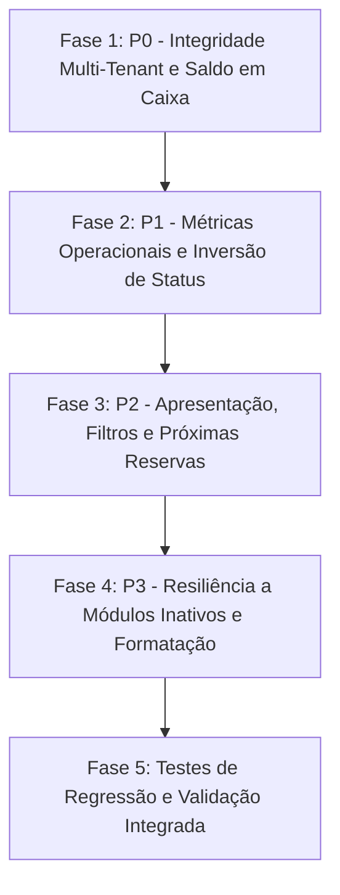

# PLANO DE CORREÇÃO DO DASHBOARD — PRATICOM ERP

Este plano organiza as ações corretivas necessárias para solucionar todos os problemas diagnosticados na auditoria do Dashboard do Praticom ERP, estruturado da maior criticidade (P0) para a menor (P3), garantindo menor impacto e preservando a integridade das demais partes do sistema.

> [!IMPORTANT]
> **Conforme as restrições da auditoria, nenhuma alteração de código ou banco de dados foi executada nesta etapa.** Este plano detalha exatamente os arquivos, trechos, lógica e testes a serem executados na etapa de implementação.

---

## 1. Visão Geral das Fases



---

## 2. Detalhamento por Fase de Implementação

### Fase 1: Correções Críticas e Integridade Multi-Tenant (P0)

#### 1.1 Correção do Vazamento Multi-Tenant em Despesas Corporativas
- **Arquivo:** `server/dao/FinancialDAO.js`
- **Problema:** Cláusula `AND (f.condominium_id = 1 OR f.condominium_id IS NULL OR b.condominium_id = 1 OR u.block_id IS NULL)` captura despesas corporativas (`unit_id IS NULL`) de qualquer outro condomínio.
- **Mudança Mínima Necessária:**
  Garantir que despesas com `f.condominium_id` preenchido com outro ID nunca sejam associadas ao condomínio 1:
  ```javascript
  // server/dao/FinancialDAO.js
  if (condominiumId) {
    const cId = parseInt(condominiumId, 10);
    if (cId === 1) {
      whereClause += ' AND (f.condominium_id = 1 OR (f.condominium_id IS NULL AND (b.condominium_id = 1 OR u.block_id IS NULL)))';
      unitWhereClause += ' AND (b.condominium_id = 1 OR u.block_id IS NULL)';
    } else {
      whereClause += ' AND (f.condominium_id = ? OR (f.condominium_id IS NULL AND b.condominium_id = ?))';
      params.push(cId, cId);
      unitWhereClause += ' AND b.condominium_id = ?';
      unitParams.push(cId);
    }
  }
  ```
- **Validação:** Rodar `financialDAO.getSummary({ condominiumId: 1 })` e checar se despesas de outros condomínios (IDs 2, 3, 6) foram expurgadas do somatório.

---

#### 1.2 Unificação de Chaves e Envio do Saldo em Caixa (`metrics.balance`)
- **Arquivos:** `server/server.js` e `server/dao/FinancialDAO.js`
- **Problema:** Backend calcula `currentBalance`, mas não envia `balance` nem `currentBalance` dentro do objeto `data.metrics`. O frontend busca `metrics.balance` e exibe sempre `R$ 0,00`.
- **Mudança Mínima Necessária:**
  1. No `server/server.js`:
     ```javascript
     metrics: {
       balance: hasFinancial ? (summary.currentBalance || 0) : null,
       currentBalance: hasFinancial ? (summary.currentBalance || 0) : null,
       pendingDeliveries: hasDeliveries ? pendingDeliveries.length : null,
       ...
     }
     ```
  2. No `client/src/views/DashboardView.jsx`:
     ```jsx
     const balanceValue = metrics.balance ?? metrics.currentBalance ?? 0;
     ```
- **Validação:** Carregar o Dashboard no navegador e validar se o card "Saldo em Caixa" exibe o valor formatado em reais correspondente ao saldo real do condomínio ativo.

---

### Fase 2: Correções de Métricas Operacionais e Inversão de Status (P1)

#### 2.1 Alinhamento do Contador de Visitantes Ativos (`activeVisitors`)
- **Arquivos:** `server/server.js` e `client/src/views/DashboardView.jsx`
- **Problema:** O backend envia `activeAccess`, enquanto o frontend e a Sidebar buscam `activeVisitors`.
- **Mudança Mínima Necessária:**
  No `server/server.js`:
  ```javascript
  metrics: {
    ...
    activeVisitors: hasAccess ? activeAccess.length : null,
    activeAccess: hasAccess ? activeAccess.length : null, // compatibilidade
  }
  ```
- **Validação:** Acessar o Dashboard e verificar se o número de visitantes no imóvel bate com os registros com status `'inside'` ou `'IN_PROPERTY'` e se a badge na Sidebar acende.

---

#### 2.2 Correção da Inversão de Status na Portaria ("No Condomínio" vs "Saiu")
- **Arquivo:** `client/src/views/DashboardView.jsx`
- **Problema:** O ternário só reconhece `'inside'`. Registros novos possuem `'IN_PROPERTY'`, fazendo com que pessoas dentro do condomínio apareçam com badge verde "Saiu".
- **Mudança Mínima Necessária:**
  No `client/src/views/DashboardView.jsx` (linha 166):
  ```jsx
  {['inside', 'IN_PROPERTY'].includes(log.status) ? (
    <span className="badge badge-warning">No Condomínio</span>
  ) : (
    <span className="badge badge-success">Saiu</span>
  )}
  ```
- **Validação:** Cadastrar uma nova entrada de visitante e verificar se a tabela "Fluxo da Portaria em Tempo Real" do Dashboard o exibe como "No Condomínio".

---

#### 2.3 Cálculo e Exposição de "Reservas de Hoje" (`todayReservations`)
- **Arquivo:** `server/server.js`
- **Problema:** A contagem de reservas para o dia corrente não é calculada no endpoint `/api/dashboard`.
- **Mudança Mínima Necessária:**
  No `server/server.js`:
  ```javascript
  const todayStr = new Date().toISOString().split('T')[0];
  const todayReservations = reservations.filter(r => 
    r.reservation_date === todayStr && 
    ['CONFIRMED', 'Confirmada'].includes(r.status)
  );

  // Injetar em metrics:
  todayReservations: hasReservations ? todayReservations.length : null
  ```
- **Validação:** Agendar um espaço para a data de hoje e comprovar que o card "Reservas de Hoje" e a badge na Sidebar exibem `1`.

---

#### 2.4 Integração do Minimercado e "Estoque Baixo" (`lowStockItems`)
- **Arquivo:** `server/server.js`
- **Problema:** `marketDAO` não é consultado em `/api/dashboard`, deixando o card e a badge do Mercadinho permanentemente em zero.
- **Mudança Mínima Necessária:**
  No `server/server.js`:
  ```javascript
  const hasMarket = condominiumDAO.isModuleEnabled(condominiumId, 'market');
  const marketProducts = hasMarket ? marketDAO.getProducts({ condominiumId }) : [];
  const lowStockItems = marketProducts.filter(p => p.stock_quantity <= (p.min_stock || 5));

  // Injetar em metrics:
  lowStockItems: hasMarket ? lowStockItems.length : null
  ```
- **Validação:** Verificar produtos do Condomínio 1 com estoque <= 5 e atestar que o card do Dashboard exibe o total correto com estilo de alerta.

---

#### 2.5 Exposição de Inadimplência e Unidades em Atraso (`overdueCount`, `overdueAmount`)
- **Arquivos:** `server/dao/FinancialDAO.js` e `server/server.js`
- **Problema:** `overdueCount` é calculado mas omitido no `return` de `FinancialDAO.getSummary`. `summary.default_amount` não existe (o valor real está em `summary.income.overdue`).
- **Mudança Mínima Necessária:**
  1. No `server/dao/FinancialDAO.js`:
     ```javascript
     return {
       ...
       overdueCount,
       ...
     };
     ```
  2. No `server/server.js`:
     ```javascript
     metrics: {
       ...
       overdueCount: hasFinancial ? (summary.overdueCount || 0) : null,
       overdueAmount: hasFinancial ? (summary.income?.overdue || 0) : null,
     }
     ```
- **Validação:** Conferir se o subtítulo do card de saldo exibe "X unidades em atraso" quando houver inadimplência e "Taxas em dia" quando zero.

---

### Fase 3: Apresentação, Filtros e Próximas Reservas (P2)

#### 3.1 Nome Dinâmico do Condomínio no Banner de Boas-Vindas
- **Arquivos:** `client/src/App.jsx` e `client/src/views/DashboardView.jsx`
- **Problema:** O texto `"Condomínio Residencial Parque das Flores"` está hardcoded.
- **Mudança Mínima Necessária:**
  1. No `App.jsx`, obter o condomínio ativo (ou passar objeto de condomínio ativo como prop `activeCondo`).
  2. No `DashboardView.jsx`, receber `activeCondo` e renderizar `{activeCondo?.name || 'Condomínio Ativo'}`.
- **Validação:** Selecionar condomínios diferentes no Header e verificar a atualização instantânea do nome no banner.

---

#### 3.2 Correção do Filtro de Prioridade nos Comunicados Urgentes
- **Arquivo:** `server/server.js`
- **Problema:** Filtro compara estritamente com `'URGENTE'` ou `'high'`, ignorando `'urgent'`.
- **Mudança Mínima Necessária:**
  ```javascript
  const urgentAnnouncements = announcements.filter(a => 
    ['URGENTE', 'URGENT', 'HIGH'].includes(String(a.priority || '').toUpperCase())
  );
  ```
- **Validação:** Publicar comunicado urgente via interface e verificar sua aparição no card lateral "Avisos em Destaque".

---

#### 3.3 Filtro Temporal e Ordenação Cronológica em "Próximas Reservas"
- **Arquivos:** `server/dao/ReservationDAO.js` e `server/server.js`
- **Problema:** Ordena por `reservation_date DESC` sem filtrar datas passadas, exibindo reservas antigas como se fossem futuras.
- **Mudança Mínima Necessária:**
  Filtrar reservas futuras (`reservation_date >= todayStr`) e com status confirmado, ordenando por `reservation_date ASC, start_time ASC`.
  ```javascript
  const upcomingReservations = reservations
    .filter(r => r.reservation_date >= todayStr && ['CONFIRMED', 'Confirmada'].includes(r.status))
    .sort((a, b) => a.reservation_date.localeCompare(b.reservation_date) || a.start_time.localeCompare(b.start_time));
  ```
- **Validação:** Garantir que o card "Próximas Reservas" exiba apenas eventos a partir de hoje em ordem cronológica de realização.

---

### Fase 4: Polimento, Resiliência a Módulos Inativos e Formatações (P3)

#### 4.1 Resiliência Visual para Módulos Desativados
- **Arquivo:** `client/src/views/DashboardView.jsx`
- **Problema:** Quando um módulo está inativo, a métrica retorna `null`, mas o card exibe `0` ou `R$ 0,00` e continua clicável.
- **Mudança Mínima Necessária:**
  Receber `availableModules` em `DashboardView.jsx`. Se `!availableModules.includes(moduleKey)`, exibir badge "Inativo" no card, opacidade reduzida e desabilitar `cursor: pointer` e clique de navegação.

---

#### 4.2 Precisão de Ponto Flutuante no Saldo Financeiro
- **Arquivo:** `server/dao/FinancialDAO.js`
- **Mudança Mínima Necessária:**
  Garantir precisão de duas casas decimais no cálculo:
  `currentBalance: parseFloat((incomePaid - expensePaid).toFixed(2))`

---

#### 4.3 Formatação de Datas de Reservas para Padrão Brasileiro
- **Arquivo:** `client/src/views/DashboardView.jsx`
- **Mudança Mínima Necessária:**
  Substituir `{res.reservation_date}` por função de formatação para `DD/MM/YYYY`:
  `{res.reservation_date.split('-').reverse().join('/')}`

---

## 3. Matriz de Risco e Plano de Rollback

| Ação Corretiva | Risco Potencial | Mitigação | Estratégia de Rollback |
| :--- | :--- | :--- | :--- |
| **Isolamento de Despesas (1.1)** | Ocultar despesas legítimas legadas do Condomínio 1. | Manter a condição de compatibilidade para `condominium_id IS NULL`, restringindo apenas IDs explicitamente diferentes de 1. | Reverter condição do `whereClause` em `FinancialDAO.js`. |
| **Normalização de Chaves (1.2, 2.1)** | Quebrar clientes ou testes que consumiam o formato anterior. | Retornar simultaneamente ambas as chaves (`balance` e `currentBalance`, `activeVisitors` e `activeAccess`). | Nenhuma quebra esperada, backward-compatible. |
| **Status da Portaria (2.2)** | Quebrar novos logs de saída. | Aceitar múltiplos valores em array `['inside', 'IN_PROPERTY']`. | Reverter ternário no JSX. |
| **Filtro de Reservas (3.3)** | Lista de próximas reservas ficar vazia se não houver agendamentos futuros. | Componente já possui estado vazio gracioso ("Nenhuma reserva para os próximos dias"). | Reverter método de ordenação. |

---

## 4. Próximos Passos Recomendados

1. **Aprovação do Plano:** Alinhar com a equipe as prioridades e o escopo de execução.
2. **Execução em Etapas:** Aplicar primeiramente a Fase 1 e Fase 2 (erros de cálculo e integridade), seguidas pelas Fases 3 e 4.
3. **Execução da Suite de Testes:** Rodar `node server/tests/suite.js` e `node server/tests/verify_isolation.js` para garantir que nenhuma regressão ocorra.
