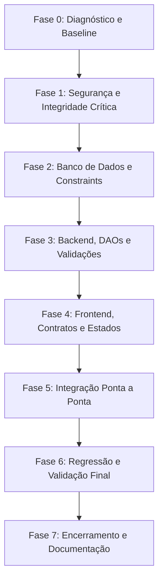

# PLANO INDIVIDUAL E PRIORIZADO DE CORREÇÃO — PRATICOM ERP

Este documento estabelece o plano técnico individual para a correção de cada um dos 17 problemas diagnosticados na auditoria, seguido pelo cronograma de execução por fases, focado na segurança, preservação absoluta dos dados existentes e compatibilidade arquitetural.

---

## 1. Planos Individuais de Correção

---

### BUG-001 — Restrição `UNIQUE(block, number)` colide unidades entre condomínios

1. **Qual é o problema?** A constraint de unicidade atual impede que dois condomínios diferentes cadastrem um apartamento de mesmo número no mesmo nome de bloco (ex: Torre A, apto 101).
2. **Causa raiz:** O schema definiu `UNIQUE(block, number)` sobre o nome textual do bloco, em vez de `UNIQUE(block_id, number)` sobre a chave estrangeira do bloco vinculada ao condomínio.
3. **Arquivos/Tabelas envolvidos:** `server/schema.sql`, `server/config/DatabaseSingleton.js`, `server/dao/ResidentDAO.js`; tabela `units`.
4. **Dependências:** Nenhuma.
5. **Menor alteração segura:** No DAO, garantir a validação de unicidade por `block_id` e `number`. No SQLite, migrar a tabela `units` via tabela temporária para substituir a constraint por `UNIQUE(block_id, number)`.
6. **Alteração no schema / migração:** Sim. É necessária uma migração segura de DDL que recrie `units`.
7. **Preservação de dados:** Executar `CREATE TABLE units_new ...`, copiar dados com `INSERT INTO units_new SELECT ...`, dropar a antiga e renomear `units_new` para `units` dentro de uma transação SQLite.
8. **Testes necessários:** Teste automatizado criando o mesmo número de apartamento em dois blocos de condomínios diferentes.
9. **Possíveis regressões:** Unidades legadas sem `block_id` (`NULL`). A migração deve atribuir temporariamente o `block_id` padrão do Bloco Alpha ou permitir nulos sem quebrar.
10. **Validação:** Script `tests/verify_isolation.js` executando criação de unidades idênticas em condomínios distintos com sucesso.

---

### BUG-002 — Checkout no PDV em cota condominial omite `condominium_id`

1. **Qual é o problema?** Compras no mercadinho faturadas via cota condominial criam registros em `financial_transactions` com `condominium_id = NULL`, fazendo a cobrança vazar para o caixa do Condomínio 1.
2. **Causa raiz:** O método `marketDAO.checkout` não recebe e não grava `condominium_id` na inserção financeira.
3. **Arquivos/Tabelas envolvidos:** `server/server.js` (rota `/api/market/checkout`), `server/dao/MarketDAO.js` (`checkout`); tabela `financial_transactions`.
4. **Dependências:** Nenhuma.
5. **Menor alteração segura:** Repassar `condominium_id: req.condominiumId` do `server.js` para o `MarketDAO.checkout` e incluir a coluna no `INSERT INTO financial_transactions`.
6. **Alteração no schema:** Nenhuma. A coluna `condominium_id` já existe na tabela.
7. **Preservação de dados:** Atualizar registros órfãos existentes que possuem categoria "Mercadinho" recuperando o condomínio através do `unit_id` correspondente.
8. **Testes necessários:** Teste de compra no PDV no Condomínio 2 e verificação de que `financial_transactions` recebeu `condominium_id = 2`.
9. **Possíveis regressões:** Nenhuma.
10. **Validação:** Verificar se o saldo do Condomínio 2 é atualizado e o saldo do Condomínio 1 permanece inalterado.

---

### BUG-003 — Mutação e exclusão por ID sem checagem de tenant (Vulnerabilidade IDOR)

1. **Qual é o problema?** Usuários podem alterar status ou excluir encomendas, comunicados, moradores, reservas e produtos de outros condomínios fornecendo apenas o ID numérico.
2. **Causa raiz:** Consultas de mutação (`UPDATE` e `DELETE`) usam apenas `WHERE id = ?` sem validar se o registro pertence ao `condominium_id` da requisição.
3. **Arquivos/Tabelas envolvidos:** `server/server.js`, `DeliveryDAO.js` (`pickupDelivery`), `OperationsDAO.js` (`registerExit`, `deleteAnnouncement`), `ReservationDAO.js` (`cancelReservation`), `ResidentDAO.js` (`deleteResident`, `deleteUnit`), `MarketDAO.js` (`updateStock`).
4. **Dependências:** Nenhuma.
5. **Menor alteração segura:** Passar `req.condominiumId` para esses métodos e incluir verificação de posse prévia ou cláusula `AND condominium_id = ?` (com join territorial em unidades).
6. **Alteração no schema:** Nenhuma.
7. **Preservação de dados:** Não altera estrutura ou registros existentes.
8. **Testes necessários:** Tentar excluir morador do condomínio 1 com header `X-Condominium-Id: 2` e verificar retorno 404/403.
9. **Possíveis regressões:** Nenhuma, desde que o fallback para condomínio 1 seja respeitado nos dados legados.
10. **Validação:** Execução da suíte de segurança confirmando bloqueio de operações cross-tenant.

---

### BUG-004 — Criação de registros dependentes sem validar vínculo territorial (ID Spoofing)

1. **Qual é o problema?** Requisições de cadastro aceitam `unit_id` ou `space_id` de outro condomínio.
2. **Causa raiz:** O backend insere chaves estrangeiras sem checar se elas pertencem ao condomínio autenticado.
3. **Arquivos/Tabelas envolvidos:** `server/dao/ResidentDAO.js`, `DeliveryDAO.js`, `OperationsDAO.js`, `ReservationDAO.js`.
4. **Dependências:** BUG-003.
5. **Menor alteração segura:** Antes de inserir, executar `SELECT id FROM units u LEFT JOIN blocks b ON u.block_id = b.id WHERE u.id = ? AND b.condominium_id = ?` e abortar com 400 se não pertencer.
6. **Alteração no schema:** Nenhuma.
7. **Preservação de dados:** Preservação total.
8. **Testes necessários:** Teste de inserção com `unit_id` cruzada esperando rejeição.
9. **Possíveis regressões:** Nenhuma.
10. **Validação:** Testes de integração automatizados.

---

### BUG-005 — Incompatibilidade de enum de status em Reservas (`CONFIRMED` vs `Confirmada`)

1. **Qual é o problema?** A tela de Reservas não identifica horários ocupados, exibe badge vermelho de erro para reservas ativas e omite o botão de cancelamento.
2. **Causa raiz:** O backend retorna `'CONFIRMED'` e o frontend compara estritamente com `'Confirmada'`.
3. **Arquivos/Tabelas envolvidos:** `client/src/views/ReservationsView.jsx` (linhas 98, 362, 369).
4. **Dependências:** Nenhuma.
5. **Menor alteração segura:** No frontend, comparar `['CONFIRMED', 'CONFIRMADA'].includes(r.status?.toUpperCase())`.
6. **Alteração no schema:** Nenhuma.
7. **Preservação de dados:** Preservação total.
8. **Testes necessários:** Carregar a tela de reservas em data com reserva agendada.
9. **Possíveis regressões:** Nenhuma.
10. **Validação:** O slot aparece bloqueado em vermelho ("Reservado"), a tabela exibe badge verde ("Confirmada") e o botão "Cancelar" fica clicável.

---

### BUG-006 — Contrato quebrado no Dashboard (`/api/dashboard` vs frontend)

1. **Qual é o problema?** Os cards do Dashboard executivo mostram R$ 0,00 de saldo e contagens zeradas porque os nomes das chaves retornadas pelo backend não batem com o que o React consome.
2. **Causa raiz:** Divergência de propriedades entre o objeto montado em `server/server.js` e as variáveis consumidas em `DashboardView.jsx` e `Sidebar.jsx`.
3. **Arquivos/Tabelas envolvidos:** `server/server.js` (rota `/api/dashboard`), `client/src/views/DashboardView.jsx`, `client/src/components/Sidebar.jsx`.
4. **Dependências:** Nenhuma.
5. **Menor alteração segura:** Em `server.js`, retornar as chaves esperadas (`balance`, `activeVisitors`, `overdueCount`, `todayReservations`, `lowStockItems`) calculadas diretamente das DAOs correspondentes.
6. **Alteração no schema:** Nenhuma.
7. **Preservação de dados:** Preservação total.
8. **Testes necessários:** Chamar `GET /api/dashboard` e validar a presença de todas as chaves no JSON.
9. **Possíveis regressões:** Nenhuma.
10. **Validação:** Todos os cartões de métricas do Dashboard e badges da barra lateral exibem valores reais.

---

### BUG-007 — Divergência entre DDL declarada e banco real (Foreign Keys ausentes)

1. **Qual é o problema?** As tabelas `announcements`, `spaces`, `market_products` e `units` não possuem restrições de Foreign Key ativas no SQLite em produção.
2. **Causa raiz:** As colunas foram adicionadas via `ALTER TABLE ADD COLUMN` durante compatibilizações prévias.
3. **Arquivos/Tabelas envolvidos:** `server/config/DatabaseSingleton.js`, `server/schema.sql`, `condo_database.sqlite`.
4. **Dependências:** Nenhuma.
5. **Menor alteração segura:** Criar rotina controlada em `DatabaseSingleton.js` que verifica via `PRAGMA foreign_key_list` se as FKs existem; caso contrário, executa migração com recriação de tabela em transação.
6. **Alteração no schema / migração:** Sim, migração controlada de estrutura.
7. **Preservação de dados:** Cópia completa dos dados existentes garantida por transação atômica.
8. **Testes necessários:** Executar `PRAGMA foreign_key_list` e `PRAGMA foreign_key_check`.
9. **Possíveis regressões:** Falha se houver registros com IDs órfãos atualmente no banco. Deve-se fazer limpeza de órfãos antes da constraint.
10. **Validação:** `PRAGMA foreign_key_check` retornando zero violações.

---

### BUG-008 — Filtro de prioridade na tela de comunicados ignorado pelo backend

1. **Qual é o problema?** A seleção de prioridade (Urgente, Alta, Normal, Baixa) no select da tela de comunicados não filtra os registros.
2. **Causa raiz:** O DAO `AnnouncementDAO.getAnnouncements` não recebe o argumento `priority` e não aplica `AND priority = ?` no SQL.
3. **Arquivos/Tabelas envolvidos:** `server/dao/OperationsDAO.js` (`AnnouncementDAO`), `server/server.js`.
4. **Dependências:** Nenhuma.
5. **Menor alteração segura:** Incluir `priority` nos parâmetros de `getAnnouncements` e adicionar a cláusula no SQL.
6. **Alteração no schema:** Nenhuma.
7. **Preservação de dados:** Preservação total.
8. **Testes necessários:** Requisição com `?priority=urgent` retornando apenas registros urgentes.
9. **Possíveis regressões:** Nenhuma.
10. **Validação:** Selecionar prioridade no frontend e ver a lista filtrada em tempo real.

---

### BUG-009 — Listagens com potencial de crescimento contínuo sem paginação

1. **Qual é o problema?** Consultas de histórico carregam todas as linhas do banco sem limites, arriscando lentidão futura.
2. **Causa raiz:** Ausência de `LIMIT` e `OFFSET` nas consultas.
3. **Arquivos/Tabelas envolvidos:** DAOs de Acessos, Encomendas, Financeiro e Vendas.
4. **Dependências:** Nenhuma.
5. **Menor alteração segura:** Adicionar suporte opcional aos parâmetros `limit` e `offset`, mantendo padrão amplo se não informados para não quebrar telas.
6. **Alteração no schema:** Nenhuma.
7. **Preservação de dados:** Preservação total.
8. **Testes necessários:** Teste de consulta com `limit=5`.
9. **Possíveis regressões:** Nenhuma.
10. **Validação:** Endpoints respondem com paginação quando solicitados.

---

### BUG-010 — Cláusula booleana duplicada/redundante no conflito de reservas

1. **Qual é o problema?** Condição duplicada com operador `OR` no SQL de verificação de reservas.
2. **Causa raiz:** Código duplicado por cópia e cola.
3. **Arquivos/Tabelas envolvidos:** `server/dao/ReservationDAO.js` (linhas 72-78).
4. **Dependências:** Nenhuma.
5. **Menor alteração segura:** Remover a repetição e manter a condição única canônica `(start_time < ? AND end_time > ?)`.
6. **Alteração no schema:** Nenhuma.
7. **Preservação de dados:** Preservação total.
8. **Testes necessários:** Teste de tentativa de agendamento no mesmo horário.
9. **Possíveis regressões:** Nenhuma.
10. **Validação:** O bloqueio de sobreposição de reservas continua funcionando identicamente.

---

### BUG-011 — Nome de condomínio estático hardcoded no banner do Dashboard

1. **Qual é o problema?** O banner de boas-vindas exibe sempre "Condomínio Residencial Parque das Flores" independente do condomínio ativo.
2. **Causa raiz:** String estática no JSX.
3. **Arquivos/Tabelas envolvidos:** `client/src/views/DashboardView.jsx` (linha 32), `client/src/App.jsx`.
4. **Dependências:** Nenhuma.
5. **Menor alteração segura:** Obter o nome do condomínio selecionado e renderizá-lo dinamicamente.
6. **Alteração no schema:** Nenhuma.
7. **Preservação de dados:** Preservação total.
8. **Testes necessários:** Alternar de condomínio e observar o banner.
9. **Possíveis regressões:** Nenhuma.
10. **Validação:** O banner acompanha o condomínio ativo selecionado no cabeçalho.

---

### BUG-012 — Seletor de Perfil (Role Switcher) meramente visual

1. **Qual é o problema?** Trocar entre Síndico, Portaria e Morador não altera permissões reais.
2. **Causa raiz:** Mock visual mantido sem lógica de autorização correspondente.
3. **Arquivos/Tabelas envolvidos:** `client/src/components/Header.jsx`, `client/src/components/Sidebar.jsx`, `client/src/App.jsx`.
4. **Dependências:** RISK-001.
5. **Menor alteração segura:** No frontend, filtrar abas administrativas (ex: Condomínios & Blocos e Financeiro) quando o papel selecionado for "Morador" ou "Portaria".
6. **Alteração no schema:** Nenhuma.
7. **Preservação de dados:** Preservação total.
8. **Testes necessários:** Clicar no botão "Morador" e validar que o menu lateral oculta menus restritos.
9. **Possíveis regressões:** Nenhuma.
10. **Validação:** Interface reage visualmente de acordo com o papel ativo.

---

### RISK-001 — Ausência total de autenticação/sessão

1. **Qual é o problema?** A API aceita qualquer `X-Condominium-Id` sem conferência de credenciais.
2. **Causa raiz:** Ausência de módulo de autenticação.
3. **Arquivos/Tabelas envolvidos:** `server/server.js`, `server/middleware/tenantContext.js`, `client/src/services/api.js`.
4. **Dependências:** Nenhuma.
5. **Menor alteração segura:** Criar tabela de usuários, endpoint `/api/auth/login` e middleware JWT que injeta o tenant validado a partir do token.
6. **Alteração no schema:** Criação da tabela `users` com senha em hash bcrypt.
7. **Preservação de dados:** Criar usuário admin inicial sem afetar dados condominiais existentes.
8. **Testes necessários:** Requisições não autenticadas recebendo 401.
9. **Possíveis regressões:** Necessidade de tela de login para o usuário.
10. **Validação:** Testes de login e proteção de rotas com token.

---

### RISK-002 — Concorrência síncrona do SQLite (`better-sqlite3`)

1. **Qual é o problema?** Transações longas podem causar contenção de escrita e travamento temporário no Event Loop.
2. **Causa raiz:** Driver síncrono monothread.
3. **Arquivos/Tabelas envolvidos:** `server/config/DatabaseSingleton.js`.
4. **Dependências:** Nenhuma.
5. **Menor alteração segura:** Configurar `PRAGMA busy_timeout = 5000` na inicialização do banco.
6. **Alteração no schema:** Nenhuma.
7. **Preservação de dados:** Preservação total.
8. **Testes necessários:** Execução concorrente de requisições de escrita.
9. **Possíveis regressões:** Nenhuma.
10. **Validação:** Zero erros `SQLITE_BUSY` sob testes paralelos.

---

### RISK-003 — Risco de orfandade de dados em exclusões manuais sem cascade

1. **Qual é o problema?** Exclusão de condomínios ou blocos pode deixar registros sem pai em tabelas complementares.
2. **Causa raiz:** Checagem de dependências manual incompleta.
3. **Arquivos/Tabelas envolvidos:** `server/dao/CondominiumDAO.js`.
4. **Dependências:** BUG-007.
5. **Menor alteração segura:** Verificar todas as tabelas dependentes (`announcements`, `market_products`, `spaces`) antes de permitir a exclusão do condomínio.
6. **Alteração no schema:** Nenhuma.
7. **Preservação de dados:** Preservação total.
8. **Testes necessários:** Tentar excluir condomínio com produtos cadastrados e validar erro 409.
9. **Possíveis regressões:** Nenhuma.
10. **Validação:** Exclusão é bloqueada com mensagem clara apontando os registros vinculados.

---

### INV-001 — Regra "Limite de 1h de reserva por morador/dia" não fiscalizada no Backend

1. **Qual é o problema?** Moradores podem agendar múltiplos horários no mesmo dia apesar do aviso na tela.
2. **Causa raiz:** O DAO de reservas não calcula o total de horas já reservadas pelo morador na data.
3. **Arquivos/Tabelas envolvidos:** `server/dao/ReservationDAO.js`.
4. **Dependências:** Nenhuma.
5. **Menor alteração segura:** Em `createReservation`, somar as horas ativas do morador/unidade no dia e rejeitar se ultrapassar 1h.
6. **Alteração no schema:** Nenhuma.
7. **Preservação de dados:** Preservação total.
8. **Testes necessários:** Criar duas reservas para a mesma unidade na mesma data e validar rejeição da segunda.
9. **Possíveis regressões:** Nenhuma.
10. **Validação:** O backend bloqueia com mensagem: "Limite diário de 1 hora por morador já atingido para esta data".

---

### INV-002 — Ausência de restrição de unicidade para CPF e Placa

1. **Qual é o problema?** Possibilidade de cadastros duplicados do mesmo CPF ou placa na mesma unidade/condomínio.
2. **Causa raiz:** Falta de índices únicos e validação no DAO.
3. **Arquivos/Tabelas envolvidos:** `server/dao/ResidentDAO.js`, `server/schema.sql`.
4. **Dependências:** Nenhuma.
5. **Menor alteração segura:** Validar no DAO antes de inserir se o CPF (se fornecido) ou a placa já constam no condomínio ativo.
6. **Alteração no schema:** Criar índices consultivos para busca rápida.
7. **Preservação de dados:** Não aplicar restrição rígida em dados legados antes de saneamento.
8. **Testes necessários:** Tentar cadastrar dois veículos com a mesma placa no mesmo condomínio.
9. **Possíveis regressões:** Rejeição de cadastros duplicados legítimos (ex: mesmo morador em unidades diferentes). A validação deve ser por condomínio.
10. **Validação:** Rejeição clara em caso de duplicidade não autorizada.

---

## 2. Plano de Execução Priorizado por Fases

A sequência de execução recomendada respeita estritamente as dependências arquiteturais e a preservação total dos dados:

### Fase 0 — Diagnóstico e Baseline (Concluída nesta auditoria)
- Mapeamento completo da arquitetura e das divergências entre banco, backend e frontend.
- Identificação e catalogação detalhada dos 17 problemas.
- Garantia de ambiente intacto sem alterações em código ou dados.

### Fase 1 — Segurança e Integridade Crítica (P0)
- **Correções:** BUG-002 (Vazamento financeiro do PDV) e BUG-003 (Vulnerabilidades IDOR Cross-Tenant).
- **Justificativa:** Estancar imediatamente qualquer vazamento de dados contábeis e bloquear manipulações indevidas entre condomínios.

### Fase 2 — Banco de Dados e Constraints (P0 e P1)
- **Correções:** BUG-001 (Colisão `UNIQUE(block, number)` em `units`) e BUG-007 (Foreign Keys ausentes em runtime).
- **Ações:** Executar migração segura via tabela temporária em transação única, preservando 100% dos dados reais do `condo_database.sqlite`. Ativar `PRAGMA busy_timeout = 5000` (RISK-002).

### Fase 3 — Backend, DAOs e Regras de Negócio (P1 e P2)
- **Correções:** BUG-004 (Validação de posse territorial), BUG-008 (Filtro de prioridade de anúncios), BUG-010 (Limpeza da query de reservas), INV-001 (Limite de 1h/dia em reservas) e RISK-003 (Proteção contra orfandade).
- **Ações:** Implementar validações de escopo territorial em todas as inserções e garantir consultas consistentes.

### Fase 4 — Frontend, Contratos de API e Estados Visuais (P1 e P2)
- **Correções:** BUG-005 (Enum `'CONFIRMED'` em reservas), BUG-006 (Contrato de métricas do Dashboard), BUG-011 (Nome dinâmico no banner) e BUG-012 (Adequação visual de perfis).
- **Ações:** Alinhar os contratos consumidos pelo React para eliminar todos os valores zerados e desbloquear a grade de horários.

### Fase 5 — Integração Ponta a Ponta
- **Ações:** Testar os fluxos completos do usuário em todos os módulos ativos (Dashboard, Portaria, Encomendas, Moradores, Reservas, Financeiro, Mural e Mercadinho).

### Fase 6 — Testes de Regressão Automatizados
- **Ações:** Executar as suítes `verify_modules.mjs`, `verify_isolation.js` e `suite.js`, garantindo 100% de aprovação e zero regressão nas funcionalidades preexistentes.

### Fase 7 — Encerramento
- **Ações:** Atualizar as checklists com evidências dos testes de cada correção e documentar o estado consolidado da versão auditada.
