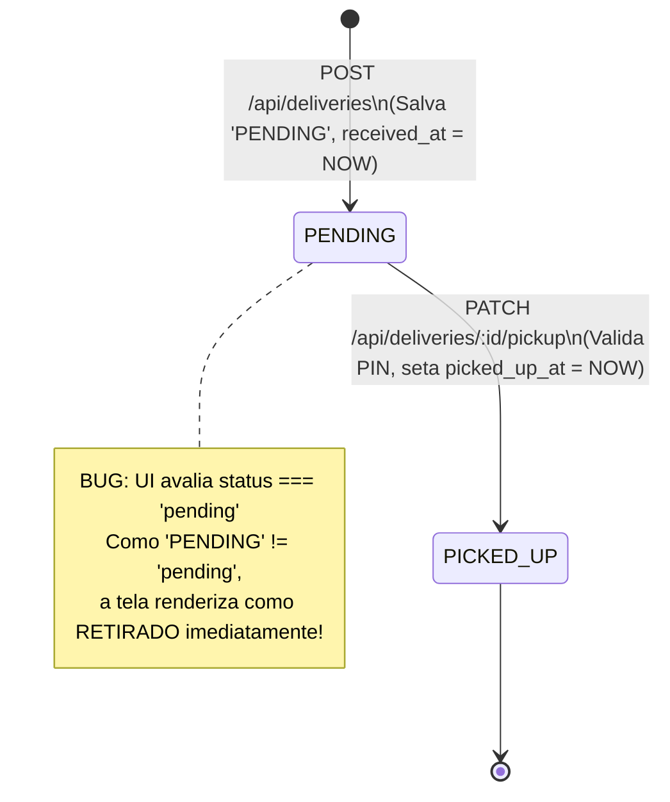
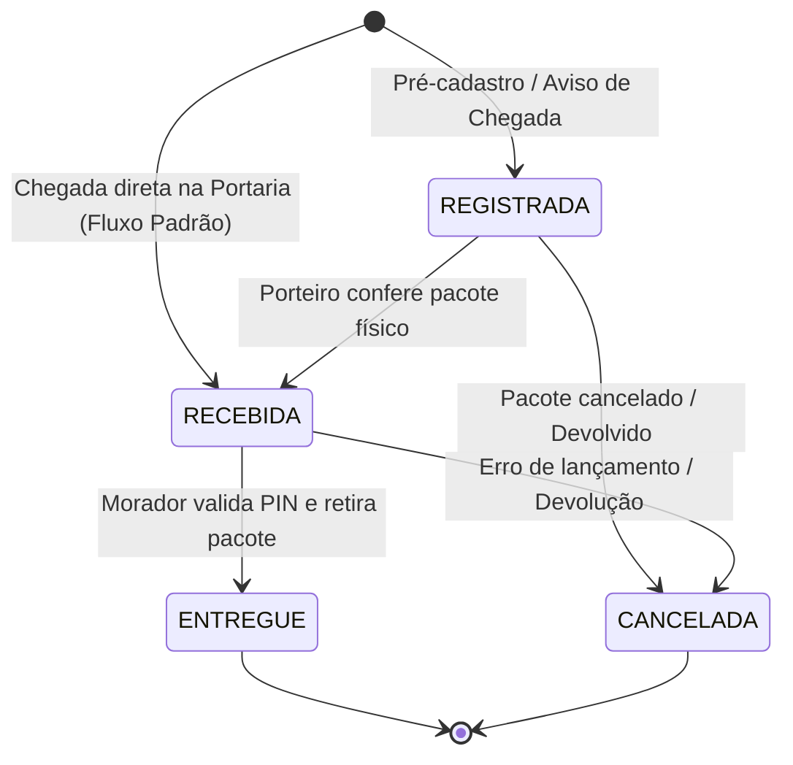

# PLANO DE MELHORIAS — CONTROLE DE ENCOMENDAS (PRATICOM ERP)

> **Status:** Diagnóstico Técnico Concluído & Plano Estrutural Aprovado  
> **Data:** 12 de Outubro de 2026  
> **Módulo:** Controle de Encomendas (`deliveries`)  
> **Escopo:** Auditoria de Código, Arquitetura de Dados, Isolamento Multi-condomínio e Especificação de Soluções  
> **Regra de Ouro:** Nenhuma alteração de código ou banco foi realizada nesta etapa.

---

## 1. Resumo do Funcionamento Atual

A auditoria técnica realizada no módulo **Controle de Encomendas** revelou que a funcionalidade possui uma infraestrutura relacional real no SQLite e padrões arquiteturais GoF (DAO, Singleton e Template Method), porém apresenta **inconsistências graves de contrato de dados entre camadas**, **lacunas críticas de CRUD (ausência completa de edição e exclusão)** e um **fluxo de status que colapsa etapas físicas do condomínio**.

### Principais Fatos Identificados:
1. **O Bug da "Baixa Prematura":** Ao cadastrar uma encomenda via modal, o backend insere no banco o status `'PENDING'` (em letras maiúsculas). No entanto, o frontend (`DeliveriesView.jsx` e `DashboardView.jsx`) avalia a expressão estrita `pkg.status === 'pending'` (em minúsculas). Como a comparação resulta em `false`, o sistema assume incorretamente o ramo `else`, renderizando a encomenda como se já estivesse **"Retirada / Entregue"**, exibindo a data inválida de retirada (`31/12/1969` ou `Invalid Date`) e ocultando os botões de ação ("Dar Baixa").
2. **Inexistência Total de Edição:** Não existe implementação de edição em nenhuma camada do sistema — não há botões ou modais na interface, não há método no cliente de API (`api.js`), não há rota Express (`PATCH/PUT /api/deliveries/:id`) e não há método `updateDelivery()` no `DeliveryDAO.js`.
3. **Inexistência Total de Exclusão ou Cancelamento:** Não há qualquer endpoint `DELETE /api/deliveries/:id`, método no DAO ou interface para remoção/cancelamento. Encomendas registradas por engano ou duplicadas tornam-se lixo indelével no banco.
4. **Ciclo de Vida Reduzido:** A criação atribui compulsoriamente `received_at = CURRENT_TIMESTAMP` e dispara imediatamente a notificação com PIN ao morador. O sistema não distingue o registro prévio/notificação de entrega do recebimento físico na portaria.
5. **Vulnerabilidades de Isolamento Multi-Condomínio (BOLA / IDOR):** As operações de mutação (`POST /api/deliveries` e `PATCH /api/deliveries/:id/pickup`) não validam se a unidade ou a encomenda pertencem ao condomínio ativo no header `X-Condominium-Id`. Além disso, a tabela `deliveries` não possui a coluna direta `condominium_id`, dependendo exclusivamente de joins indiretos com `units` e `blocks`.

---

## 2. Mapa dos Arquivos e Componentes Envolvidos

A tabela a seguir consolida todos os arquivos do ecossistema envolvidos no módulo de encomendas:

| Camada | Arquivo / Componente | Papel / Responsabilidade Atual |
| :--- | :--- | :--- |
| **Banco de Dados (DDL)** | `server/schema.sql` (L84–101) | Criação da tabela `deliveries` e índice `idx_deliveries_status`. Define `status DEFAULT 'pending'`, chaves estrangeiras com `units` e `residents`. Não possui `condominium_id` direto. |
| **Persistência / DAO** | `server/dao/DeliveryDAO.js` | Métodos `getDeliveries()`, `createDelivery()`, `pickupDelivery()`. Utiliza `DatabaseSingleton.js` e dispara notificações via `DeliveryNotificationDispatcher`. |
| **Notificações (GoF)** | `server/services/templates/NotificationTemplate.js` | Implementação do padrão *Template Method* (`DeliveryNotificationDispatcher`) para disparar logs de envio de PIN ao morador. |
| **Controlador / Rotas** | `server/server.js` (L130–167) | Endpoints REST: `GET /api/deliveries`, `POST /api/deliveries`, `PATCH /api/deliveries/:id/pickup`. Protegidos pelo middleware `checkModuleAvailability('deliveries')`. |
| **Métricas / Dashboard** | `server/server.js` (L94–96) | Cálculo de `pendingDeliveries` para o KPI do dashboard. Nota: precisou de gambiarra `status === 'pending' \|\| status === 'PENDING'`. |
| **Cliente HTTP Frontend** | `client/src/services/api.js` (L65–70) | Funções `getDeliveries(params)`, `createDelivery(data)`, `pickupDelivery(id, data)`. |
| **Visão Principal** | `client/src/views/DeliveriesView.jsx` | Interface de encomendas: barra de busca, filtro por status, tabela com badges de status, modais `isNewModalOpen` e `isPickupModalOpen`. |
| **Visão de Painel** | `client/src/views/DashboardView.jsx` (L53–62, L180–234) | Card de métrica "Encomendas Pendentes" e tabela "Últimas Encomendas Recebidas" com renderização de status. |
| **Navegação / Sidebar** | `client/src/components/Sidebar.jsx` (L20) | Item de menu "Controle de Encomendas" com badge contador `stats?.pendingDeliveries`. |
| **Testes Automatizados** | `server/tests/suite.js` | Apenas testa `GET /api/deliveries` (status 200). Não possui testes para criação, baixa, edição ou isolamento. |

---

## 3. Fluxo Atual vs. Proposta do Ciclo de Vida dos Status

### 3.1. Diagnóstico do Fluxo Atual



**Problemas do Fluxo Atual:**
- Ao registrar, assume-se que o pacote já está fisicamente recebido (`received_at = NOW`).
- Se um morador ou a portaria cadastrar previamente uma encomenda esperada (com código de rastreio), ela já queima a etapa de conferência física.
- Não há como estornar ou cancelar uma encomenda lançada por engano.
- Mistura caótica de strings de status no banco: `'pending'`, `'PENDING'`, `'delivered'`, `'PICKED_UP'`.

---

### 3.2. Proposta do Ciclo de Vida Padronizado

Propõe-se um fluxo robusto de 4 estados fundamentais, padronizados em caixa alta (`UPPERCASE`), garantindo retrocompatibilidade com os dados existentes:



### Detalhamento dos Estados Propostos:

| Status Proposto | Significado | Situação de Atribuição | Ação para Avançar | Ator Responsável | Informações Obrigatórias Registradas | Transições Proibidas |
| :--- | :--- | :--- | :--- | :--- | :--- | :--- |
| **`REGISTRADA`** | Encomenda pré-cadastrada no sistema (aviso de compra/rastreio) antes da chegada física à portaria. | Quando o morador ou portaria cadastra a encomenda com código de rastreio antes da van dos Correios/transportadora chegar. | "Confirmar Recebimento Físico" na portaria. | Portaria ou Morador | `unit_id`, `courier`, `tracking_code`, `registered_at`, `registered_by`. | Não pode ir diretamente para `ENTREGUE` sem ser recebida fisicamente. |
| **`RECEBIDA`** *(Estado padrão na portaria)* | O pacote físico foi descarregado, conferido e guardado na portaria. O PIN de retirada é ativado e o morador é notificado. | Quando o entregador entrega o pacote na portaria (ou quando uma encomenda `REGISTRADA` chega fisicamente). | "Dar Baixa / Entregar ao Morador" com verificação de PIN. | Porteiro / Operador de Portaria | `received_at` (timestamp), `received_by`, `pickup_code` (4 dígitos), `notes` (ex: gaveta/escaninho). | Não pode voltar para `REGISTRADA`. |
| **`ENTREGUE`** | Pacote entregue em mãos ao morador ou pessoa autorizada. | Quando o morador comparece à portaria e fornece o PIN correto. | Conclusão do ciclo (estado final). | Porteiro / Morador | `picked_up_at` (timestamp), `picked_up_by` (nome de quem retirou), validação de `pickup_code`. | Não pode transicionar para `REGISTRADA`, `RECEBIDA` ou `CANCELADA`. |
| **`CANCELADA`** | Registro invalidado por erro de digitação, duplicidade, extravio da transportadora ou devolução. | Quando identificado erro no cadastro ou recusa do pacote. | Nenhuma (estado terminal). Registro preservado para auditoria. | Síndico, Administrador ou Porteiro autorizado | `cancelled_at`, `cancelled_by`, `cancellation_reason` (motivo do cancelamento). | Não pode transicionar para nenhum outro estado. |

> **Nota sobre o fluxo prático da portaria:**  
> No cotidiano da maioria dos condomínios, 90% das encomendas chegam direto com a van. Por isso, o modal de cadastro da portaria terá a opção padrão **"Cadastrar como Recebida Físico"** (cria direto em `RECEBIDA`), mantendo a agilidade do porteiro em apenas um clique, mas permitindo também o pré-aviso (`REGISTRADA`).

---

## 4. Análise de Campos e Melhorias no Cadastro e Listagem

### 4.1. Auditoria dos Campos de Dados

| Campo | Presente no Schema Atual? | Tipo Atual | Situação e Necessidade de Melhoria |
| :--- | :--- | :--- | :--- |
| `id` | Sim | `INTEGER PK AUTO` | Adequado. |
| `unit_id` | Sim | `INTEGER FK` | Adequado. Deve possuir validação estrita de pertencimento ao condomínio ativo. |
| `resident_id` | Sim | `INTEGER FK NULL` | Adequado. Pode ser nulo se o pacote for destinado apenas ao apartamento. |
| `courier` | Sim | `TEXT NOT NULL` | Adequado (transportadora: Mercado Livre, Amazon, etc.). |
| `tracking_code` | Sim | `TEXT NULL` | Adequado. |
| `description` | Sim | `TEXT NULL` | Adequado (volume, descrição da embalagem). |
| `status` | Sim | `TEXT DEFAULT 'pending'` | **Necessita Padronização:** Unificar enum no backend/frontend para `REGISTRADA`, `RECEBIDA`, `ENTREGUE`, `CANCELADA`. Tratar legados (`pending` -> `RECEBIDA`, `delivered`/`PICKED_UP` -> `ENTREGUE`). |
| `pickup_code` | Sim | `TEXT NOT NULL` | Adequado (código numérico de 4 dígitos para conferência). |
| `notes` | Sim | `TEXT NULL` | Adequado (observações de localização interna na portaria). |
| `registered_at` | **Não** | — | **Novo campo necessário:** Marca temporal de quando o registro foi criado no sistema (atualmente usa `received_at`). |
| `registered_by` | **Não** | — | **Novo campo necessário:** Identificação de quem efetuou o cadastro (login/porteiro). |
| `received_at` | Sim | `DATETIME` | Manter, mas atribuir apenas quando o pacote for fisicamente recebido na portaria. |
| `received_by` | **Não** | — | **Novo campo necessário:** Nome do porteiro que recebeu fisicamente a entrega. |
| `picked_up_at` | Sim | `DATETIME NULL` | Manter (data/hora da entrega ao morador). |
| `picked_up_by` | Sim | `TEXT NULL` | Manter (nome de quem retirou). |
| `cancelled_at` | **Não** | — | **Novo campo necessário:** Data/hora do cancelamento. |
| `cancellation_reason`| **Não** | — | **Novo campo necessário:** Motivo do estorno/cancelamento. |

---

### 4.2. Melhorias na Interface e Listagem (`DeliveriesView.jsx`)

1. **Pesquisa Multi-critério:**
   - Atualmente pesquisa por: bloco, número, morador, transportadora e rastreio.
   - *Melhoria:* Manter busca flexível e adicionar pesquisa por `PIN` de retirada e descrição do volume.
2. **Filtros por Status e Período:**
   - Adicionar seletor unificado de status: `Todas`, `Recebidas (Aguardando Retirada)`, `Pré-Registradas`, `Já Entregues`, `Canceladas`.
   - Adicionar filtro rápido de período: `Hoje`, `Últimos 7 dias`, `Este Mês`, `Todas as Datas`.
3. **Identificação Visual dos Status (Badges):**
   - `RECEBIDA`: Badge Amarelo/Laranja com ícone de relógio ("Aguardando Retirada").
   - `REGISTRADA`: Badge Azul com ícone de calendário ("Aguardando Chegada").
   - `ENTREGUE`: Badge Verde com ícone de check duplo ("Retirado em DD/MM/AAAA").
   - `CANCELADA`: Badge Cinza/Vermelho com ícone de cancelamento ("Cancelada").
4. **Ordenação e Lista Vazia:**
   - Ordenar por padrão: Encomendas pendentes (`RECEBIDA` e `REGISTRADA`) no topo, ordenadas pela data mais recente; encomendas finalizadas (`ENTREGUE` e `CANCELADA`) abaixo.
   - Componente visual de lista vazia com mensagem amigável contextualizada (ex: *"Nenhuma encomenda aguardando retirada no momento"*).
5. **Prevenção de Duplicidade:**
   - Validação preventiva: se houver tentativa de cadastrar uma encomenda com o mesmo `tracking_code` (não vazio) e mesma unidade dentro do mesmo condomínio, emitir alerta de duplicidade antes de persistir.

---

## 5. Planejamento de Edição e Exclusão

### 5.1. Edição de Encomendas

#### Regras de Negócio:
- **Campos Editáveis:**
  - Em estado `REGISTRADA` ou `RECEBIDA`: Unidade (`unit_id`), Morador destinatário (`resident_id`), Transportadora (`courier`), Código de rastreio (`tracking_code`), Descrição (`description`), Observações (`notes`).
  - Em estado `ENTREGUE`: Apenas Observações (`notes`) e Nome de quem retirou (`picked_up_by`). Bloquear alteração de unidade, morador ou transportadora para preservar integridade histórica e jurídica.
  - Em estado `CANCELADA`: Bloqueada para qualquer edição.

#### Arquitetura da Solução:
1. **Frontend:**
   - Adicionar botão de ação com ícone de lápis (`Edit2`) em cada linha da tabela.
   - Criar modal `isEditModalOpen` pré-carregando os dados da encomenda selecionada.
   - Método `api.updateDelivery(id, data)` com chamada HTTP `PATCH /api/deliveries/:id`.
2. **Backend:**
   - Rota: `PATCH /api/deliveries/:id`.
   - Método no DAO: `deliveryDAO.updateDelivery(id, data, { condominiumId })`.
   - Validação: Confirmar que a encomenda pertence ao condomínio do operador antes de aplicar o update.
   - Resposta: Registro completo atualizado com dados de unidade e morador via JOIN.

---

### 5.2. Exclusão e Cancelamento

#### Análise Arquitetural: Exclusão Física vs. Cancelamento Lógico

> [!IMPORTANT]
> Em sistemas condominiais de portaria e segurança predial, **a exclusão física irrestrita de registros é uma má prática crítica**, pois elimina rastreabilidade caso uma encomenda tenha sido furtada, extraviada ou entregue por engano.

#### Solução Recomendada: Estratégia Híbrida Segura
1. **Cancelamento Lógico (Padrão para encomendas recebidas ou notificadas):**
   - Transiciona o status para `CANCELADA`.
   - Armazena `cancelled_at = CURRENT_TIMESTAMP`, `cancelled_by` e `cancellation_reason` obrigatório (mínimo 5 caracteres).
   - O registro deixa de contar no KPI de "Pendentes", mas permanece visível no histórico com filtro específico.
2. **Exclusão Física Condicionada (Somente para registros imediatos sem entrega):**
   - Permitida **apenas se a encomenda estiver no estado `REGISTRADA` ou `RECEBIDA` há menos de 10 minutos** (para corrigir erro flagrante de digitação do porteiro sem poluir o histórico com cancelamento).
   - Encomendas que já tiveram retirada confirmada (`ENTREGUE`) **nunca podem ser excluídas fisicamente**, apenas consultadas.

#### Arquitetura da Solução:
- **Frontend:**
  - Botão de ação com ícone de lixeira/cancelamento (`Trash2` / `Ban`).
  - Modal de confirmação solicitando obrigatoriamente o motivo do cancelamento.
- **Backend:**
  - Rota: `DELETE /api/deliveries/:id` (com body `{ reason }`) ou `PATCH /api/deliveries/:id/cancel`.
  - Método no DAO: `deliveryDAO.cancelDelivery(id, { reason, cancelledBy, condominiumId })`.
  - Validação estrita de autorização e tenant.

---

## 6. Auditoria da Integração com o Banco de Dados

Rastreamento ponta a ponta de todas as operações do ciclo de encomendas:

| Operação | Frontend (`DeliveriesView`) | Serviço (`api.js`) | Endpoint (`server.js`) | Camada DAO (`DeliveryDAO.js`) | Tabela SQLite (`deliveries`) | Situação Atual |
| :--- | :--- | :--- | :--- | :--- | :--- | :--- |
| **Criar Encomenda** | `handleCreate()` | `createDelivery(data)` | `POST /api/deliveries` | `createDelivery(data)` | `INSERT INTO deliveries` | **Parcialmente Implementado** *(Salva no banco com persistência real, mas força 'PENDING' maiúsculo e 'received_at = NOW')* |
| **Listar Encomendas** | `loadData()` | `getDeliveries(params)`| `GET /api/deliveries` | `getDeliveries(filter)` | `SELECT d.* ... LEFT JOIN` | **Parcialmente Implementado** *(Consulta dados reais do SQLite, mas filtro de status quebra por divergência de casing)* |
| **Consultar Encomenda por ID** | Ausente | Ausente | Ausente | Ausente | Ausente | **Ausente** |
| **Editar Encomenda** | Ausente | Ausente | Ausente | Ausente | Ausente | **Ausente** |
| **Dar Baixa (Entrega)** | `handlePickup()` | `pickupDelivery(id, data)` | `PATCH /api/deliveries/:id/pickup` | `pickupDelivery(id, data)` | `UPDATE deliveries SET status = 'PICKED_UP'` | **Parcialmente Implementado** *(Persiste no banco, mas grava 'PICKED_UP' sem validação de condomínio)* |
| **Confirmar Recebimento Físico** | Ausente | Ausente | Ausente | Ausente | Ausente | **Ausente** |
| **Excluir / Cancelar** | Ausente | Ausente | Ausente | Ausente | Ausente | **Ausente** |

### Confirmação de Persistência no Banco:
- O cadastro e a baixa **estão realmente integrados ao SQLite** e **persistem após reiniciar o servidor**.
- Foram localizados **7 registros reais gravados no banco**, comprovando que não se trata de *mock* ou dados voláteis em memória.
- O problema relatado de "já aparecer como entregue" é **100% decorrente da discrepância de casing** entre `'PENDING'` (persistido no banco) e `'pending'` (testado na condição React da tabela).

---

## 7. Segurança e Isolamento Multi-Condomínio (Tenant Isolation)

O Praticom ERP adota arquitetura multi-condomínio com chave de tenant repassada via header `X-Condominium-Id` ou identificada na sessão. A auditoria identificou vulnerabilidades que precisam ser sanadas:

```
[Cliente] --- (X-Condominium-Id: 2) ---> [server.js] ---> [DeliveryDAO]
                                                |
                                                V
                         ⚠️ POST /api/deliveries não valida se unit_id pertence ao condomínio 2!
                         ⚠️ PATCH /api/deliveries/:id/pickup não valida se :id pertence ao condomínio 2!
```

### Vulnerabilidades Identificadas:
1. **Broken Object Level Authorization (BOLA / IDOR) na Baixa:**  
   Em `PATCH /api/deliveries/:id/pickup`, o endpoint recebe o `id` da encomenda e efetua a baixa sem checar se aquela encomenda pertence ao condomínio ativo. Um usuário do Condomínio A poderia dar baixa em encomendas do Condomínio B se soubesse ou iterasse o ID.
2. **Injeção de Unidade de Outro Condomínio no Cadastro:**  
   Em `POST /api/deliveries`, o payload envia `unit_id`. O backend não consulta se a referida unidade pertence a um bloco do `condominiumId` da requisição antes de realizar o `INSERT`.
3. **Ausência de Coluna `condominium_id` na Tabela `deliveries`:**  
   O isolamento de listagem é realizado através de `LEFT JOIN units u ... LEFT JOIN blocks b ... WHERE b.condominium_id = ?`. Se uma unidade tiver `block_id` nulo ou mal mapeado, o registro pode vazar para o condomínio 1 (conforme regra de legado: `b.condominium_id = 1 OR u.block_id IS NULL`) ou sumir da listagem.
4. **Proteção de Módulo:**  
   O middleware `checkModuleAvailability('deliveries')` está implementado e ativo em todas as rotas existentes, bloqueando o acesso caso o módulo de encomendas esteja desativado para aquele condomínio.

---

## 8. Checklist de Problemas e Melhorias (ENC-001 a ENC-008)

### Item ENC-001: Discrepância Crítica de Casing no Status da Encomenda
- **Problema:** Encomenda recém-criada é exibida como "Já Retirada / Entregue" com data inválida na listagem e no dashboard.
- **Situação:** **Confirmado**.
- **Prioridade:** **P0 (Crítico)**.
- **Camada:** Integração / Frontend / Backend.
- **Localização:**  
  - Backend: `server/dao/DeliveryDAO.js` (linha 53: grava `'PENDING'`, linha 99: grava `'PICKED_UP'`).
  - Frontend: `client/src/views/DeliveriesView.jsx` (linhas 138, 209: compara com `'pending'`).
  - Dashboard: `client/src/views/DashboardView.jsx` (linha 222: compara com `'pending'`).
  - Backend Metrics: `server/server.js` (linha 95: gambiarra `status === 'pending' || status === 'PENDING'`).
- **Evidência:** No SQLite, o registro ID 7 foi inserido com `status = 'PENDING'`. Na tabela React, a expressão `'PENDING' === 'pending'` resulta em `false`, disparando o template de encomenda retirada e ocultando o botão "Dar Baixa".
- **Causa Raiz:** Inconsistência de padronização: o DDL inicial definia `'pending'`, o DAO passou a inserir `'PENDING'` em maiúsculas, e o frontend continuou esperando `'pending'` em minúsculas.
- **Impacto:** Operação de portaria inviabilizada — o porteiro cadastra a encomenda e não consegue dar baixa nem visualizá-la como pendente.
- **Solução Proposta:** Padronizar todos os status no backend e frontend usando enum de constantes unificado em caixa alta (`PENDING`/`RECEBIDA`, `DELIVERED`/`ENTREGUE`, etc.) e normalizar comparações no frontend com `.toUpperCase()`.
- **Dependências:** Nenhuma.
- **Testes Necessários:** Cadastrar nova encomenda via interface e verificar se o badge exibido é "Aguardando Retirada" com botão "Dar Baixa" visível.
- **Critério de Conclusão:** Encomenda cadastrada aparece imediatamente no estado pendente/aguardando em todas as telas e aceita baixa normalmente.

---

### Item ENC-002: Inexistência de Funcionalidade de Edição
- **Problema:** Usuário não consegue corrigir informações de encomendas já cadastradas.
- **Situação:** **Confirmado**.
- **Prioridade:** **P0 (Crítico)**.
- **Camada:** Todas as camadas (Frontend, Backend, DAO).
- **Localização:**  
  - Frontend: `client/src/views/DeliveriesView.jsx` (não há botão de editar nem modal).
  - API Service: `client/src/services/api.js` (não há método `updateDelivery`).
  - Backend: `server/server.js` (não há rota `PATCH /api/deliveries/:id`).
  - DAO: `server/dao/DeliveryDAO.js` (não há método `updateDelivery`).
- **Evidência:** Busca textual no projeto não localizou qualquer referência a `updateDelivery` ou edição de encomendas.
- **Causa Raiz:** Funcionalidade não foi desenvolvida na versão inicial do sistema.
- **Impacto:** Erros de digitação da portaria (bloco errado, apartamento errado, transportadora trocada) não podem ser corrigidos.
- **Solução Proposta:** Criar endpoint `PATCH /api/deliveries/:id`, implementar método `updateDelivery()` no DAO e adicionar botão e modal de edição no `DeliveriesView.jsx`.
- **Dependências:** ENC-005 (Validação de condomínio).
- **Testes Necessários:** Editar o apartamento e o código de rastreio de uma encomenda e verificar se o SQLite persiste as alterações.
- **Critério de Conclusão:** Usuário autorizado clica em "Editar", altera os campos permitidos, salva com sucesso e a listagem reflete a alteração.

---

### Item ENC-003: Inexistência de Exclusão ou Cancelamento
- **Problema:** Encomendas cadastradas por engano não podem ser removidas ou canceladas.
- **Situação:** **Confirmado**.
- **Prioridade:** **P0 (Crítico)**.
- **Camada:** Todas as camadas (Frontend, Backend, DAO, Banco).
- **Localização:**  
  - Frontend: `client/src/views/DeliveriesView.jsx` (não há botão de exclusão).
  - Backend: `server/server.js` (não há endpoint `DELETE /api/deliveries/:id`).
  - DAO: `server/dao/DeliveryDAO.js` (não há método `deleteDelivery` ou `cancelDelivery`).
- **Evidência:** Ausência total de rotas DELETE para `/api/deliveries`.
- **Causa Raiz:** Módulo concebido apenas com criação e baixa, sem previsão de cancelamento ou estorno.
- **Impacto:** Acúmulo de registros inválidos e distorção das métricas do condomínio.
- **Solução Proposta:** Implementar cancelamento lógico seguro com registro de motivo (`cancellation_reason`) e opção de exclusão física apenas para cadastros recém-criados (<10 min).
- **Dependências:** ENC-005 (Isolamento de tenant).
- **Testes Necessários:** Tentar cancelar encomenda informando motivo e validar se o status passa para `CANCELADA` sem ser contabilizado como pendente.
- **Critério de Conclusão:** Registro cancelado com sucesso e botão de confirmação com diálogo modal de aviso.

---

### Item ENC-004: Colapso do Fluxo de Recebimento Físico e Notificação Prematura
- **Problema:** O cadastro assume automaticamente recebimento físico imediato (`received_at = NOW`) e dispara notificação de retirada, sem opção de pré-registro.
- **Situação:** **Confirmado**.
- **Prioridade:** **P1 (Alto)**.
- **Camada:** Backend (DAO) e Regras de Negócio.
- **Localização:** `server/dao/DeliveryDAO.js` (linhas 52–74).
- **Evidência:** No método `createDelivery()`, o SQL executa `received_at = CURRENT_TIMESTAMP` compulsoriamente e chama `this.notifier.sendNotification()` logo em seguida.
- **Causa Raiz:** Ausência de separação no modelo de dados entre data de pré-registro (`registered_at`) e data de chegada na portaria (`received_at`).
- **Impacto:** Notificações disparadas precocemente para o morador antes da conferência do pacote; impossibilidade de pré-aviso de encomenda.
- **Solução Proposta:** Adicionar campo `registered_at`, permitir status `REGISTRADA` e `RECEBIDA`, e disparar a notificação somente na transição para `RECEBIDA`.
- **Dependências:** ENC-001.
- **Testes Necessários:** Criar encomenda como pré-registrada e confirmar que a notificação de retirada só é despachada quando confirmada a chegada física na portaria.
- **Critério de Conclusão:** Fluxo com duas etapas claras: Pré-cadastro/Registro -> Confirmação de Recebimento Físico na Portaria.

---

### Item ENC-005: Falha de Isolamento de Condomínio (Vulnerabilidade BOLA / IDOR)
- **Problema:** Endpoints de mutação não validam se os recursos pertencem ao condomínio autenticado.
- **Situação:** **Confirmado**.
- **Prioridade:** **P1 (Alto)**.
- **Camada:** Segurança / Backend.
- **Localização:** `server/server.js` (linhas 140–167) e `server/dao/DeliveryDAO.js` (linhas 49–105).
- **Evidência:** Em `POST /api/deliveries`, não há checagem se `body.unit_id` pertence ao condomínio do header `req.condominiumId`. Em `PATCH /api/deliveries/:id/pickup`, a query busca `SELECT * FROM deliveries WHERE id = ?` sem validar se a encomenda pertence ao condomínio ativo.
- **Causa Raiz:** Métodos de escrita foram implementados sem receber o parâmetro `condominiumId` para validação de posse.
- **Impacto:** Risco de um condomínio cadastrar ou dar baixa em encomendas de outro condomínio via manipulação de ID na API.
- **Solução Proposta:** Validar `unit_id` no cadastro contra as unidades do condomínio autenticado; na baixa e na edição, validar se a encomenda pertence ao condomínio do usuário.
- **Dependências:** Nenhuma.
- **Testes Necessários:** Teste automatizado tentando dar baixa em encomenda do Condomínio A com header do Condomínio B (esperado: 403 ou 404).
- **Critério de Conclusão:** Nenhuma operação de escrita é autorizada sem validação estrita de pertencimento ao condomínio do request.

---

### Item ENC-006: Filtro de Status Inconsistente e Busca Limitada na Interface
- **Problema:** Filtro de status na tabela não localiza todos os registros devido à mistura de status legados e não há filtros por data.
- **Situação:** **Confirmado**.
- **Prioridade:** **P2 (Médio)**.
- **Camada:** Frontend e Backend.
- **Localização:** `client/src/views/DeliveriesView.jsx` (linhas 131–141) e `server/dao/DeliveryDAO.js` (linhas 35–38).
- **Evidência:** No SQLite existem registros com `status` igual a `'pending'`, `'PENDING'`, `'delivered'` e `'PICKED_UP'`. O filtro `status=pending` traz apenas 1 dos 2 pendentes.
- **Causa Raiz:** Filtro SQL exato (`d.status = ?`) sem normalização `UPPER(d.status)` e sem agrupamento de status sinônimos.
- **Impacto:** Registros somem da tela quando o usuário tenta filtrar por status.
- **Solução Proposta:** Normalizar os filtros no DAO com `UPPER()` e mapear compatibilidade com dados legados; adicionar filtro por período (Hoje, 7 dias, Mês).
- **Dependências:** ENC-001.
- **Testes Necessários:** Selecionar "Aguardando Retirada" e comprovar que todos os registros pendentes (sejam `'pending'` ou `'PENDING'`) são listados.
- **Critério de Conclusão:** Todos os registros existentes retornados corretamente em seus respectivos filtros.

---

### Item ENC-007: Ausência de Registro do Porteiro / Responsável
- **Problema:** O sistema não registra quem foi o operador/porteiro responsável pelo recebimento da encomenda.
- **Situação:** **Confirmado**.
- **Prioridade:** **P2 (Médio)**.
- **Camada:** Banco de Dados / DAO / Frontend.
- **Localização:** `server/schema.sql`, `server/dao/DeliveryDAO.js` e `client/src/views/DeliveriesView.jsx`.
- **Evidência:** Apenas na baixa existe o campo `picked_up_by` (morador). No recebimento, não há campo `received_by` nem `registered_by`.
- **Causa Raiz:** Schema inicial incompleto para rastreabilidade de turnos da portaria.
- **Impacto:** Dificuldade de apurar responsabilidades em caso de encomendas trocadas ou extraviadas na portaria.
- **Solução Proposta:** Adicionar campos opcionais/automáticos `received_by` e `registered_by` persistidos no cadastro.
- **Dependências:** Nenhuma.
- **Testes Necessários:** Cadastrar encomenda com nome do porteiro ou usuário autenticado e verificar persistência.
- **Critério de Conclusão:** Nome do responsável pelo recebimento visível nos detalhes da encomenda.

---

### Item ENC-008: Cobertura Incompleta na Suíte de Testes do Backend
- **Problema:** A suíte de testes existente (`server/tests/suite.js`) apenas valida se `GET /api/deliveries` retorna status 200, sem testar criação, baixa, edição ou isolamento.
- **Situação:** **Confirmado**.
- **Prioridade:** **P2 (Médio)**.
- **Camada:** Testes Automatizados.
- **Localização:** `server/tests/suite.js` (linhas 6–21).
- **Evidência:** O arquivo testa CRUD completo para moradores (`/api/residents`) e portaria de acessos (`/api/access`), mas não possui bloco de teste de CRUD para `/api/deliveries`.
- **Causa Raiz:** Módulo de encomendas ficou de fora da bateria de testes de mutação.
- **Impacto:** Bugs de casing e falta de métodos CRUD não foram detectados automaticamente.
- **Solução Proposta:** Adicionar bateria de testes para o ciclo completo de encomendas em `server/tests/suite.js`.
- **Dependências:** ENC-001, ENC-002, ENC-003, ENC-005.
- **Testes Necessários:** Executar `node server/tests/suite.js` e validar aprovação de 100% dos testes de encomendas.
- **Critério de Conclusão:** Testes automatizados cobrindo criação, edição, baixa com PIN, cancelamento e rejeição de acesso inter-condomínios.

---

## 9. Plano de Correção Individual para Cada Problema

### Fase 1: Padronização de Status e Correção Imediata da UI (ENC-001 & ENC-006)
1. **Unificação de Enums:**
   - Criar módulo de constantes compartilhadas ou padronizar strings em caixa alta:
     - `PENDING` (Aguardando Retirada / Recebida na Portaria)
     - `PICKED_UP` (Entregue ao Morador)
     - `REGISTERED` (Pré-registrada)
     - `CANCELLED` (Cancelada)
2. **Atualização no DAO (`DeliveryDAO.js`):**
   - No método `getDeliveries()`, normalizar a consulta de status:
     ```javascript
     if (status) {
       if (status.toUpperCase() === 'PENDING') {
         sql += " AND UPPER(d.status) IN ('PENDING', 'RECEBIDA')";
       } else if (status.toUpperCase() === 'DELIVERED' || status.toUpperCase() === 'PICKED_UP') {
         sql += " AND UPPER(d.status) IN ('DELIVERED', 'PICKED_UP', 'ENTREGUE')";
       } else {
         sql += " AND UPPER(d.status) = ?";
         params.push(status.toUpperCase());
       }
     }
     ```
3. **Atualização no Frontend (`DeliveriesView.jsx` e `DashboardView.jsx`):**
   - Alterar as comparações booleanas para serem tolerantes a caixa alta e baixa:
     `const isPending = ['PENDING', 'pending', 'RECEBIDA'].includes(pkg.status);`
   - Exibir corretamente o badge amarelo e o botão "Dar Baixa" para encomendas recém-cadastradas.

---

### Fase 2: Implementação de Edição e Cancelamento Seguro (ENC-002 & ENC-003)
1. **Novos Métodos no `DeliveryDAO.js`:**
   - `getDeliveryById(id, { condominiumId })`: Busca registro com validação de condomínio.
   - `updateDelivery(id, data, { condominiumId })`: Atualiza campos cadastrais permitidos verificando se a encomenda pertence ao condomínio.
   - `cancelDelivery(id, { reason, cancelledBy, condominiumId })`: Atualiza status para `CANCELLED` e grava justificativa.
2. **Novos Endpoints no `server.js`:**
   - `PATCH /api/deliveries/:id` (Edição cadastral).
   - `DELETE /api/deliveries/:id` ou `PATCH /api/deliveries/:id/cancel` (Cancelamento lógico).
3. **Novos Métodos no `client/src/services/api.js`:**
   - `updateDelivery: (id, data) => request('/deliveries/' + id, { method: 'PATCH', body: JSON.stringify(data) })`
   - `cancelDelivery: (id, data) => request('/deliveries/' + id + '/cancel', { method: 'PATCH', body: JSON.stringify(data) })`
4. **Interface no `DeliveriesView.jsx`:**
   - Inclusão de botões de Ação na coluna da tabela:
     - Botão "Editar" (ícone lápis) -> abre modal de edição preenchido.
     - Botão "Cancelar" (ícone lixeira/ban) -> abre modal com campo obrigatório de motivo.

---

### Fase 3: Blindagem de Segurança e Isolamento Multi-Condomínio (ENC-005)
1. **Validação no `POST /api/deliveries`:**
   - Antes do `INSERT`, executar query no SQLite para confirmar que `unit_id` pertence ao `req.condominiumId`:
     `SELECT id FROM units u JOIN blocks b ON u.block_id = b.id WHERE u.id = ? AND b.condominium_id = ?`
   - Se não pertencer, retornar status HTTP 403 Forbidden (*"Unidade não pertence ao condomínio autenticado"*).
2. **Validação no `PATCH /api/deliveries/:id/pickup`, Edição e Cancelamento:**
   - Validar que a entrega alvo pertence ao condomínio da requisição antes de processar qualquer alteração.

---

### Fase 4: Refinamento do Ciclo de Vida e Notificações (ENC-004 & ENC-007)
1. **Migração Não-Destrutiva do Schema SQLite:**
   - Executar `ALTER TABLE deliveries ADD COLUMN registered_at DATETIME;` (se não existir).
   - Executar `ALTER TABLE deliveries ADD COLUMN received_by TEXT;` (se não existir).
   - Executar `ALTER TABLE deliveries ADD COLUMN cancellation_reason TEXT;` (se não existir).
2. **Ajuste no Despacho de Notificação:**
   - Garantir que a notificação via `Template Method` seja disparada apenas quando o status for efetivamente `RECEBIDA`/`PENDING` (chegada física comprovada).

---

### Fase 5: Expansão dos Testes Automatizados (ENC-008)
1. **Adicionar Bateria Completa de Testes em `server/tests/suite.js`:**
   - Teste 1: Cadastrar encomenda no Condomínio 1 e verificar persistência com status correto.
   - Teste 2: Validar que a encomenda recém-criada é retornada como pendente na API e no Dashboard.
   - Teste 3: Atualizar dados da encomenda (edição) e verificar campos no banco.
   - Teste 4: Tentar dar baixa com PIN incorreto (deve falhar com 400).
   - Teste 5: Dar baixa com PIN correto (deve atualizar para `PICKED_UP`/`ENTREGUE`).
   - Teste 6: Tentar acessar ou alterar encomenda do Condomínio 1 utilizando credenciais do Condomínio 2 (deve bloquear com 403/404).
   - Teste 7: Cancelar uma encomenda e validar registro de justificativa.

---

## 10. Riscos de Regressão e Cuidados com os Dados Existentes

### 10.1. Preservação dos Dados Históricos
- O banco atual possui 7 registros com diferentes grafias (`'pending'`, `'PENDING'`, `'delivered'`, `'PICKED_UP'`).
- **Cuidado Mandatório:** Nenhuma migração ou alteração de código deve descartar esses registros ou torná-los inacessíveis. Todas as queries de consulta e lógica de apresentação devem manter compatibilidade com as variações legadas (ex: usando `UPPER(status)` nas condições).

### 10.2. Riscos de Regressão em Outros Módulos
1. **Dashboard (`DashboardView.jsx` & `server.js` L94–96):**
   - O contador de `pendingDeliveries` depende do status da encomenda. A alteração deve garantir que tanto novos status quanto legados continuem somando corretamente no KPI.
2. **Sidebar (`Sidebar.jsx` L20):**
   - O badge numérico da barra lateral reflete `stats?.pendingDeliveries`. Testar para garantir que o número não fique zerado indevidamente.
3. **Exclusão de Unidades (`ResidentDAO.js` L152):**
   - `ResidentDAO` verifica se uma unidade tem encomendas antes de permitir sua exclusão: `SELECT COUNT(*) FROM deliveries WHERE unit_id = ?`. Garantir que alterações no módulo de encomendas não quebrem essa validação de integridade referencial.

---

## 11. Ordem de Implementação Recomendada

```
Etapa 1: Correção do Bug de Casing (ENC-001) e Normalização na UI/Dashboard
    │   └── Imediato: Faz a tela funcionar corretamente com os dados já existentes.
    ▼
Etapa 2: Blindagem de Isolamento Multi-Condomínio (ENC-005)
    │   └── Segurança: Impede vazamentos e acessos indevidos antes de criar novas rotas.
    ▼
Etapa 3: Implementação de Edição e Cancelamento no Backend/DAO (ENC-002, ENC-003)
    │   └── Backend: Cria as rotas PATCH e DELETE/cancel com validações.
    ▼
Etapa 4: Implementação de Modais de Edição e Cancelamento no Frontend (ENC-002, ENC-003)
    │   └── Interface: Adiciona botões e modais na tabela de encomendas.
    ▼
Etapa 5: Filtros Avançados, Pesquisa por PIN e Tratamento Visual (ENC-006, ENC-007)
    │   └── UX: Melhora a busca, filtros de status e inclusão do operador responsável.
    ▼
Etapa 6: Cobertura de Testes Automatizados e Regressão (ENC-008)
    │   └── Qualidade: Execução da suíte completa de testes no backend.
```

---

## 12. Conclusão e Próximos Passos

O diagnóstico detalhado demonstrou com precisão cirúrgica a causa dos problemas reportados:
- O sistema **possui persistência real no SQLite**, mas foi sabotado por uma divergência de letras maiúsculas/minúsculas entre o DAO e a interface React, gerando a falsa impressão de que a encomenda já nascia entregue/baixada.
- As funcionalidades de **edição** e **exclusão** não estão ocultas — elas **realmente não foram implementadas** e precisam ser criadas respeitando os padrões arquiteturais já estabelecidos no projeto (DAO, Singleton e Facade).
- A implementação deste plano de melhorias corrigirá as falhas sem introduzir complexidade desnecessária, preservando a base de dados existente e garantindo segurança total entre condomínios.

Aguardando autorização do usuário para iniciar a execução do plano conforme a ordem recomendada.
