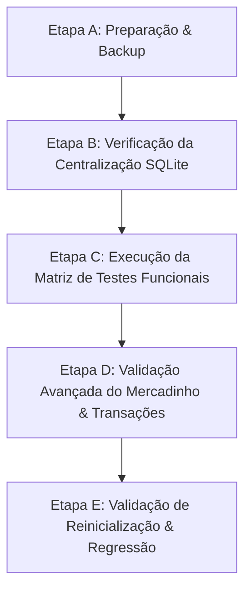

# 📋 PLANO DE PREPARAÇÃO, AUDITORIA FUNCIONAL E CENTRALIZAÇÃO DO SQLITE — PRATICOM ERP

> Nota de histórico: este é um plano de execução anterior. O estado atual usa SQLite para flags e itens de venda; consulte `0md.md`.

**Projeto:** Praticom ERP (Sistema Integrado de Gestão Condominial)  
**Data:** 10/10/2026  
**Status do Documento:** Planejamento e Preparação para Execução  
**Regra Fundamental:** Nenhuma alteração de código, deleção de arquivos ou migração de banco foi realizada nesta fase de diagnóstico.

---

## 1. Diagnóstico do Estado Atual do Repositório

### 1.1 Estrutura Geral do Projeto
O repositório é composto pelas seguintes camadas funcionais:

```text
Praticom ERP/
├── client/                          # Frontend SPA (React 18 + Vite 5)
│   ├── src/
│   │   ├── components/              # Sidebar.jsx, Header.jsx
│   │   ├── views/                   # 8 Abas Operacionais (Dashboard, Deliveries, Financial, etc.)
│   │   ├── services/                # api.js (Cliente HTTP Axios/Fetch)
│   │   └── App.jsx                  # Roteador de Estado Global e Toasts
├── server/                          # Backend API REST (Node.js + Express 4)
│   ├── server.js                    # Servidor Express com 14 Endpoints e Middleware LPS
│   ├── schema.sql                   # Schema DDL SQL Relacional (12 Tabelas + Índices)
│   ├── condo_database.sqlite        # Banco de Dados SQLite Relacional Oficial
│   ├── migrate.js                   # Script de Migração Histórica (JSON -> SQLite)
│   ├── config/
│   │   ├── DatabaseSingleton.js     # Conexão Única SQLite (PRAGMA foreign_keys = ON)
│   │   ├── AppConfigSingleton.js    # Gerenciador de Feature Flags (LPS)
│   │   └── features.json            # Arquivo de Configuração de Feature Flags
│   ├── dao/                         # Camada DAO (Factory Method)
│   │   ├── DAOFactory.js            # Instanciação centralizada das DAOs
│   │   ├── ResidentDAO.js           # Moradores, Unidades, Veículos, Pets
│   │   ├── DeliveryDAO.js           # Encomendas e PIN
│   │   ├── FinancialDAO.js          # Transações e Boletos
│   │   ├── ReservationDAO.js        # Espaços e Agendamentos
│   │   ├── MarketDAO.js             # Produtos, Estoque e Vendas PDV
│   │   └── OperationsDAO.js         # Portaria (Acessos) e Mural (Comunicados)
│   ├── services/templates/          # Padrão Template Method (Relatórios, Pagamentos, Notificações)
│   ├── tests/
│   │   └── suite.js                 # Suíte Integrada de Testes HTTP/CRUD
│   └── legacy/                      # Arquivos Históricos Descontinuados
│       ├── database.js.bak          # Persistência antiga em memória/JSON
│       └── condo_store.json.bak     # Backup do banco legado em JSON
├── START/                           # Scripts de Inicialização Rápida
│   ├── iniciar_sistema.bat          # Inicializador Batch (Backend + Frontend)
│   ├── abrir_sistema.bat            # Atalho Batch para o Navegador
│   └── HOW_TO_START.md              # Documentação de Inicialização
└── Documentos de Projeto (.md)      # REQUISITOS_ACADEMICOS, MAPA_PADROES, etc.
```

---

## 2. Inventário Completo das Abas e Funcionalidades do Frontend

O frontend React possui **8 abas principais** declaradas em `client/src/components/Sidebar.jsx` e renderizadas em `client/src/App.jsx`:

| ID da Aba | Nome Visual | Componente View | Responsabilidade & Operações |
| :--- | :--- | :--- | :--- |
| `dashboard` | **Dashboard** | `DashboardView.jsx` | Métricas consolidadas (encomendas pendentes, acessos ativos, inadimplência, avisos urgentes e atalhos de navegação). |
| `deliveries` | **Controle de Encomendas** | `DeliveriesView.jsx` | Recebimento de pacotes, código PIN de retirada, filtragem por status (`pending`/`picked_up`) e confirmação de entrega. |
| `financial` | **Financeiro & Taxas** | `FinancialView.jsx` | Resumo de receita/despesas/inadimplência, gráfico de fluxo, cadastro de despesas, emissão e baixa de boletos condominiais. |
| `access` | **Portaria & Acessos** | `AccessControlView.jsx` | Registro de entrada de visitantes/prestadores, controle de pessoas no prédio e registro de saída (`EXITED`). |
| `residents` | **Cadastro de Pessoas** | `ResidentsView.jsx` | Diretório de unidades, moradores (proprietário/inquilino), veículos (placa) e animais de estimação (pets). |
| `reservations` | **Reservas (1h/dia)** | `ReservationsView.jsx` | Agendamento de áreas comuns (churrasqueira, salão, quadra), validação da regra de no máximo 1 hora por morador/dia. |
| `announcements` | **Mural de Avisos** | `AnnouncementsView.jsx` | Informativos condominiais, comunicados com prioridade (URGENTE dispara notificação), fixação de aviso e filtro por categoria. |
| `market` | **Mercadinho & Estoque** | `MarketInventoryView.jsx` | Gestão de estoque (ajuste rápido +/- 1 ou +10), alertas de reposição, cadastro de produtos e Terminal PDV de Autoatendimento com débito em boleto/PIX. |

---

## 3. Matriz de Testes por Página

Abaixo encontra-se a matriz de auditoria funcional com o plano de testes para cada aba do sistema:

| Página / Aba | Funcionalidades | Testes Necessários | Resultado Proposto | Problemas Conhecidos / A Investigar |
| :--- | :--- | :--- | :--- | :--- |
| **Dashboard** | Consolidação de estatísticas e cards interativos. | 1. Carregar indicadores HTTP via GET `/api/dashboard`.<br>2. Validar se totais batem com o banco.<br>3. Testar clique em cards para navegação entre abas. | `PENDENTE` | Verificar se o calculo de `defaultRate` no SQLite lida corretamente com divisão por zero quando não há unidades. |
| **Encomendas** | Cadastro, código PIN e baixa de entregas. | 1. Carregar lista em GET `/api/deliveries`.<br>2. Cadastrar encomenda (POST).<br>3. Confirmar baixa por PIN correto e PIN incorreto (PATCH). | `PENDENTE` | Confirmar se `picked_up_at` é gravado no padrão ISO DATETIME no SQLite. |
| **Financeiro** | Resumo financeiro, despesas e baixa de boletos. | 1. Carregar dados via GET `/api/financial/summary` e `/transactions`.<br>2. Lançar nova taxa/despesa.<br>3. Dar baixa no pagamento via Template Method (`PaymentTemplate`). | `PENDENTE` | Verificar se boletos atrasados recalculam juros/multa dinamicamente no backend. |
| **Portaria** | Registro de entrada e saída de visitantes. | 1. Listar acessos ativos em GET `/api/access`.<br>2. Registrar entrada de visitante associado a uma unidade.<br>3. Registrar saída e validar atualização do status para `EXITED`. | `PENDENTE` | Validar comportamento do filtro por documento/nome na listagem. |
| **Moradores & Unidades** | Gestão de apartamentos, moradores, veículos e pets. | 1. Listar unidades e moradores (GET `/api/units`, `/api/residents`).<br>2. Cadastrar novo morador com FK válida de unidade.<br>3. Excluir morador e verificar deleção em cascata/integridade. | `PENDENTE` | Testar se ao apagar um morador com veículo/pet, as chaves estrangeiras (`ON DELETE SET NULL` / `CASCADE`) funcionam. |
| **Reservas** | Agendamento com restrição de 1h/dia por morador. | 1. Listar espaços e reservas ativas (GET `/api/spaces`, `/api/reservations`).<br>2. Tentar reservar espaço com < 1h e > 1h no mesmo dia.<br>3. Validar rejeição caso haja conflito de horário. | `PENDENTE` | Garantir que a trava de 1 hora/dia seja validada no backend (DAO), e não apenas no frontend. |
| **Mural de Avisos** | Publicação de comunicados e notificações de urgência. | 1. Listar comunicados (GET `/api/announcements`).<br>2. Criar comunicado com prioridade `URGENTE`.<br>3. Validar se o disparador de notificação (`NotificationTemplate`) é acionado sem erros. | `PENDENTE` | Verificar se a exclusão de comunicados limpa os dados corretamente no banco. |
| **Mercadinho** | Gestão de estoque, reposição, terminal PDV e vendas. | 1. Listar produtos e categorias (GET `/api/market/products`).<br>2. Testar ajuste rápido de estoque (+1, -1, +10).<br>3. Adicionar itens à cesta no PDV.<br>4. Finalizar venda com débito no boleto da unidade (POST `/api/market/checkout`).<br>5. Verificar decremento no estoque e registro em `market_sales`. | `PENDENTE` | 1. Investigar armazenamento dos itens da venda em formato `items_json` versus tabela relacional `market_sale_items`.<br>2. Validar comportamento quando a Feature Flag `ENABLE_MARKETPLACE` for alterada. |

---

## 4. Mapeamento das Fontes de Dados e Centralização no SQLite

### 4.1 Arquivo SQLite Oficial e Instância Singleton
* **Caminho Absoluto Resolvido:** O banco oficial é instanciado em [`server/config/DatabaseSingleton.js`](file:///c:/Users/Heitor/Praticom/server/config/DatabaseSingleton.js) apontando para:
  `path.join(__dirname, '..', 'condo_database.sqlite')` $\rightarrow$ `c:\Users\Heitor\Praticom\server\condo_database.sqlite`.
* **Garantia de Conexão Única:** A classe `DatabaseSingleton` implementa o padrão GoF Singleton, assegurando uma única instância física do `better-sqlite3` com suporte a transações síncronas de alta performance.
* **Integridade Referencial:** A instrução `PRAGMA foreign_keys = ON;` é executada imediatamente após a abertura da conexão em `DatabaseSingleton.js`.

---

## 5. Inventário e Classificação de Arquivos JSON

Identificou-se uma distinção clara entre arquivos JSON operacionais (banco de dados antigo), backups e configurações do sistema:

| Arquivo | Localização | Classificação Oficial | Ação Recomendada |
| :--- | :--- | :--- | :--- |
| `server/config/features.json` | `server/config/` | **Configuração de Feature Flags (LPS)** | **MANTER.** Arquivo legítimo de configuração do padrão Linha de Produtos de Software. Não é um banco de dados operacional. |
| `server/legacy/condo_store.json.bak` | `server/legacy/` | **Backup Histórico do Banco Legado** | **ARQUIVADO.** Mantido como cópia de segurança em pasta isolada. Nenhuma leitura ou escrita é feita por `server.js` neste arquivo. |
| `server/package.json` | `server/` | **Configuração do Projeto Node.js** | **MANTER.** Declaração de dependências e scripts de execução (`better-sqlite3`, `express`, `cors`). |
| `client/package.json` | `client/` | **Configuração do Projeto React/Vite** | **MANTER.** Declaração de dependências do frontend (`react`, `lucide-react`, `vite`). |

> [!IMPORTANT]
> **Conclusão de Diagnóstico de Persistência:** Nenhuma rota ativa do servidor (`server/server.js`) realiza leitura ou gravação de dados operacionais de negócio em arquivos `.json`. O arquivo `condo_database.sqlite` é a única fonte oficial de dados.

---

## 6. Auditoria Específica do Mercadinho (Fase 4)

### 6.1 Análise das Regras de Negócio e Modelo Relacional
Atualmente, o esquema do Mercadinho é composto por 2 tabelas em [`server/schema.sql`](file:///c:/Users/Heitor/Praticom/server/schema.sql):

1. **`market_products`**: Armazena `id`, `name`, `category`, `price`, `stock_quantity`, `barcode`.
2. **`market_sales`**: Armazena `id`, `unit_id`, `resident_id`, `total_amount`, `payment_method`, `created_at`, `items_json`.

### 6.2 Avaliação da Coluna `items_json` vs. Tabela Relacional `market_sale_items`

* **Situação Atual:** As vendas gravam a lista de itens comprados no campo textual `items_json` (ex: `[{"product_id":1, "name":"Refrigerante", "price":6.50, "quantity":2}]`).
* **Análise de Impacto:**
  * *Vantagem do `items_json`:* Mantém um snapshot congelado do preço e nome do produto no momento exato da venda, sem requerer JOINs complexos no PDV.
  * *Desvantagem:* Dificulta consultas relacionais SQL puras para relatórios de produtos mais vendidos por período.
* **Proposta de Estruturação no Plano:**
  Para manter a aderência total ao requisito de Banco de Dados Relacional Normalizado (3ª Forma Normal), propõe-se adicionar a tabela relacional opcional `market_sale_items` no esquema:

```sql
CREATE TABLE IF NOT EXISTS market_sale_items (
    id INTEGER PRIMARY KEY AUTOINCREMENT,
    sale_id INTEGER NOT NULL,
    product_id INTEGER NOT NULL,
    quantity INTEGER NOT NULL,
    unit_price REAL NOT NULL,
    subtotal REAL NOT NULL,
    FOREIGN KEY (sale_id) REFERENCES market_sales(id) ON DELETE CASCADE,
    FOREIGN KEY (product_id) REFERENCES market_products(id) ON DELETE RESTRICT
);
```

### 6.3 Testes de Atomicidade e Transações no Checkout
No método `checkout()` em [`server/dao/MarketDAO.js`](file:///c:/Users/Heitor/Praticom/server/dao/MarketDAO.js), a transação deve ser envolvida no bloco `db.transaction()` do `better-sqlite3`:
1. Validar disponibilidade em estoque para todos os itens da cesta.
2. Rejeitar a venda caso qualquer item tenha `stock_quantity < quantity`.
3. Decrementar o estoque em `market_products`.
4. Inserir a venda em `market_sales`.
5. Se o método de pagamento for `condo_bill` (débito no boleto), criar automaticamente a transação de cobrança em `financial_transactions`.
6. Confirmar (`COMMIT`) ou reverter tudo (`ROLLBACK`) em caso de exceção.

---

## 7. Plano de Execução em Etapas (Fase 5)



### Etapa A — Preparação e Backup
- **Ações:** Criar cópia de segurança física de `condo_database.sqlite` em `server/legacy/condo_database.sqlite.bak`.
- **Arquivos Envolvidos:** `server/condo_database.sqlite`.
- **Critério de Conclusão:** Backup verificado e funcional.

### Etapa B — Centralização da Conexão
- **Ações:** Confirmar que todos os DAOs importam exclusivamente `DatabaseSingleton.js`.
- **Arquivos Envolvidos:** `server/dao/*.js`, `server/config/DatabaseSingleton.js`.
- **Critério de Conclusão:** 100% dos DAOs conectados ao mesmo Singleton SQLite.

### Etapa C — Execução da Matriz de Testes
- **Ações:** Executar testes manuais e automatizados HTTP/CRUD para as 8 abas.
- **Arquivos Envolvidos:** `server/tests/suite.js`, `client/src/views/*.jsx`.
- **Critério de Conclusão:** Todos os itens da Matriz de Testes marcados como `APROVADO`.

### Etapa D — Validação Transacional do Mercadinho
- **Ações:** Testar concorrência, estoque negativo e integração de lançamentos no boleto financeiro.
- **Arquivos Envolvidos:** `server/dao/MarketDAO.js`, `client/src/views/MarketInventoryView.jsx`.
- **Critério de Conclusão:** Vendas processadas atomicamente sem inconsistências de estoque.

### Etapa E — Validação Final de Reinicialização
- **Ações:** Reiniciar os processos do backend e frontend via `iniciar_sistema.bat` e validar persistência total dos dados.
- **Critério de Conclusão:** Todos os dados cadastrados permanecem intactos após reinicialização.

---

## 8. Critérios Objetivos de Conclusão

1. ✅ **Interface Frontend 100% Preservada:** Nenhuma alteração visual, componente ou layout modificado no client React.
2. ✅ **Fonte Única de Dados:** SQLite (`condo_database.sqlite`) utilizado por todas as 8 abas e 14 endpoints da API REST.
3. ✅ **Zero Persistência Operacional em JSON:** Arquivos JSON limitados estritamente a configurações (`features.json`, `package.json`).
4. ✅ **Mercadinho Consistente e Atômico:** Checkout com atualização garantida de estoque e suporte a Feature Flags.
5. ✅ **Persistência Pós-Reinício:** Aplicação inicia e lê todos os registros gravados no SQLite após reinicializar o servidor.
