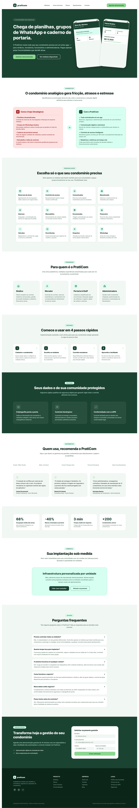

# 🏢 Praticom - Sistema Integrado de Gestão Condominial (ERP)

<p align="center">
  
</p>

<p align="center">
  <b>Plataforma inteligente, moderna e acessível para gestão completa de condomínios residenciais e comerciais.</b>
</p>

<p align="center">
  
  
  
  
</p>

---

## 📌 Visão Geral

O **Praticom** é uma solução ERP completa para condomínios focada em eficiência operacional para síndicos e administradoras, agilidade para a portaria e praticidade e conveniência para os moradores.

A aplicação conta com arquitetura desacoplada (Frontend SPA em React + Backend RESTful em Express), persistência relacional em SQLite e uma interface fluida com suporte nativo a temas Claro/Escuro e perfis de acesso.

---

## ✨ Principais Funcionalidades

### 📊 1. Dashboard e Métricas em Tempo Real
* Indicadores instantâneos de encomendas a retirar, visitantes ativos no local e inadimplência.
* Gráficos e resumos de receitas vs. despesas, próximas reservas de áreas comuns e avisos urgentes.
* Atualização automática periódica para monitoramento de rotina.

### 📦 2. Gestão de Encomendas (Deliveries)
* Cadastro rápido de encomendas recebidas na portaria (transportadora, destinatário, unidade e rastreio).
* Geração de código de retirada seguro (PIN/QR Code).
* Notificação de chegada e confirmação com baixa de entrega ao morador.

### 🛡️ 3. Portaria e Controle de Acesso
* Fluxo em tempo real de visitantes, prestadores de serviços e entregadores.
* Registro de entrada com documento, empresa, unidade de destino e foto/identificação.
* Baixa ágil de saída e histórico de acessos auditável.

### 👥 4. Cadastro de Moradores, Unidades e Veículos
* Gerenciamento de blocos e unidades condominiais.
* Cadastro de moradores com dados de contato e vínculos.
* Registro de veículos (placa, modelo e vaga) para liberação na portaria.

### 📅 5. Reservas de Espaços Comuns
* Agendamento de churrasqueiras, salão de festas, academia, quadras e espaços gourmet.
* Validação automática de conflitos de datas e horários.
* Políticas e regras de reserva configuráveis por pessoa/dia.

### 💰 6. Gestão Financeira Condominial
* Controle de fluxo de caixa (taxas condominiais, manutenções, despesas operacionais).
* Status de transações (Pago, Pendente, Atrasado) e categorias orçamentárias.
* Relatório consolidado com resumo financeiro mensal.

### 📢 7. Mural de Comunicados
* Publicação de comunicados e alertas para o condomínio.
* Filtros por categoria (*Manutenção*, *Assembleia*, *Aviso Geral*, *Urgente*).
* Destaque com nível de prioridade e fixação de avisos críticos.

### 🛒 8. Mercadinho Autônomo (Honest Market & PDV)
* Mini-mercado 24/7 integrado ao condomínio.
* Terminal de Ponto de Venda (PDV) com autoatendimento para compras rápidas.
* Múltiplos meios de pagamento: **PIX**, **Cartão** e **Débito em Cota Condominial**.
* Controle de estoque em tempo real com alertas visuais de reposição.

---

## 🛠️ Tecnologias e Arquitetura

### 🖥️ Frontend (`/client`)
* **React 18**: Construção de interface reativa e modular baseada em componentes.
* **Vite**: Bundler ultrarrápido para desenvolvimento e build otimizado.
* **Lucide React**: Biblioteca moderna de ícones vetoriais.
* **Design System Customizado**: CSS Vanilla com variáveis temáticas (Dark/Light mode), layout responsivo, glassmorphism e micro-interações.

### ⚙️ Backend (`/server`)
* **Node.js & Express**: Servidor HTTP e rotas de API RESTful.
* **CORS**: Middleware configurado para integração com o frontend.
* **Database Engine**: Banco relacional SQLite (`condo_database.sqlite`), acessado por DAOs com integridade referencial ativa.

---

## 📁 Estrutura de Pastas

```text
condo-erp/
├── client/                     # Aplicação Frontend (Vite + React)
│   ├── public/                 # Arquivos estáticos
│   ├── src/
│   │   ├── components/         # Componentes reutilizáveis (Header, Sidebar, etc.)
│   │   ├── services/           # Comunicação com a API (fetch client)
│   │   ├── views/              # Telas da aplicação (Dashboard, Portaria, Financeiro...)
│   │   ├── App.jsx             # Componente raiz e orquestrador de estado global
│   │   ├── index.css           # Design system e folhas de estilo globais
│   │   └── main.jsx            # Ponto de entrada do React
│   ├── index.html              # HTML base com fontes Google (Plus Jakarta Sans & Outfit)
│   ├── package.json            # Dependências e scripts do Frontend
│   └── vite.config.js          # Configurações do Vite
│
├── server/                     # Servidor Backend (Node.js + Express)
│   ├── condo_database.sqlite   # Banco de dados relacional SQLite
│   ├── database.js             # Modelos de dados, regras de negócio e seed inicial
│   ├── package.json            # Dependências e scripts do Backend
│   └── server.js               # Definição de rotas da API REST e inicialização
│
├── design/                     # Protótipos visuais, mockups de telas e componentes
├── .gitignore                  # Regras de exclusão do Git
├── start_app.ps1               # Script PowerShell para inicialização rápida do ambiente
└── README.md                   # Documentação oficial do projeto
```

---

## 🚀 Como Executar o Projeto

### 📋 Pré-requisitos
* [Node.js](https://nodejs.org/) (versão 18 ou superior)
* Gerenciador de pacotes `npm` (ou `yarn` / `pnpm`)

---

### Opção 1: Inicialização Rápida via Script (Windows PowerShell)

Execute o script de automação presente na raiz do repositório:

```powershell
.\start_app.ps1
```

> Esse comando inicia o backend em segundo plano e inicializa o servidor de desenvolvimento do frontend.

---

### Opção 2: Inicialização Manual

#### 1️⃣ Inicializar o Servidor Backend:
```bash
# Acesse o diretório do servidor
cd server

# Instale as dependências (caso seja a primeira execução)
npm install

# Inicie a API
npm run dev
```
*A API estará disponível em: `http://localhost:5000`*

#### 2️⃣ Inicializar o Frontend:
```bash
# Abra um novo terminal e acesse a pasta client
cd client

# Instale as dependências (caso seja a primeira execução)
npm install

# Inicie o servidor Vite
npm run dev
```
*O aplicativo estará disponível em: `http://localhost:5173`*

---

## 🔌 Principais Endpoints da API

| Módulo | Método | Endpoint | Descrição |
|---|---|---|---|
| **Dashboard** | `GET` | `/api/dashboard` | Métricas consolidadas e resumo geral |
| **Encomendas** | `GET` | `/api/deliveries` | Listagem com filtros de status e unidade |
| | `POST` | `/api/deliveries` | Registro de nova encomenda na portaria |
| | `PATCH` | `/api/deliveries/:id/pickup` | Confirmação de retirada com PIN |
| **Portaria** | `GET` | `/api/access` | Histórico e logs de controle de acesso |
| | `POST` | `/api/access/entry` | Registro de entrada de visitante/prestador |
| | `PATCH` | `/api/access/:id/exit` | Registro de saída do condomínio |
| **Moradores** | `GET` | `/api/residents` | Lista de moradores cadastrados |
| | `POST` | `/api/residents` | Cadastro de novo morador |
| | `DELETE` | `/api/residents/:id` | Remoção de morador |
| **Unidades** | `GET` | `/api/units` | Lista de apartamentos/unidades |
| **Veículos** | `GET` | `/api/vehicles` | Listagem de veículos cadastrados |
| **Reservas** | `GET` | `/api/reservations` | Consulta de reservas por data/espaço |
| | `POST` | `/api/reservations` | Realização de nova reserva |
| | `PATCH` | `/api/reservations/:id/cancel` | Cancelamento de reserva |
| **Financeiro** | `GET` | `/api/financial/summary` | Balanço consolidado de receitas e despesas |
| | `GET` | `/api/financial/transactions` | Extrato de transações |
| | `POST` | `/api/financial/transactions` | Lançamento de nova conta |
| | `PATCH` | `/api/financial/transactions/:id` | Edição de lançamento não pago |
| | `DELETE` | `/api/financial/transactions/:id` | Exclusão de lançamento não pago |
| | `PATCH` | `/api/financial/transactions/:id/pay` | Baixa de pagamento |
| **Comunicados** | `GET` | `/api/announcements` | Lista de avisos e comunicados |
| | `POST` | `/api/announcements` | Publicação de novo comunicado |
| | `PATCH` | `/api/announcements/:id` | Edição de comunicado |
| | `DELETE` | `/api/announcements/:id` | Exclusão de comunicado |
| **Mercadinho** | `GET` | `/api/market/products` | Catálogo de produtos e níveis de estoque |
| | `POST` | `/api/market/checkout` | Conclusão de compra no autoatendimento |
| | `PATCH` | `/api/market/products/:id/stock` | Ajuste manual ou reposição de estoque |

---

## 🎨 Protótipos e Design

Os protótipos de alta fidelidade e referências visuais estão organizados no diretório [`design/`](file:///c:/Users/richa/.gemini/antigravity-ide/scratch/condo-erp/design), cobrindo telas como:
* Painel da Síndica & Módulos Administrativos
* Painel da Portaria & Fila de Entrada
* Acesso Inteligente (Face ID)
* Interface do Morador (Acessibilidade e Usabilidade)
* PDV do Mercadinho Condominial

---

## 📄 Licença

Este projeto está desenvolvido sob licença proprietária para gestão condominial. Todos os direitos reservados.

---

## 📌 Branch e Versão Regular (`Praticom_Regular` / `regular_PRaticon`)

Esta branch consolida a versão regular e estável do **PratiCom ERP**, integrando:
* **Padrões de Projeto GoF**: Implementação rigorosa de Singletons (`DatabaseSingleton`, `AppConfigSingleton`), DAOs com Factory Method (`DAOFactory`), e Template Method para processamento e validação.
* **Camada de Domínio e Repositórios**: Modelagem rica orientada a domínio (10 Entidades DDD) e repositórios padronizados com compactação de código (`BaseRepository`).
* **Multi-Tenancy e Isolamento Lógico**: Separação estrita por condomínio via headers e middlewares de segurança (`tenantContextMiddleware`, `moduleGuard`).
* **Banco de Dados SQLite**: Persistência relacional com integridade referencial ativa (`PRAGMA foreign_keys = ON`) e modo WAL.

