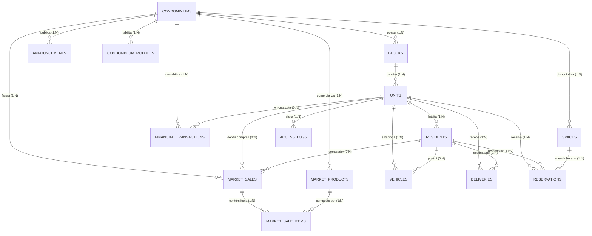

# 📋 Especificação Técnica Completa e Catálogo de Requisitos — PratiCom ERP

> **Documento Mestre de Requisitos de Software, Regras de Negócio e Arquitetura**  
> **Versão:** 2.0 (Clean MVC + DDD Estrito)  
> **Sistema:** PratiCom — Sistema Integrado de Gestão Condominial  
> **Diretriz Arquitetural:** Model-Route-Controller-Service-Database com validação estrita DDD pré-persistência e classes concretas especializadas por domínio.

---

## 🏛️ 1. Arquitetura Alvo: Clean MVC + DDD

O sistema adota uma separação rigorosa em 5 camadas concisas, desacopladas e fortemente tipadas por domínio de negócio:

```
[ Cliente HTTP / Frontend React 18 ]
                 │
                 ▼
┌─────────────────────────────────────┐
│    ROUTES (/server/routes)          │ ➔ Mapeia verbos HTTP para Controladores Concretos
└────────────────┬────────────────────┘
                 ▼
┌─────────────────────────────────────┐
│  CONTROLLERS (/server/controllers)  │ ➔ Extrai requisições, valida tipos e orquestra Services
└────────────────┬────────────────────┘
                 ▼
┌─────────────────────────────────────┐
│    SERVICES (/server/services)      │ ➔ Regras de negócio, cálculos, transações ACID e workflows
└────────┬───────────────────┬────────┘
         │                   │
         ▼                   ▼
┌──────────────────┐ ┌──────────────────────────────────────┐
│   MODELS (DDD)   │ │      DATABASE (/server/database)     │
│   10 Entidades   │ │   SQLite 3 (WAL + Foreign Keys ON)   │
│   com validate() │ │   Repositórios com Prepared Stmts    │
└──────────────────┘ └──────────────────────────────────────┘
```

### Regra de Ouro (Classificação DDD Obrigatória):
> **Nenhum dado é inserido ou atualizado no banco de dados SQLite sem antes ser instanciado e aprovado pelo método `.validate()` de sua respectiva classe de Domínio DDD.** Se qualquer invariante de negócio for violada, o processamento é interrompido imediatamente e um `DomainValidationError` (HTTP 400 Bad Request) é retornado com o campo exato e a mensagem amigável.

---

## 📦 2. As 10 Entidades de Domínio (Domain-Driven Design)

Todas as entidades estendem a classe base `BaseEntity` ([server/models/BaseEntity.js](file:///c:/Users/heitor.farias/Praticom/server/models/BaseEntity.js)), encapsulando atributos de negócio, validações de invariantes e métodos comportamentais:

| # | Entidade DDD | Atributos e Tipos | Invariantes de Negócio e Validações Estritas (`.validate()`) | Métodos de Comportamento de Domínio |
|---|---|---|---|---|
| **1** | **`Condominium`** | `id`: Int<br>`name`: String<br>`cnpj`: String<br>`address`: String<br>`city`: String<br>`state`: String<br>`phone`: String<br>`status`: Enum | • `name` é obrigatório e deve ter no mínimo 3 caracteres.<br>• `status` deve ser estritamente `'ACTIVE'` ou `'INACTIVE'`.<br>• `cnpj` deve ser único quando informado. | `isActive()`: Retorna se o condomínio está apto a operar. |
| **2** | **`Block`** | `id`: Int<br>`condominium_id`: Int<br>`name`: String<br>`description`: String<br>`status`: Enum | • `condominium_id` é obrigatório (>0).<br>• `name` do bloco não pode ser vazio.<br>• Par `(condominium_id, name)` deve ser único. | `normalizeName()`: Remove espaços e padroniza caixa. |
| **3** | **`Unit`** | `id`: Int<br>`block_id`: Int<br>`number`: String<br>`floor`: Int<br>`type`: String | • `block_id` é obrigatório (>0).<br>• `number` da unidade é obrigatório.<br>• Par `(block_id, number)` é estritamente único. | `getFullAddress()`: Retorna `Bloco X - Apto Y`. |
| **4** | **`Resident`** | `id`: Int<br>`unit_id`: Int<br>`name`: String<br>`email`: String<br>`phone`: String<br>`cpf`: String<br>`role`: Enum<br>`emergency_contact`: String | • `unit_id` é obrigatório (>0).<br>• `name` deve ter no mínimo 3 caracteres.<br>• `role` deve ser `'Proprietário'`, `'Inquilino'` ou `'Dependente'`.<br>• `cpf` deve ser sanitizado contendo apenas dígitos numéricos. | `isOwner()`: Identifica poder de voto em assembleias. |
| **5** | **`Vehicle`** | `id`: Int<br>`unit_id`: Int<br>`resident_id`: Int<br>`plate`: String<br>`model`: String<br>`color`: String<br>`type`: String<br>`parking_spot`: String | • `unit_id` é obrigatório (>0).<br>• `plate` deve ser normalizada em maiúsculas sem traços (7 caracteres alfanuméricos padrão Mercosul ou antigo).<br>• `model` é obrigatório. | `formattedPlate()`: Exibe placa no padrão `ABC-1234` ou `BRA2E19`. |
| **6** | **`Delivery`** | `id`: Int<br>`unit_id`: Int<br>`resident_id`: Int<br>`courier`: String<br>`tracking_code`: String<br>`description`: String<br>`status`: Enum<br>`pickup_code`: String (4 dígitos)<br>`received_at`: Datetime<br>`picked_up_at`: Datetime | • `unit_id` e `courier` são obrigatórios.<br>• `pickup_code` é gerado automaticamente como um PIN criptográfico de 4 dígitos.<br>• `status` transita estritamente: `PENDING` ➔ `PICKED_UP` ou `CANCELLED`. | `confirmPickup(pin, person)`: Confere PIN e efetua baixa.<br>`cancel(reason)`: Registra justificativa. |
| **7** | **`AccessLog`** | `id`: Int<br>`destination_unit_id`: Int<br>`visitor_name`: String<br>`document`: String<br>`type`: String<br>`status`: Enum<br>`company`: String<br>`vehicle_plate`: String<br>`entered_at`: Datetime<br>`exited_at`: Datetime | • `visitor_name` e `document` são obrigatórios.<br>• `destination_unit_id` é obrigatório (>0).<br>• `status` inicia em `'IN_PROPERTY'` e é finalizado em `'EXITED'`. | `registerExit()`: Preenche `exited_at` com o timestamp atual. |
| **8** | **`Reservation`** | `id`: Int<br>`space_id`: Int<br>`resident_id`: Int<br>`unit_id`: Int<br>`reservation_date`: Date<br>`start_time`: Time<br>`end_time`: Time<br>`status`: Enum<br>`notes`: String | • Todos os campos de espaço, morador, unidade, data e horários são obrigatórios.<br>• `start_time` deve ser estritamente anterior a `end_time`.<br>• Bloqueio inegociável de sobreposição de horários no mesmo espaço. | `hasConflict(start, end)`: Algoritmo de intersecção temporal. |
| **9** | **`FinancialTransaction`** | `id`: Int<br>`condominium_id`: Int<br>`unit_id`: Int<br>`type`: Enum (`income` / `expense`)<br>`category`: String<br>`description`: String<br>`amount`: Real (>0)<br>`due_date`: Date<br>`status`: Enum (`PENDING` / `PAID`)<br>`payment_date`: Date | • `type` deve ser `'income'` (receita) ou `'expense'` (despesa).<br>• `amount` deve ser um número positivo maior que zero.<br>• `due_date` e `description` são obrigatórios. | `markAsPaid()`: Liquida transação e registra data de pagamento. |
| **10**| **`Announcement`** | `id`: Int<br>`condominium_id`: Int<br>`title`: String<br>`content`: String<br>`category`: String<br>`priority`: Enum (`normal` / `alta` / `urgente`)<br>`is_pinned`: Boolean (0 ou 1) | • `title` (mínimo 3 caracteres) e `content` são obrigatórios.<br>• `priority` aceita `'normal'`, `'alta'` ou `'urgente'`.<br>• Avisos urgentes ou fixados possuem prioridade no dashboard. | `isCritical()`: Retorna se requer alerta imediato. |
| **11**| **`MarketProduct`** | `id`: Int<br>`condominium_id`: Int<br>`name`: String<br>`category`: String<br>`price`: Real (>=0)<br>`stock_quantity`: Int (>=0)<br>`min_stock`: Int<br>`barcode`: String | • `name` é obrigatório.<br>• `price` deve ser positivo ou zero.<br>• `stock_quantity` não pode ser negativo em nenhuma hipótese. | `isLowStock()`: Retorna `true` se `stock <= min_stock`. |

---

## 🗄️ 3. Diagrama de Entidade-Relacionamento Completo (ERD)

O modelo relacional do PratiCom ERP elimina qualquer redundância e estabelece relacionamentos estritos com chaves estrangeiras ativas (`PRAGMA foreign_keys = ON;`):



---

## 📖 4. Dicionário de Dados Exaustivo Tabela por Tabela

Abaixo está a especificação técnica minuciosa de cada uma das 15 tabelas que compõem o banco de dados relacional SQLite (`server/condo_database.sqlite`).

---

### 4.1 Tabela `condominiums` (Tenant Raiz do Sistema)
Armazena a entidade jurídica/territorial raiz de cada condomínio gerenciado na plataforma multi-tenant.

| Coluna | Tipo SQLite | Modificadores / Constraints | Valor Padrão | Descrição de Negócio e Validações |
|---|---|---|---|---|
| `id` | `INTEGER` | `PRIMARY KEY AUTOINCREMENT` | Auto | Identificador único serial do condomínio. |
| `name` | `TEXT` | `NOT NULL` | - | Nome oficial ou fantasia do condomínio (mínimo 3 caracteres). |
| `cnpj` | `TEXT` | `UNIQUE` | `NULL` | Cadastro Nacional de Pessoa Jurídica (sanitizado, único no sistema). |
| `address` | `TEXT` | - | `NULL` | Logradouro e número predial. |
| `city` | `TEXT` | - | `NULL` | Município sede do condomínio. |
| `state` | `TEXT` | - | `NULL` | UF federativa (2 caracteres, ex: 'PR', 'SP'). |
| `phone` | `TEXT` | - | `NULL` | Telefone principal ou WhatsApp da administração/portaria. |
| `status` | `TEXT` | `NOT NULL CHECK(status IN ('ACTIVE', 'INACTIVE'))` | `'ACTIVE'` | Define se o condomínio está operacional ou bloqueado. |
| `created_at`| `DATETIME` | - | `CURRENT_TIMESTAMP` | Data e hora de criação do registro no banco. |

---

### 4.2 Tabela `blocks` (Blocos, Torres e Setores Territoriais)
Subdivide territorialmente cada condomínio em torres ou blocos de apartamentos.

| Coluna | Tipo SQLite | Modificadores / Constraints | Valor Padrão | Descrição de Negócio e Validações |
|---|---|---|---|---|
| `id` | `INTEGER` | `PRIMARY KEY AUTOINCREMENT` | Auto | Identificador único do bloco/torre. |
| `condominium_id` | `INTEGER` | `NOT NULL, FK -> condominiums(id) ON DELETE CASCADE` | - | Vínculo obrigatório com o condomínio proprietário. |
| `name` | `TEXT` | `NOT NULL` | - | Identificação do bloco (ex: 'Torre A - Acácia', 'Bloco 1'). |
| `description` | `TEXT` | - | `NULL` | Detalhes adicionais (localização, pavimentos, etc.). |
| `status` | `TEXT` | `NOT NULL CHECK(status IN ('ACTIVE', 'INACTIVE'))` | `'ACTIVE'` | Estado operacional do bloco. |
| `created_at` | `DATETIME` | - | `CURRENT_TIMESTAMP` | Timestamp de registro no banco. |

* **Regra de Unicidade Composta**: `UNIQUE(condominium_id, name)` — Impede duplicação de blocos de mesmo nome dentro do mesmo condomínio.

---

### 4.3 Tabela `units` (Unidades Habitacionais / Apartamentos)
Representa as residências físicas pertencentes aos blocos onde residem os moradores.

| Coluna | Tipo SQLite | Modificadores / Constraints | Valor Padrão | Descrição de Negócio e Validações |
|---|---|---|---|---|
| `id` | `INTEGER` | `PRIMARY KEY AUTOINCREMENT` | Auto | Identificador único serial da unidade. |
| `block_id` | `INTEGER` | `NOT NULL, FK -> blocks(id) ON DELETE CASCADE` | - | Bloco ao qual a unidade pertence fisicamente. |
| `number` | `TEXT` | `NOT NULL` | - | Número ou identificador do apartamento (ex: '101', '502-B'). |
| `floor` | `INTEGER` | - | `NULL` | Andar/Pavimento da unidade no bloco. |
| `type` | `TEXT` | - | `'Residencial'` | Classificação da unidade ('Residencial', 'Cobertura', 'Comercial'). |
| `created_at` | `DATETIME` | - | `CURRENT_TIMESTAMP` | Timestamp de cadastro. |

* **Regra de Unicidade Composta**: `UNIQUE(block_id, number)` — Garante que não possam existir dois apartamentos com o mesmo número na mesma torre.

---

### 4.4 Tabela `residents` (Moradores e Ocupantes)
Cadastra as pessoas físicas residentes em cada unidade com seus dados de contato e vínculos legais.

| Coluna | Tipo SQLite | Modificadores / Constraints | Valor Padrão | Descrição de Negócio e Validações |
|---|---|---|---|---|
| `id` | `INTEGER` | `PRIMARY KEY AUTOINCREMENT` | Auto | Identificador único do morador. |
| `unit_id` | `INTEGER` | `NOT NULL, FK -> units(id) ON DELETE CASCADE` | - | Apartamento vinculado ao morador. |
| `name` | `TEXT` | `NOT NULL` | - | Nome completo da pessoa (mínimo 3 caracteres). |
| `email` | `TEXT` | - | `NULL` | E-mail para envio de notificações e comunicados. |
| `phone` | `TEXT` | - | `NULL` | Número de telefone/WhatsApp para contato. |
| `cpf` | `TEXT` | - | `NULL` | CPF do morador (apenas dígitos para indexação). |
| `role` | `TEXT` | `CHECK(role IN ('Proprietário', 'Inquilino', 'Dependente'))` | `'Proprietário'` | Papel legal no condomínio. |
| `emergency_contact` | `TEXT` | - | `NULL` | Contato alternativo para situações emergenciais. |
| `created_at` | `DATETIME` | - | `CURRENT_TIMESTAMP` | Timestamp de cadastro. |

---

### 4.5 Tabela `vehicles` (Frotas e Veículos Cadastrados)
Controla os veículos automotores autorizados a acessar as garagens e portarias do condomínio.

| Coluna | Tipo SQLite | Modificadores / Constraints | Valor Padrão | Descrição de Negócio e Validações |
|---|---|---|---|---|
| `id` | `INTEGER` | `PRIMARY KEY AUTOINCREMENT` | Auto | Identificador do veículo. |
| `unit_id` | `INTEGER` | `NOT NULL, FK -> units(id) ON DELETE CASCADE` | - | Unidade titular da vaga de estacionamento. |
| `resident_id` | `INTEGER` | `FK -> residents(id) ON DELETE SET NULL` | `NULL` | Morador condutor principal do veículo. |
| `plate` | `TEXT` | `NOT NULL` | - | Placa sanitizada e em maiúsculas (7 caracteres alfanuméricos). |
| `model` | `TEXT` | `NOT NULL` | - | Marca e modelo (ex: 'Jeep Compass', 'Honda Civic'). |
| `color` | `TEXT` | - | `NULL` | Cor predominante da lataria para triagem visual. |
| `type` | `TEXT` | - | `'Carro'` | Categoria ('Carro', 'Moto', 'SUV', 'Caminhonete'). |
| `parking_spot` | `TEXT` | - | `NULL` | Identificação física da vaga demarcada (ex: 'G1-02'). |
| `created_at` | `DATETIME` | - | `CURRENT_TIMESTAMP` | Timestamp de cadastro. |

---

### 4.6 Tabela `deliveries` (Encomendas e Armário Digital da Portaria)
Registra o ciclo de vida completo de recebimento e entrega de encomendas com autenticação por PIN.

| Coluna | Tipo SQLite | Modificadores / Constraints | Valor Padrão | Descrição de Negócio e Validações |
|---|---|---|---|---|
| `id` | `INTEGER` | `PRIMARY KEY AUTOINCREMENT` | Auto | Protocolo serial da encomenda. |
| `unit_id` | `INTEGER` | `NOT NULL, FK -> units(id) ON DELETE CASCADE` | - | Apartamento destinatário do pacote. |
| `resident_id` | `INTEGER` | `FK -> residents(id) ON DELETE SET NULL` | `NULL` | Morador específico a quem o pacote foi endereçado. |
| `courier` | `TEXT` | `NOT NULL` | - | Transportadora ou entregador (Mercado Livre, Correios, etc.). |
| `tracking_code` | `TEXT` | - | `NULL` | Código de rastreamento da remessa. |
| `description` | `TEXT` | - | `NULL` | Descrição do volume (caixa, envelope, dimensões). |
| `status` | `TEXT` | `CHECK(status IN ('PENDING', 'PICKED_UP', 'CANCELLED'))` | `'PENDING'` | Estado da encomenda no armário da portaria. |
| `pickup_code` | `TEXT` | `NOT NULL` | - | PIN de segurança numérico de 4 dígitos gerado na recepção. |
| `notes` | `TEXT` | - | `NULL` | Observações da portaria (avarias na embalagem, etc.). |
| `received_at` | `DATETIME` | - | `CURRENT_TIMESTAMP` | Timestamp do momento exato de recebimento na portaria. |
| `picked_up_at` | `DATETIME` | - | `NULL` | Timestamp da conferência do PIN e entrega ao morador. |
| `picked_up_by` | `TEXT` | - | `NULL` | Nome de quem compareceu para retirar o pacote. |
| `cancelled_at` | `DATETIME` | - | `NULL` | Timestamp caso o recebimento tenha sido cancelado. |
| `cancellation_reason` | `TEXT` | - | `NULL` | Justificativa formal do cancelamento da encomenda. |

---

### 4.7 Tabela `access_logs` (Controle de Acesso de Visitantes e Prestadores)
Registra em tempo real todas as entradas e saídas de terceiros pelas portarias do condomínio.

| Coluna | Tipo SQLite | Modificadores / Constraints | Valor Padrão | Descrição de Negócio e Validações |
|---|---|---|---|---|
| `id` | `INTEGER` | `PRIMARY KEY AUTOINCREMENT` | Auto | Identificador do registro de acesso. |
| `destination_unit_id` | `INTEGER` | `NOT NULL, FK -> units(id) ON DELETE CASCADE` | - | Unidade visitada ou contratante do serviço. |
| `visitor_name` | `TEXT` | `NOT NULL` | - | Nome completo do visitante ou prestador. |
| `document` | `TEXT` | `NOT NULL` | - | RG ou CPF apresentado na identificação. |
| `type` | `TEXT` | - | `'Visitante'` | Categoria ('Visitante', 'Prestador de Serviço', 'Delivery'). |
| `status` | `TEXT` | `CHECK(status IN ('IN_PROPERTY', 'EXITED'))` | `'IN_PROPERTY'` | `'IN_PROPERTY'` (dentro) ou `'EXITED'` (já liberado na saída). |
| `company` | `TEXT` | - | `NULL` | Razão social da empresa prestadora (Copel, Sanepar, etc.). |
| `vehicle_plate` | `TEXT` | - | `NULL` | Placa do veículo utilizado para ingresso. |
| `entered_at` | `DATETIME` | - | `CURRENT_TIMESTAMP` | Momento exato da abertura do portão de entrada. |
| `exited_at` | `DATETIME` | - | `NULL` | Momento exato do registro de saída pela portaria. |

---

### 4.8 Tabela `spaces` (Áreas Comuns Reserváveis)
Catálogo dos espaços físicos de lazer e convivência disponibilizados pelo condomínio.

| Coluna | Tipo SQLite | Modificadores / Constraints | Valor Padrão | Descrição de Negócio e Validações |
|---|---|---|---|---|
| `id` | `INTEGER` | `PRIMARY KEY AUTOINCREMENT` | Auto | Identificador único do espaço. |
| `condominium_id` | `INTEGER` | `NOT NULL, FK -> condominiums(id) ON DELETE CASCADE` | - | Condomínio proprietário da área. |
| `name` | `TEXT` | `NOT NULL` | - | Nome da área (ex: 'Salão Nobre', 'Churrasqueira 01'). |
| `capacity` | `INTEGER` | - | `30` | Lotação máxima autorizada para o espaço. |
| `description` | `TEXT` | - | `NULL` | Equipamentos inclusos (ar condicionado, freezer, fogão). |
| `created_at` | `DATETIME` | - | `CURRENT_TIMESTAMP` | Data de criação do cadastro da área. |

---

### 4.9 Tabela `reservations` (Agendamento de Espaços Comuns)
Gerencia os agendamentos dos moradores com controle rigoroso contra conflito de horários.

| Coluna | Tipo SQLite | Modificadores / Constraints | Valor Padrão | Descrição de Negócio e Validações |
|---|---|---|---|---|
| `id` | `INTEGER` | `PRIMARY KEY AUTOINCREMENT` | Auto | Código serial do agendamento. |
| `space_id` | `INTEGER` | `NOT NULL, FK -> spaces(id) ON DELETE CASCADE` | - | Espaço comum agendado. |
| `resident_id` | `INTEGER` | `NOT NULL, FK -> residents(id) ON DELETE CASCADE` | - | Morador responsável legal pelo evento. |
| `unit_id` | `INTEGER` | `NOT NULL, FK -> units(id) ON DELETE CASCADE` | - | Unidade habitacional vinculada à reserva. |
| `reservation_date` | `TEXT` | `NOT NULL` | - | Data do evento no formato ISO `YYYY-MM-DD`. |
| `start_time` | `TEXT` | `NOT NULL` | - | Horário de início no formato `HH:MM`. |
| `end_time` | `TEXT` | `NOT NULL` | - | Horário de término no formato `HH:MM`. |
| `status` | `TEXT` | `CHECK(status IN ('CONFIRMED', 'CANCELLED'))` | `'CONFIRMED'` | Estado da reserva. |
| `notes` | `TEXT` | - | `NULL` | Finalidade do evento ou observações do morador. |
| `created_at` | `DATETIME` | - | `CURRENT_TIMESTAMP` | Data e hora de solicitação da reserva. |

* **Regra Algorítmica de Não-Sobreposição**: Nenhuma reserva pode ser confirmada se existir outra reserva ativa (`status = 'CONFIRMED'`) no mesmo `space_id` e `reservation_date` onde `NOT (nova_fim <= existente_inicio OR nova_inicio >= existente_fim)`.

---

### 4.10 Tabela `financial_transactions` (Lançamentos Contábeis e Taxas)
Mantém o livro-razão financeiro de receitas (cotas condominiais) e despesas operacionais.

| Coluna | Tipo SQLite | Modificadores / Constraints | Valor Padrão | Descrição de Negócio e Validações |
|---|---|---|---|---|
| `id` | `INTEGER` | `PRIMARY KEY AUTOINCREMENT` | Auto | Identificador do lançamento contábil. |
| `condominium_id` | `INTEGER` | `NOT NULL, FK -> condominiums(id) ON DELETE CASCADE` | - | Condomínio titular do lançamento. |
| `unit_id` | `INTEGER` | `FK -> units(id) ON DELETE SET NULL` | `NULL` | Unidade pagadora (quando for receita de taxa). |
| `type` | `TEXT` | `NOT NULL CHECK(type IN ('income', 'expense'))` | - | `'income'` (receita) ou `'expense'` (despesa). |
| `category` | `TEXT` | `NOT NULL` | - | Classificação orçamentária ('Taxa', 'Manutenção', 'Luz'). |
| `description` | `TEXT` | `NOT NULL` | - | Histórico do lançamento descritivo. |
| `amount` | `REAL` | `NOT NULL CHECK(amount > 0)` | - | Valor monetário em reais (estritamente maior que zero). |
| `due_date` | `TEXT` | `NOT NULL` | - | Data de vencimento da obrigação (`YYYY-MM-DD`). |
| `status` | `TEXT` | `CHECK(status IN ('PENDING', 'PAID'))` | `'PENDING'` | Estado de liquidação do título. |
| `payment_date` | `TEXT` | - | `NULL` | Data em que a baixa de pagamento foi confirmada. |
| `created_at` | `DATETIME` | - | `CURRENT_TIMESTAMP` | Timestamp do lançamento no sistema. |

---

### 4.11 Tabela `announcements` (Mural de Comunicados e Avisos)
Veicula os comunicados oficiais e avisos de urgência da administração aos condôminos.

| Coluna | Tipo SQLite | Modificadores / Constraints | Valor Padrão | Descrição de Negócio e Validações |
|---|---|---|---|---|
| `id` | `INTEGER` | `PRIMARY KEY AUTOINCREMENT` | Auto | Identificador do comunicado. |
| `condominium_id` | `INTEGER` | `NOT NULL, FK -> condominiums(id) ON DELETE CASCADE` | - | Condomínio onde o aviso será publicado. |
| `title` | `TEXT` | `NOT NULL` | - | Título resumido da publicação (mínimo 3 caracteres). |
| `content` | `TEXT` | `NOT NULL` | - | Texto integral do comunicado. |
| `category` | `TEXT` | - | `'Geral'` | Segmento ('Geral', 'Assembleia', 'Manutenção', 'Obras'). |
| `priority` | `TEXT` | `CHECK(priority IN ('normal', 'urgente', 'alta'))` | `'normal'` | Nível de urgência da comunicação. |
| `is_pinned` | `INTEGER` | - | `0` | Booleano (1 ou 0) para fixação no topo do mural e do dashboard. |
| `created_at` | `DATETIME` | - | `CURRENT_TIMESTAMP` | Timestamp de publicação. |

---

### 4.12 Tabela `market_products` (Catálogo do Mercadinho Autônomo)
Gerencia o inventário físico do Honest Market 24/7 com alerta de reposição de estoque.

| Coluna | Tipo SQLite | Modificadores / Constraints | Valor Padrão | Descrição de Negócio e Validações |
|---|---|---|---|---|
| `id` | `INTEGER` | `PRIMARY KEY AUTOINCREMENT` | Auto | Código serial do produto. |
| `condominium_id` | `INTEGER` | `NOT NULL, FK -> condominiums(id) ON DELETE CASCADE` | - | Condomínio onde o produto está exposto. |
| `name` | `TEXT` | `NOT NULL` | - | Nome comercial do item (ex: 'Coca-Cola 350ml'). |
| `category` | `TEXT` | - | `'Geral'` | Departamento ('Bebidas', 'Snacks', 'Doces', 'Congelados'). |
| `price` | `REAL` | `NOT NULL CHECK(price >= 0)` | - | Preço de venda unitário em reais. |
| `stock_quantity` | `INTEGER` | `CHECK(stock_quantity >= 0)` | `0` | Quantidade física disponível na prateleira (não aceita negativo). |
| `min_stock` | `INTEGER` | - | `5` | Ponto crítico de estoque para disparar alerta de reposição. |
| `barcode` | `TEXT` | - | `NULL` | Código EAN-13 para leitura óptica no autoatendimento. |
| `created_at` | `DATETIME` | - | `CURRENT_TIMESTAMP` | Data de inclusão no catálogo. |

---

### 4.13 Tabela `market_sales` (Cabeçalho de Vendas do PDV)
Armazena o registro financeiro consolidado de cada transação de compra concluída no terminal.

| Coluna | Tipo SQLite | Modificadores / Constraints | Valor Padrão | Descrição de Negócio e Validações |
|---|---|---|---|---|
| `id` | `INTEGER` | `PRIMARY KEY AUTOINCREMENT` | Auto | Número do cupom fiscal/recibo de venda. |
| `condominium_id` | `INTEGER` | `NOT NULL, FK -> condominiums(id) ON DELETE CASCADE` | - | Condomínio onde a venda ocorreu. |
| `unit_id` | `INTEGER` | `FK -> units(id) ON DELETE SET NULL` | `NULL` | Apartamento do comprador (obrigatório se débito em boleto). |
| `resident_id` | `INTEGER` | `FK -> residents(id) ON DELETE SET NULL` | `NULL` | Morador titular da compra. |
| `total_amount` | `REAL` | `NOT NULL` | - | Valor total da venda somando todos os itens. |
| `payment_method` | `TEXT` | `NOT NULL` | - | Meio de liquidação ('PIX', 'CARD', 'CONDO_FEE'). |
| `created_at` | `DATETIME` | - | `CURRENT_TIMESTAMP` | Momento exato da conclusão da compra. |

---

### 4.14 Tabela `market_sale_items` (Itens Detalhados da Venda)
Relaciona os produtos vendidos em cada transação garantindo rastreabilidade de preços históricos.

| Coluna | Tipo SQLite | Modificadores / Constraints | Valor Padrão | Descrição de Negócio e Validações |
|---|---|---|---|---|
| `id` | `INTEGER` | `PRIMARY KEY AUTOINCREMENT` | Auto | Identificador do item da venda. |
| `sale_id` | `INTEGER` | `NOT NULL, FK -> market_sales(id) ON DELETE CASCADE` | - | Venda à qual o item pertence. |
| `product_id` | `INTEGER` | `NOT NULL, FK -> market_products(id) ON DELETE CASCADE` | - | Produto comercializado. |
| `quantity` | `INTEGER` | `NOT NULL CHECK(quantity > 0)` | - | Unidades adquiridas (mínimo 1). |
| `unit_price` | `REAL` | `NOT NULL` | - | Preço unitário praticado no momento da venda. |
| `subtotal` | `REAL` | `NOT NULL` | - | `quantity * unit_price`. |

---

### 4.15 Tabela `condominium_modules` (Modularidade por Condomínio)
Permite a ativação e desativação seletiva dos módulos do ERP para cada condomínio contratante.

| Coluna | Tipo SQLite | Modificadores / Constraints | Valor Padrão | Descrição de Negócio e Validações |
|---|---|---|---|---|
| `id` | `INTEGER` | `PRIMARY KEY AUTOINCREMENT` | Auto | Identificador do registro de ativação. |
| `condominium_id` | `INTEGER` | `NOT NULL, FK -> condominiums(id) ON DELETE CASCADE` | - | Condomínio que possui a parametrização. |
| `module_key` | `TEXT` | `NOT NULL` | - | Chave do módulo ('deliveries', 'access', 'reservations', 'market', etc.). |
| `is_enabled` | `INTEGER` | - | `1` | Booleano (1 para ativado, 0 para desativado). |

* **Regra de Unicidade Composta**: `UNIQUE(condominium_id, module_key)`.

---

## 🏗️ 5. Arquitetura Concreta e Não-Genérica por Domínio

Para atender estritamente ao princípio de não ser genérico, cada subsistema possui classes dedicadas em todas as camadas com métodos específicos de negócio:

### 5.1 Camada de Controladores Especializados (`server/controllers/`)
1. **`CondominiumController`**: Gerencia ativação/desativação territorial, listagem de blocos e auditoria de módulos.
2. **`ResidentController`**: Contém busca avançada por CPF sanitizado, listagem por unidade habitacional e controle de inadimplência associada.
3. **`VehicleController`**: Trata formatação e validação de placas Mercosul, controle de ocupação de vagas de garagem e bloqueio de placas duplicadas.
4. **`DeliveryController`**: Implementa fluxo de recepção de remessas, despacho de notificação ao morador, baixa autenticada por PIN de 4 dígitos e cancelamento formal.
5. **`AccessLogController`**: Monitora fila ativa de pessoas no interior da propriedade, registro de crachá/veículo e cálculo do tempo de permanência na saída.
6. **`ReservationController`**: Executa checagem de conflitos de horários em tempo real, cancelamento de agenda e relatório de taxa de ocupação dos espaços comuns.
7. **`FinancialController`**: Consolidação do balancete mensal, cálculo da taxa de inadimplência percentual e baixa atômica de títulos em aberto.
8. **`MarketController`**: Orquestra o checkout atômico em transação ACID, validação de estoque remanescente, geração de chave Copia e Cola do PIX e histórico de vendas.
9. **`DashboardController`**: Agrega métricas de todos os módulos de forma sintetizada para o síndico.

---

## 🎨 6. Diretrizes do Frontend Moderno ("Não Regular")

O frontend foi desenvolvido com uma experiência visual de altíssimo nível (WOW factor):
- **Design System Vanilla CSS**: Design tokens sem frameworks pesados, paletas sofisticadas (Dark/Light mode automático), tipografia Google Fonts (*Plus Jakarta Sans* & *Outfit*).
- **Glassmorphism & Micro-Interações**: Cards com desfoque de fundo suave, sombras elegantes, feedbacks de transição suaves em hover/focus.
- **Componentes Interativos Ricos**:
  - `Keypad Virtual Tátil`: Teclado numérico estilo armário inteligente na baixa de encomendas.
  - `Checkout PIX Interativo`: Exibição visual de QR Code e botão funcional com feedback de "Código Copiado".
  - `Barra de Arrecadação Mensal`: Indicador visual percentual de receitas liquidadas versus inadimplência.
  - `Toast Notifications`: Sistema flutuante global para confirmações instantâneas de ações.
